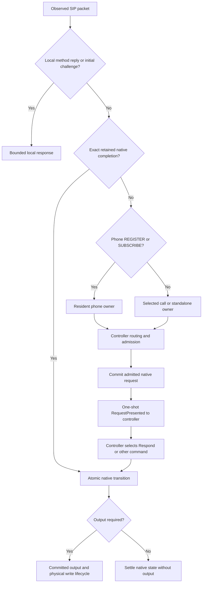
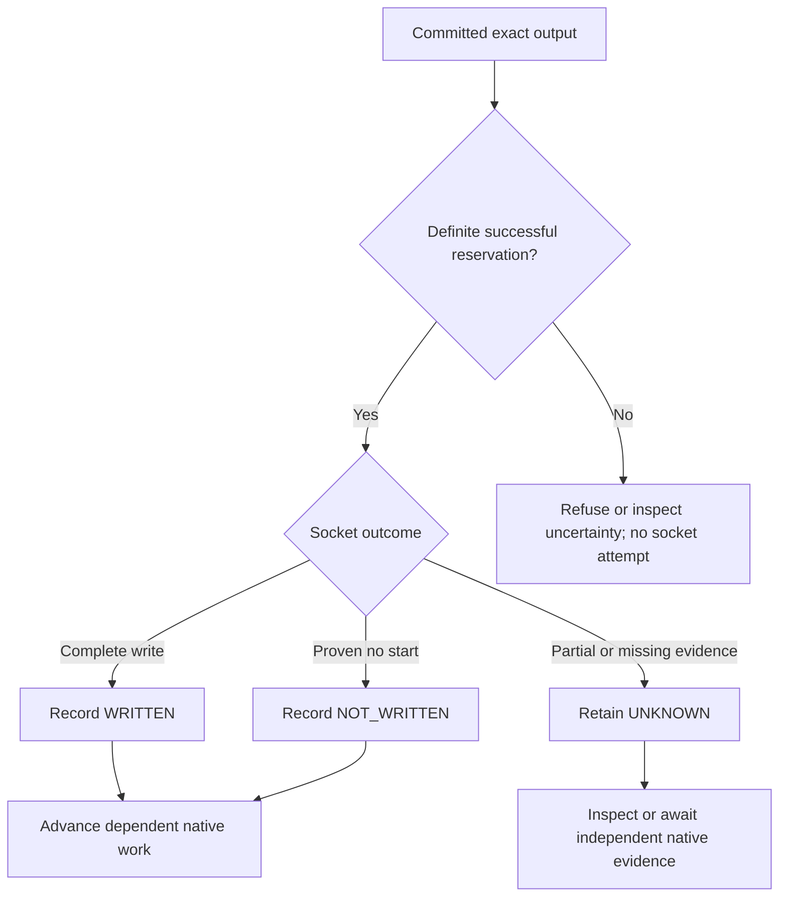

# sipbridge architecture

This is the source of truth for component ownership and required behavior.
The normative supplements below supply exact contracts. Implementation details
such as helper names, whole-group reconstruction and polling loops are not
additional guarantees. Changes to behavior start here or in its owning supplement,
then ship with the code that implements them.

## Reading map and contract ownership

| Document | Owns |
| --- | --- |
| [Resident Memory](docs/memory-core.md) | Typed process-local authority, local deadlines and Memory delivery gate |
| [Service runtime](docs/runtime.md) | Serving selection, configuration, bounds and shutdown; legacy checkpoint fixture contract |
| [Protocol](PROTOCOL.md) | Canonical control messages, capabilities, controller decisions and result meanings |
| [Binary Redis core](docs/redis-core.md) | Selected-record Redis authority, native procedure ownership and exact physical evidence |
| [Controller recovery](docs/controller-recovery.md) | Historical checkpoint fixture attachment protocol; not advertised by either serving backend |
| [Operation flows](docs/operations/index.md) | End-to-end flowcharts and work accounting for the checkpoint fixture engine |
| [Fixtures](docs/fixtures.md), [verification](docs/verification.md) | Test programs, reproducible evidence and qualification limits |

`proto/sipbridge-control.proto` owns the shared wire declarations. Its generated
Go/TypeScript codecs, distribution copy and schema receipt ship together.
Consumers pin the full receipt and an immutable image; major `1` alone does not
establish compatibility. Native retained storage has its own schema identity.

The default resident Memory runtime follows [Resident Memory core](docs/memory-core.md).
It owns typed process-local protocol records and immutable message facts. Explicit
Redis selection composes the existing resident phone domain with the binary
[Redis core](docs/redis-core.md) call domain;
`state.OpenBackend` and the former checkpoint engine remain fixture APIs only.
Both serving backends use parsed direct request/completion hooks and the same
JSON control framing. A control disconnect in Memory expires the application
term. Redis closes the exact control attachment and handles loss of the owner
through application-term expiry. Committed native obligations finish under
their own deadlines. Healthy phone subscriptions
remain pinned to their accepting process and connection until socket close or
their own expiry.

This describes the current source, not deployment evidence. The binary Redis
runtime never decodes checkpoint-format records: a namespace written by the
checkpoint engine requires stopping its writers and resetting only the allowed
native root before the matching binary profile starts. The JSON control framing
does not change Redis's raw binary storage contract.

## Components and authority

| Component | Owns |
| --- | --- |
| Physical ingress | Observed UDP peers, TCP/TLS sockets, framing and exact socket-write evidence |
| Native execution | SIP transactions/dialogs/subscriptions and their bounded outstanding obligations |
| Native ownership domain | Resident phone records or shared Redis call records; each has its own bounded publication mechanism |
| Control session | Authenticated controller transport, bounded RPC and correlated heartbeat |
| Application controller | Account authorization, call behavior, registration policy, subscription content and media orchestration |

SIP transaction, dialog and timer decisions belong to the pinned sipgo reducers.
Subscription metadata and coordination with physical output belong to the adapter.
Resident Memory publishes touched typed records directly; binary Redis execution
selects the actual records for one native operation and commits atomically.
It does not reconstruct a whole-Call-ID graph for ordinary bookkeeping.

Each native context has one sole authority. The default Memory runtime owns all
native work locally. With explicit Redis selection, inbound REGISTER server
transactions and the complete phone SUBSCRIBE/NOTIFY lifecycle use the existing
resident records on the accepting process; initial INVITE, calls, call-NOTIFY and
other standalone clients use shared Redis records. There is no Redis mirror of
local phone state, promotion between domains, backend fallback or reconstruction
from controller memory. Local records are lost with the accepting process epoch. The service has
no business database, trusted-directory Redis, account-backend or Kubernetes
credentials. Firewall, PKI, CNI/routing, discovery and capture collectors are external.

## Four distinct identities

| Identity | Lifetime and authority |
| --- | --- |
| Physical flow | One ingress process epoch and exact socket or UDP listener/peer tuple. A replacement cannot recreate it from Contact or peer IP. |
| Logical context | Native state authority, Call-ID group/incarnation and non-reused directional context/dialog identity. Compatible workers can execute retained call work; subscriptions remain pinned to their accepting process/socket. |
| Controller owner | The original live application process and lease. A replacement process does not inherit its internal call state. |
| Timer executor | A derivative assignment of scheduled work to a worker. It owns neither the dialog, socket nor application. |

A new TLS connection on another worker can continue a retained call dialog after its
identity, transport, sequence and flow checks. It does not transfer timer ownership
or authenticate a fresh call. Responses use the admitted request's flow;
publication of a route for later output is a separate ordered decision.

The same public authority and schema name both internal domains. Reserved,
process-epoch authenticated local IDs select the accepting owner even after
retirement; a foreign local reference cannot produce shared absence. Exact
selection and serving profile rules belong to [runtime](docs/runtime.md#native-ownership-domains).

Controller reattachment is not a serving capability. The older attachment
protocol remains documented only for explicit [checkpoint fixtures](docs/controller-recovery.md).

## Shared state and local state

| Retained object | What must survive |
| --- | --- |
| Shared call dialog | Identity/tags, accepted routing/flow, sequence watermarks, application authority and established-call obligations |
| Local phone subscription | Existing resident FSM, exact accepting process/epoch and socket, own expiry, committed NOTIFY and physical evidence; no shared copy |
| Local REGISTER server transaction | Existing resident procedure, original UDP replay horizon and exact output duties; business registration remains controller-owned |
| Outstanding procedure | Its semantic phase, original deadline, selected output and necessary physical/completion evidence |
| Accepted INVITE work | Required successful final, ACK/fork/offer-answer and ACK-before-cleanup-BYE duties |
| Current result/disposition evidence | Only the original live waiter result and evidence still required by actual native or physical obligations |
| Process-local work | Socket/parser state, bounded emission bytes, transient operation values and scheduling hints; none is a second shared-state authority |

Messages are opaque wire where exact emission, replay or recovery needs bytes.
Parsed mutable SIP objects live within an operation. Persist reusable semantic
facts rather than retaining a parsed request as a quiet dialog's source of truth.
Classification and selector lookup reuse one transient parse at each received
boundary. Construct rich SIP control DTOs only when delivering them publicly;
receipt storage accepts immutable wire directly without building a DTO first.
Memory uses owned immutable native message facts through
matching, reducers, construction, output and retirement, as defined in its
[parse-once contract](docs/memory-core.md#parse-once-and-retain-only-required-message-data).
Exact replay policy and cutoffs belong to [runtime](docs/runtime.md); terminating
a reliable transaction is not by itself permission to erase its unsettled output.
All records, packets, results, queues and transient work have explicit bounds.

## Request and write lifecycle

Presentation is a direct, bounded controller exchange from a definite fresh
commit. Deferred publication/proof completion can return that same one-shot DTO
under the original deadline. It is not a durable job or a replayable callback.
Losing initial setup in this window can fail that request. Retained lifecycle
events and established protocol obligations have independent recovery rules.

Both serving backends use one request notification and one controller decision
as defined in [the direct-decision contract](PROTOCOL.md#direct-request-decision).
The diagram above describes that direct presentation boundary.

The controller selects application responses and prepares subscription content.
Accepted SUBSCRIBE requires its immediate/refresh NOTIFY even when content is
unchanged. Native delivery preserves the NOTIFY intent once committed; it cannot
invent content that the controller has not supplied. Registration mutation and
ordered business publication remain controller-owned operations.

A write is not peer receipt. Redis cannot atomically commit a socket operation.
UNKNOWN never becomes NOT_WRITTEN through timeout and does not authorize an
older-flow fallback or another attempt. Native retransmissions remain the same
bounded SIP procedure, with its original identity and deadline. A successful
INVITE still requires SIP ACK over TCP/TLS. Positive local ACK-write evidence
precedes an automatic losing-fork cleanup BYE.

No authoritative protocol aggregate survives a controller RPC, socket operation
or response wait. Only bounded immutable DTOs and hints cross those boundaries.
Current-context command results and frozen historical outcomes have distinct
meaning; a newer command cannot replace evidence an older operation is entitled
to observe. Exact admission, receipt and uncertainty rules live in runtime.

## Transport and business admission

UDP, TCP and TLS retain their actual class in flows, advertisements and native
timers. A retained TLS context cannot migrate to plaintext. Observed ingress,
never Via/Contact text, supplies physical source evidence. Plaintext replacement
requires its matching binding/current-flow evidence; TLS continuity still needs
native context checks and controller policy where that request requires it.

Method policy can reject disabled REGISTER/SUBSCRIBE before state or control
access. OPTIONS capability probes also finish locally, without native context
lookup, retained history or a controller exchange. Configured initial digest challenges run locally, without account
credentials or native context creation. A digest-bearing request still needs
controller verification. Neither challenge nor native continuity authenticates
an account. Exact supported methods and challenge rules are in runtime/protocol.

Business commands carry current policy, owner, sequence and directory evidence.
Respond uses the transaction return flow; DialogRequest uses accepted dialog
routing and a fresh native local CSeq. Subscription processor adoption is separate
from handset-flow publication and never adopts an INVITE call. Unregistered
network targets use controller-selected URI/proxy, actual transport and an opaque
credential reference; clear credentials are ephemeral lookup results only.

Registration fallback and prepared dialog resume preserve the native first SIP
hop. A dialog with an empty route set can use its authorized direct UA socket.
For a retained route set, a replacement must prove it reaches the first route
on the original transport before native publishes or reassigns a write. A
duplicate resume on the assigned socket may observe the same pending result
after native consumes the physical proof.

## Recovery and process lifecycle

Memory executes process-local indexed deadlines without shared scheduling. In
Redis binary execution, each worker executes its actual indexed deadlines. One coordinator handles
unowned work and expired-worker transfer. Presence, leases and queue heads are
metadata, not SIP authority. Workers remember only wake cursors and conservative
local deadlines; they do not poll dialog records. Followers wait for observed
leader expiry or a handoff notification. The coordinator waits for actual orphan,
application-owner or unowned-work deadlines. Bounded work recomputes the next
head; completed repair does not leave a periodic empty repair loop.

Every shared operation revalidates Redis authority, revision, generation and
original deadline. Local phone publication uses the existing authenticated
control session capability under the [resident publication guard](docs/memory-core.md#shared-session-capability-for-the-local-phone-domain). Native/controller lease loss, socket closure and datastore
failure are separate events. Missing or rolled-back Redis state can lose calls
or require registration; asynchronous replication does not promise zero loss or
exactly-once execution. No cached local state reconstructs missing authority.

Service readiness withdraws routing for unavailable shared execution. The local
phone domain continues only under its actual session capability and conservative
proof bound; it does not add a per-phone shared worker-lease check. Shutdown and
drain still fence new admission. Unavailability does not close healthy retained flows merely
because Redis, discovery or controller policy is unavailable; overload is not a
liveness restart condition. Certificates/trust reload for new handshakes and
preserve established sockets. Controller/account/policy/discovery/certificate
changes must not unnecessarily roll the SIP process.

SIGTERM withdraws readiness, finishes admitted work within the fixed connection
drain, then closes remaining sockets. Phones can reconnect and use retained
compatible contexts; sockets and controller memory do not move. The
[runtime drain](docs/runtime.md#bounded-sip-connection-drain) and
[deployment guide](docs/guide/deployment.md) own bounds and rollout steps.

## Qualification and release boundary

The public project is [GitHub](https://github.com/zyno-io/sipbridge); documentation
publication does not deploy a workload. The pinned consolidated `third_party/sipgo`
snapshot is immutable and verified by its dependency manifest. Changes require
upstream qualification and refreshed native/wire tests.

CI gates image publication on source/schema receipts, formatting/vet, Redis race
and restart checks, pinned-native tests and independent wire qualification.
Application/account, media/CDR, carrier/handset, load and live rollout evidence are
separate acceptance boundaries. See [verification](docs/verification.md).
