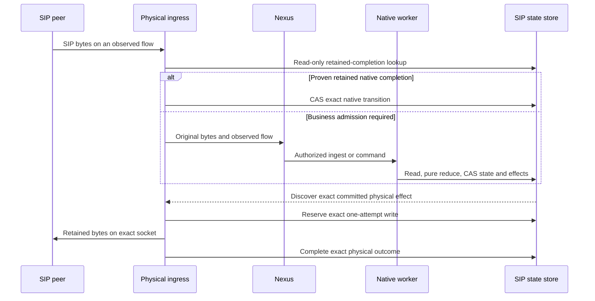

# sipbridge architecture

Status: experimental UDP/TCP/TLS service with a Nexus adapter. Local native,
process/socket and backend E2E checks have different scopes; production selection,
full platform conformance, load qualification and safe SIP-core replacement remain
gated. The supported production Drachtio deployment is unchanged.

## Reading map and contract ownership

This document owns the component boundaries and invariants below. Its normative
supplements own the details; a behavior change updates the owning document first.

| Document | Owns |
| --- | --- |
| [Runtime](docs/runtime.md) | State transitions, leases, completion, physical evidence, exact service bounds and reclamation. |
| [Protocol](PROTOCOL.md) | Control wire behavior, capability compatibility, identity, business admission and proposed conformance requirements. |
| [Fixtures](docs/fixtures.md) | Test-program behavior, limits and evidence scope. |
| [Verification](docs/verification.md) | Reproducible checks and explicitly dated historical evidence. |
| [README](README.md) | Build, publication and qualification entry points. |

The canonical Talk schema owns wire fields and generated Go/TypeScript bindings.
`dependencies/sipbridge-control.proto` is its read-only snapshot. Add application
families in that owner before their producers/consumers; fixture JSON is never the
service API. Current service behavior is distinguished from proposed protocol and
rollout requirements throughout these documents.

## Components and authority

| Component | Authority | Principal implementation |
| --- | --- | --- |
| Physical ingress | UDP peers, TCP/TLS sockets, framing, observed source and exact socket-write evidence | `internal/engine/ingress.go`, `outbound_stream.go`, `state_writer.go` |
| Native execution | SIP transaction/dialog/timer values and finite committed effects | `internal/engine/state_engine*.go`, pinned `third_party/sipgo` reducers |
| Execution driver | Bounded read, pure reduction and store CAS; no engine-owned authoritative FSM | `internal/execution` |
| SIP state store | Logical group/incarnation, revisions, owner terms, committed effects and finite retention | `internal/state` |
| Control session | mTLS admission, transport fencing, bounded RPC, heartbeat and reload | `internal/control` |
| Nexus | CallSession behavior, authorization, registration policy, subscription content and trusted routing directory | External Talk backend |
| Pilot | Account-scoped registration/business mutation | External Talk backend |

`cmd/sipbridge` runs one schema 2 / reducer 9 / timers 1 CAS execution path.
`SIPBRIDGE_STATE_BACKEND` selects `memory` (the default) or explicit `redis` at
startup. The selected store is the sole protocol authority; the engine retains no
authoritative copy. Memory is process-local standalone state, lost on restart;
Redis supports compatible workers sharing retained state. There is no automatic
backend fallback, live migration or alternate execution mode. The separate
`cmd/sipbridge-control` and `cmd/sipbridge-fixture` are test programs described in
[Fixtures](docs/fixtures.md).

SIP transaction matching, dialog sequence rules, retransmissions and timers belong
to the pinned sipgo reducers. Subscription protocol metadata and finite effect
coordination belong to the adapter; BLF/MWI content and business decisions remain
in Nexus. The SIP process has no business database, trusted-directory Redis,
Pilot or Kubernetes credentials and requires no NET_ADMIN capability.

Sipguard's privileged kernel enforcement stays separate. Registry, firewall
policy/scoring, PKI issuance, CNI/routing and collectors remain external. A helper
container sharing a Pod is still coupled to that Pod's rollout.

## Four distinct identities

A physical flow belongs to one ingress process epoch and identifies an exact
socket or UDP listener/peer tuple. Ingress alone creates observed source and
transport evidence. Via/Contact text cannot supply it. Stream connection IDs
are never reused within a process epoch.

A logical SIP context belongs to one compatible SIP-state authority, Call-ID
group, incarnation and non-reused context ID. A worker attached to that authority can execute its
next store transition; the replying executor is metadata, not logical ownership.
Call-ID alone never merges directional dialogs, fork branches or subscriptions.

A Nexus CallSession belongs to its original authenticated Nexus process/epoch and
pinned SIP-owner lease term. Native portability never transfers that in-memory
call. A directory-approved subscription controller handoff is the explicit
exception for subscription processing, with separate accepted-flow admission.

The trusted business directory and SIP-state Redis have separate authority. A
business directory epoch change refuses the affected operation; it cannot rebuild
old business authority. Native completion and retirement do not require directory
reconciliation or authority-retirement RPCs.

## Request and write lifecycle

The diagram shows roles, not extra services or permission to send arbitrary
bytes. Control connections are Nexus-initiated. Native dispatch uses committed
SIP-state effects; there is no trusted per-send grant or settlement round trip.

Ingress uses sipgo framing and parsing, retaining original bytes and actual
transport. Before business routing it can prove an exact retained native
completion without creating a group/context. REGISTER, SUBSCRIBE and NOTIFY
requests use normal policy admission when enabled. The process-local
[method policy](docs/runtime.md#process-local-method-policy) can reject disabled
REGISTER/SUBSCRIBE locally before any state or control access. A read-side match is a hint; the
CAS transition validates current native identities, flow, lease and deadline.

Business routing selects an eligible Nexus, with bounded authenticated redirects
before acceptance. Existing calls prefer their connected original Nexus. A tagged
live-context lookup can use one validated read without a new revision; new inbound
contexts require a committed single-use reservation. Neither lookup nor an
internal redirect grants ownership, send permission or account authentication.

The native worker loads one bounded Call-ID group, reduces in Go and atomically
commits its next value and finite effects. It retains no authoritative snapshot
between operations or across external I/O. Store CAS, incarnation, revision,
comparison counter, lease and original-deadline guards supply serialization.
A retained unexpected pending computation fails closed; it is never resumed.

Every normal output, including native ACK/CANCEL/cached finals and timer output,
comes from a committed effect. Only the exact physical ingress can reserve and
write that effect. A known complete socket write is WRITTEN; proven no start is
NOT_WRITTEN; partial writes and missing evidence remain UNKNOWN. A successful
write proves neither peer receipt nor application success. Store atomicity does
not include sockets, Nexus or Pilot operations.

UNKNOWN never authorizes an automatic physical retry or older-flow fallback.
Native retransmissions are distinct finite SIP obligations, with their original
transaction identity and deadlines. ACK-written proof precedes an automatic UAC
cleanup BYE. A best-effort stateless 503 during proven datastore unavailability is
the narrowly bounded exception to committed output; its race limitations are
specified in [Runtime](docs/runtime.md#datastore-failure-and-refusal-arbitration).
ACK and responses never receive such a reply. Static method denials are the
separate local-output exception documented above; they cannot admit business work.

Configured [initial digest challenges](PROTOCOL.md#local-initial-digest-challenges)
also run before state/control lookup. They use a bounded trusted nonce policy,
not account credentials, and never mark a request authenticated. Nexus/Pilot
retain verification, replay admission and account authority. Their local 401 and
policy-unavailable response cannot create a CallSession or retained SIP context.

## Transport and business admission

UDP, TCP and TLS preserve their real transport class in FlowRef, native state,
Via/Contact advertisement and native timer selection. A retained context cannot
change class. Replacement plaintext flows need exact current-flow or matching
binding evidence; a TLS dialog tuple can permit only the explicitly negotiated,
fully validated context-continuity attempt. It never authenticates an account.
Transaction responses use their exact admitted request flow, independently of an
ordinary future delivery route.

The service uses sipgo portable transaction/dialog values and pure reducers,
returning messages as committed effects. It has no resident UA or native transport
pool that can dial around the physical-effect boundary. Builders use explicit
public advertisement and actual observed source/transport. Private implementation
addresses never escape into advertised headers or source evidence.

Nexus commands carry bounded command-time policy admission. Respond, OpenUac and
DialogRequest require the exact owner term, operation, sequence, directory epoch,
semantic expiry and selected delivery evidence. Public Cancel retains its
exact-owner/live-term cleanup exemption. New business commands cannot renew an
earlier setup selection. Native completion uses its independent retained scope.

Nexus/Pilot own registration mutation and ordered binding publication. A delayed
or replayed older result cannot restore a previous binding. An unregister removes
new-call eligibility only after explicit committed removal and unchanged-binding
CAS; existing-context transport authority has its own bounded lease.

Subscriptions retain accepted Contact, flow, Event identity, expiry and independent
NOTIFY/request sequence. A rejected refresh preserves those fields. Controller
adoption changes processing authority first; only a policy-accepted refresh and
validated publication receipt can change accepted delivery. INVITE ownership
never changes through this path.

Unregistered outbound destinations require a Nexus-selected URI, optional proxy,
transport and opaque credential reference. All sends still use committed effects.
Digest retries use sipgo's complete serialized Request-URI and fixed retained
inputs. Clear credentials are ephemeral and never stored in transition inputs,
artifacts or ordinary logs. TLS verifies the peer name/chain; SIPS cannot downgrade.

## Recovery and process lifecycle

The Redis adapter opens from configured primary/Sentinel endpoints, namespace, credentials,
TLS trust and service identity key. An empty namespace is available empty state;
there is no provisioning command, namespace marker inventory or manual recovery
generation. Old references, results and timers cannot recreate erased state.
Fresh registrations and calls can establish new records immediately.

Redis is asynchronously replicated. Failover reconnects to the writable primary;
compatible retained records can resume, while missing/inconsistent records can lose
a call or require registration again. A structurally valid rollback may be
undetectable. Recovery provides no rollback or exactly-once guarantee and uses no
resident second copy to reconstruct lost state.

Authenticated control exchanges renew the Nexus process's SIP-state lease.
Datastore errors do not imply Nexus death or close healthy control/public sockets.
An existing connected session can resume its exact retained term after an outage
until sealing/successor evidence wins. Owner loss permanently fences business
commands before bounded native termination; no relay arrival clears that fence.

`/sip-servingz` reports listeners, public TLS and process lifecycle.
`/sip-readyz` additionally requires datastore and signaling availability. Liveness
measures an internally broken process; loss of Redis, Nexus, registry or policy
must not trigger SIP-process restart. Readiness fences new work while retained
native duties and healthy sockets remain independent.

Public/private certificate, key and trust directories reload as validated atomic
contexts for new handshakes. Invalid updates retain the previous context; existing
SIP/control sessions remain open. Deploy directly projected directories without
subPath or init-time copies.

The image is independently digest-pinned and promoted. Ordinary Nexus/Pilot/policy,
discovery and certificate changes must not alter the SIP Pod template. Publication
never deploys a workload. Prefer explicit promotion and OnDelete updates when a
production chart is designed; an actual SIP-core restart still loses its sockets.
Fence admission, preserve retained paths, drain native/application work, withdraw
the backend and restart deliberately. Zero-disconnect core replacement remains
unprovided.

## Qualification and release boundary

GitLab `signal24/oss/sipbridge` is the canonical source and image publisher;
GitHub mirroring is deferred. The consolidated `third_party/sipgo` snapshot is
immutable and verified against `dependencies/sipgo.json` and its checksum manifest.
Native fixture generation runs in a disposable copy. A dependency change requires
native branch tests and wire qualification.

CI requires source/schema pins, formatting/vet, Redis-enabled race tests, real
Redis/Sentinel restart tests, pinned-native tests and the independent TLS fixture
before image publication. Consumers verify the image's contract receipt and choose
its digest separately from backend releases. See [README](README.md) for commands
and [Verification](docs/verification.md) for evidence limits.

Local synthetic control/Redis/socket tests do not prove real account policy,
media/CDR, carrier/handset interoperability, load, version-skew acceptance or safe
production drain. The isolated staging experiment and Talk backend qualification
own that evidence. No document grants deployment authorization.
