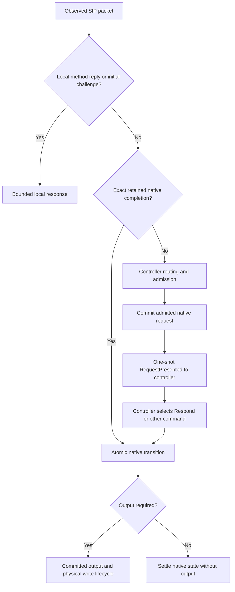
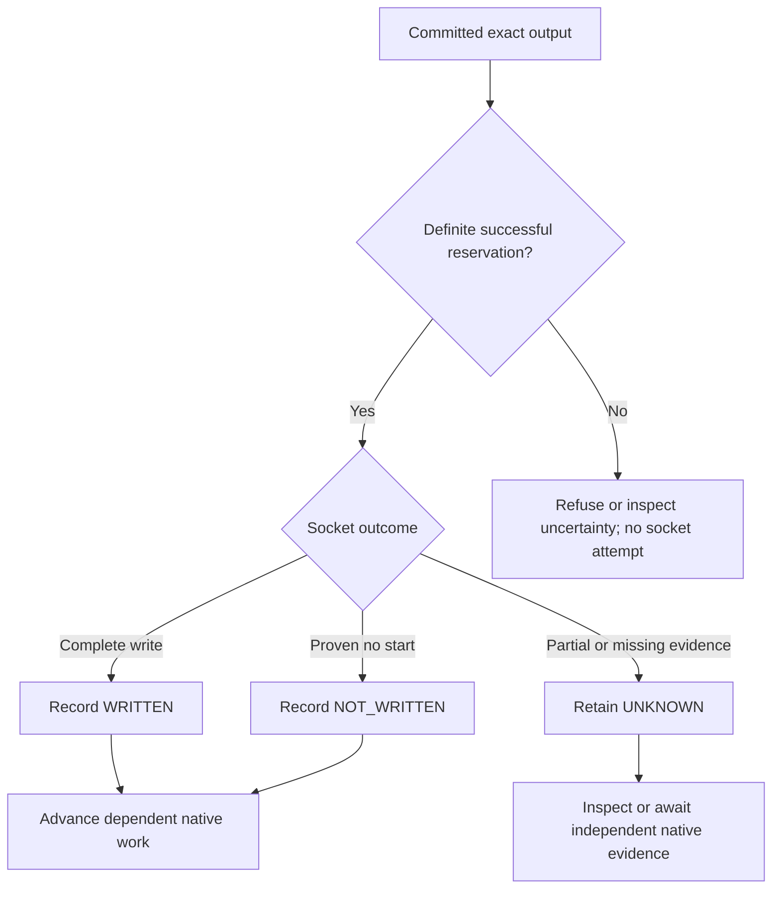

# sipbridge architecture

This is the source of truth for component ownership and required behavior.
The normative supplements below supply exact contracts. Implementation details
such as helper names, whole-group reconstruction and polling loops are not
additional guarantees. Changes to behavior start here or in its owning supplement,
then ship with the code that implements them.

## Reading map and contract ownership

| Document | Owns |
| --- | --- |
| [Resident Memory](docs/memory-core.md) | Typed process-local authority, local deadlines and Memory delivery gate |
| [Checkpoint runtime](docs/runtime.md) | Redis checkpoints, atomic operations, physical evidence, scheduling, bounds and shutdown |
| [Protocol](PROTOCOL.md) | Canonical control messages, capabilities, controller decisions and result meanings |
| [Controller recovery](docs/controller-recovery.md) | Optional controller checkpoint/attachment recovery only |
| [Operation flows](docs/operations/index.md) | End-to-end flowcharts and current implementation work accounting |
| [Fixtures](docs/fixtures.md), [verification](docs/verification.md) | Test programs, reproducible evidence and qualification limits |

`proto/sipbridge-control.proto` owns the shared wire declarations. Its generated
Go/TypeScript codecs, distribution copy and schema receipt ship together.
Consumers pin the full receipt and an immutable image; major `1` alone does not
establish compatibility. Native retained storage has its own schema identity.

The replacement Memory runtime follows [Resident Memory core](docs/memory-core.md).
Its message representation revision is independently reviewed and locked before
implementation; SIP reducers remain the sole semantic authority. The deployed
checkpoint runtime below remains the serving implementation until the replacement
passes its protocol and CPU gates. Redis implementation follows that Memory gate.

## Components and authority

| Component | Owns |
| --- | --- |
| Physical ingress | Observed UDP peers, TCP/TLS sockets, framing and exact socket-write evidence |
| Native execution | SIP transactions/dialogs/subscriptions and their bounded outstanding obligations |
| State backend | Shared checkpoints, atomic revisions, owner terms and finite retention |
| Control session | Authenticated controller transport, bounded RPC and correlated heartbeat |
| Application controller | Account authorization, call behavior, registration policy, subscription content and media orchestration |

SIP transaction, dialog and timer decisions belong to the pinned sipgo reducers.
Subscription metadata and coordination with physical output belong to the adapter.
Resident Memory publishes touched typed records directly; Redis execution reads
a current checkpoint, computes an affected transition and commits atomically. A whole-Call-ID graph is a storage implementation choice,
not permission to require every future bookkeeping operation to rebuild it.

The selected backend is the sole protocol authority. Memory is process-local and
lost on restart. Explicit Redis selection allows compatible workers to share
state. There is no automatic backend fallback, second resident authoritative FSM
or reconstruction of lost protocol state from controller memory. The service has
no business database, trusted-directory Redis, account-backend or Kubernetes
credentials. Firewall, PKI, CNI/routing, discovery and capture collectors are external.

## Four distinct identities

| Identity | Lifetime and authority |
| --- | --- |
| Physical flow | One ingress process epoch and exact socket or UDP listener/peer tuple. A replacement cannot recreate it from Contact or peer IP. |
| Logical context | Native state authority, Call-ID group/incarnation and non-reused directional context/dialog identity. Another compatible worker can execute it. |
| Controller owner | The original live application process and lease. A replacement process does not inherit its internal call state. |
| Timer executor | A derivative assignment of scheduled work to a worker. It owns neither the dialog, socket nor application. |

A new TLS connection on another worker can continue a retained context after its
identity, transport, sequence and flow checks. It does not transfer timer ownership
or authenticate a fresh call. Responses use the admitted request's flow;
publication of a route for later output is a separate ordered decision.

Optional controller reattachment additionally requires the controller's durable
recovery handle and application checkpoint. It is defined only in
[controller recovery](docs/controller-recovery.md). Physical reconnection and
shared native state do not imply that this capability is enabled.

## Shared state and local state

| Retained object | What must survive |
| --- | --- |
| Established dialog/subscription | Identity/tags, accepted routing/flow, sequence watermarks, application authority and expiry/termination state |
| Outstanding procedure | Its semantic phase, original deadline, selected output and necessary physical/completion evidence |
| Accepted INVITE work | Required successful final, ACK/fork/offer-answer and ACK-before-cleanup-BYE duties |
| Replay/disposition evidence | Only the bounded result, request identity and admission evidence required by the supported replay contract |
| Process-local work | Socket/parser state, bounded emission bytes, transient operation values and scheduling hints; none is a second shared-state authority |

Messages are opaque wire where exact emission, replay or recovery needs bytes.
Parsed mutable SIP objects live within an operation. Persist reusable semantic
facts rather than retaining a parsed request as a quiet dialog's source of truth.
Classification and selector lookup reuse one transient parse at each received
boundary. Construct rich SIP control DTOs only when delivering them publicly;
receipt storage accepts immutable wire directly without building a DTO first.
The Memory target further requires owned immutable native message facts through
matching, reducers, construction, output and retirement, as defined in its
[parse-once contract](docs/memory-core.md#parse-once-and-retain-only-required-message-data).
Exact replay policy and cutoffs belong to [runtime](docs/runtime.md); terminating
a reliable transaction is not by itself permission to erase its unsettled output.
All records, packets, results, queues and transient work have explicit bounds.

## Request and write lifecycle

Presentation is a direct, bounded controller exchange from a definite fresh
commit. Deferred publication/proof completion can return that same one-shot DTO
under the original deadline. It is not a durable job or a replayable callback.
Losing initial setup in this window can fail that request. Retained lifecycle
events and established protocol obligations have independent recovery rules.

The controller selects application responses and prepares subscription content.
Accepted SUBSCRIBE requires its immediate/refresh NOTIFY even when content is
unchanged. Native delivery preserves the NOTIFY intent once committed; it cannot
invent content that the controller has not supplied. Registration mutation and
ordered business publication remain controller-owned operations.

A write is not peer receipt. Redis cannot atomically commit a socket operation.
UNKNOWN never becomes NOT_WRITTEN through timeout and does not authorize an
older-flow fallback or another attempt. Native retransmissions remain the same
bounded SIP procedure, with its original identity and deadline. A successful
INVITE still requires SIP ACK over TCP/TLS. Positive local ACK-write evidence
precedes an automatic losing-fork cleanup BYE.

No authoritative protocol aggregate survives a controller RPC, socket operation
or response wait. Only bounded immutable DTOs and hints cross those boundaries.
Current-context command results and frozen historical outcomes have distinct
meaning; a newer command cannot replace evidence an older operation is entitled
to observe. Exact admission, receipt and uncertainty rules live in runtime.

## Transport and business admission

UDP, TCP and TLS retain their actual class in flows, advertisements and native
timers. A retained TLS context cannot migrate to plaintext. Observed ingress,
never Via/Contact text, supplies physical source evidence. Plaintext replacement
requires its matching binding/current-flow evidence; TLS continuity still needs
native context checks and controller policy where that request requires it.

Method policy can reject disabled REGISTER/SUBSCRIBE before state or control
access. OPTIONS capability probes also finish locally, without native context
lookup, retained history or a controller exchange. Configured initial digest challenges run locally, without account
credentials or native context creation. A digest-bearing request still needs
controller verification. Neither challenge nor native continuity authenticates
an account. Exact supported methods and challenge rules are in runtime/protocol.

Business commands carry current policy, owner, sequence and directory evidence.
Respond uses the transaction return flow; DialogRequest uses accepted dialog
routing and a fresh native local CSeq. Subscription processor adoption is separate
from handset-flow publication and never adopts an INVITE call. Unregistered
network targets use controller-selected URI/proxy, actual transport and an opaque
credential reference; clear credentials are ephemeral lookup results only.

## Recovery and process lifecycle

Each worker executes deadlines for its own groups. One coordinator handles
unowned work and expired-worker transfer. Presence, leases and queue heads are
metadata, not SIP authority. Workers remember only wake cursors and conservative
local deadlines; they do not poll dialog records. Followers wait for observed
leader expiry or a handoff notification. The coordinator waits for actual orphan,
application-owner or unowned-work deadlines. Bounded work recomputes the next
head; completed repair does not leave a periodic empty repair loop.

Every selected operation revalidates shared authority, revision, generation and
original deadline. Native/controller lease loss, socket closure and datastore
failure are separate events. Missing or rolled-back Redis state can lose calls
or require registration; asynchronous replication does not promise zero loss or
exactly-once execution. No cached local state reconstructs missing authority.

Readiness fences fresh work. It does not close healthy retained flows merely
because Redis, discovery or controller policy is unavailable; overload is not a
liveness restart condition. Certificates/trust reload for new handshakes and
preserve established sockets. Controller/account/policy/discovery/certificate
changes must not unnecessarily roll the SIP process.

SIGTERM withdraws readiness, finishes admitted work within the fixed connection
drain, then closes remaining sockets. Phones can reconnect and use retained
compatible contexts; sockets and controller memory do not move. The
[runtime drain](docs/runtime.md#bounded-sip-connection-drain) and
[deployment guide](docs/guide/deployment.md) own bounds and rollout steps.

## Qualification and release boundary

The public project is [GitHub](https://github.com/zyno-io/sipbridge); documentation
publication does not deploy a workload. The pinned consolidated `third_party/sipgo`
snapshot is immutable and verified by its dependency manifest. Changes require
upstream qualification and refreshed native/wire tests.

CI gates image publication on source/schema receipts, formatting/vet, Redis race
and restart checks, pinned-native tests and independent wire qualification.
Application/account, media/CDR, carrier/handset, load and live rollout evidence are
separate acceptance boundaries. See [verification](docs/verification.md).
