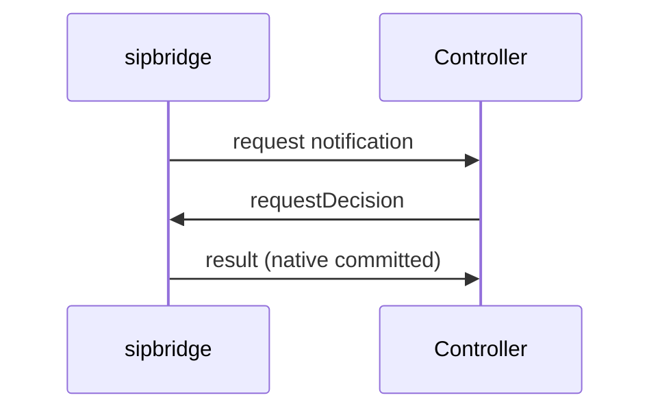

# sipbridge control protocol

Status: experimental implemented service contract. Qualification requirements are
identified below. The current service uses UDP/TCP/TLS listeners,
authenticated JSON control, schema 1 / reducer 1 / timers 1 CAS and autonomous native
completion. [Verification](docs/verification.md) lists the current test coverage
and its limits; full platform conformance is not yet qualified. The session-only
and stdio programs are separate [fixtures](docs/fixtures.md).

This is the normative wire/business-admission supplement to
[ARCHITECTURE.md](ARCHITECTURE.md). [Runtime](docs/runtime.md) owns exact execution,
lease, physical-proof and capacity rules. MUST/MUST NOT describe required behavior;
proposed requirements are not claims of implementation or qualification. Neither
fixture success nor a negotiated capability proves complete platform acceptance.

## 1. Scope and contract authority

sipbridge owns SIP transport and native protocol execution. The application controller owns authorization,
call state, registration policy and subscription content. Account services remain
behind that controller, while a media server handles RTP. The SIP process receives no business database,
trusted-directory Redis, Kubernetes or account backend credentials.

The current service supports actual UDP/TCP/TLS transport and explicitly authorized
registered or network destinations. Existing carrier, media, REFER/Replaces and
legacy behavior need their own backend acceptance evidence.

The canonical `proto/sipbridge-control.proto` in this repository defines the
session and application messages, field numbers and catalogs. Its distribution
copy is `dependencies/sipbridge-control.proto`. Generated Go/TypeScript JSON
types and validators use those declarations, with recorded hashes in
`dependencies`. Neither peer maintains a handwritten contract. This document
owns field behavior; other SIP server protocols are separate APIs.

## 2. Identity, execution and capabilities

| Identity | Authority and lifetime |
| --- | --- |
| Physical flow | Exact live ingress process epoch/socket or UDP listener/peer tuple; sockets never migrate. |
| Logical SIP context | SIP-state authority, Call-ID group, incarnation and non-reused context ID; compatible workers execute pure transitions. |
| Controller application | Stable original lineage and pinned lease. Optional authenticated reattachment changes the holder and generation; application state must be restored by the controller. |

`ContextRef.state` is authoritative logical identity. `owner` and snapshot executor
identify the replying physical worker, not another protocol authority. The selected
SIP-state adapter contains the only retained authoritative protocol values; the
engine has no second FSM. Memory authorities are process-local and change on
restart. One CAS read/reduce/commit records effects before I/O. No computation
stripe/snapshot spans controller RPC, socket I/O or response wait. Physical reservation
fetches exact committed bytes and never accepts caller-selected replacement wire.

The current service negotiates the following behavior. Negotiation precedes session
claim admission so an incompatible controller cannot fence a compatible one.

| Capability | Current meaning |
| --- | --- |
| `sip.v1` | Typed SIP application/control family, separate from session-only transport. |
| `sip.state.v1` | Logical contexts, owner leases and CAS execution in the selected state adapter. Memory authority is process-local. |
| `sip.native-completion.v1` | Retained native completion, physical settlement and retirement without a surviving controller. |
| `sip.controller-reattach.v1` | Optional token/principal-bound recovery of a stable owner by a new holder, with generation fencing and bounded owner-scoped context listing. |
| `sip.command-admission.v1` | Command-time policy/delivery admission for Respond, OpenUac and DialogRequest. |
| `sip.command-budget.v1` | Commands may carry the 40-second budget; ordinary RPC/write limits remain separate. |
| `sip.dialog-continuity.v1` | Explicit native validation of same-transport replacement-flow attempts. |
| `sip.request-decision.v1` | Memory request notification/decision/commit contract below; requires its updated canonical schema receipt. |

State execution requires `sip.state.v1` for every backend. Negotiation validates
state authority before claim admission and acquires the native owner lease before
publishing a usable peer. There is no backend-specific state capability.

A changed business directory epoch requires re-establishing work under current
authority. Native completion and state retirement use the retained SIP-state
authority independently of controller business policy.

The hello returns the controller application's SIP-owner lease receipt; contexts
pin that stable lineage and term. Without the recovery capability, the existing
process-bound renewal and loss rules apply. With `sip.controller-reattach.v1`,
`hello.recovery` proves the same principal and recovery token, atomically changes
the holder and attachment generation, and preserves only eligible retained work.
The new holder reconciles its own context inventory and sends fresh ready status
before business work. Expired, sealed or missing contexts are never resurrected.
Control transport, readiness, directory liveness and SIP-owner authority remain
distinct. [Controller recovery](docs/controller-recovery.md) owns attachment rules;
[Runtime](docs/runtime.md#owner-lease-and-permanent-loss) owns lease execution.

Every eligible controller keeps authenticated control sessions to signaling replicas,
including retained-work paths during drain. Business routing and receiver callbacks
use those controller-initiated sessions. Current native writes use local SIP-state
permits/reservations and exact physical ingress; no trusted per-send permit ledger,
controller physical-write relay or edge-to-edge credential mesh is required. A recorded
physical outcome belongs to its immutable attempt. Inspection never starts a write;
UNKNOWN cannot settle, expire into NOT_WRITTEN or free its retained obligation.

Effect IDs are content-bound: fingerprint is lowercase SHA-256 of these ordered
UTF-8 parts, each prefixed by eight lowercase hexadecimal byte-length digits and
colon. ID is `e-` plus digest. Parts: `sipbridge-send-v1`; authority service,
generation and primary ID; group ID, incarnation, Call-ID, decimal partition;
context ID; application instance/epoch; pinned lease term; principal, binding,
actual transport; decimal authority class; requested completion scope; decimal
deadline milliseconds; immutable send-emission attempt ID; SIP method/decimal status;
lowercase SHA-256 of immutable wire; proposed flow ingress instance/epoch, connection
ID, source IP/decimal port, listener, transport. An absent flow contributes seven
empty strings. Executor metadata is excluded. Empty ID/fingerprint is allowed only
while minting; supplied mismatch refuses. Each native retransmission has a new
committed emission ID with retained SIP identity and original finite deadlines.

Primary/Sentinel failover automatically reconnects. Configuration-derived authority
is not a data-survival receipt. Missing state fails affected old operations; fresh
work can allocate a new incarnation. A valid asynchronous rollback may be undetectable.
No namespace provisioning/reset or resident reconstruction is part of recovery.

## 3. Transport, authentication and framing

### Local initial digest challenges

`sip.local-challenge.v1` negotiates process-configured initial authentication
methods and short-lived nonce issuance policy. HelloAck carries the immutable
`InboundAuthPolicy`; a process configured to require auth refuses controllers
that do not negotiate this capability. Empty native required-auth configuration
preserves existing controller behavior.

The controller supplies `DigestChallengePolicy` in SessionStatus: realm, authentication
epoch, a 32-byte purpose/epoch-scoped nonce-signing key and absolute expiry.
This is sensitive control material, never loggable payload or an account
credential. It does not authenticate any SIP request. The broad trusted RPC
secret, passwords and HA1 hashes never enter this process. Policy acceptance
requires the negotiated capability, valid shape and an expiry no more than
60 seconds away. The worker retains a bounded current policy with its original
fixed expiry. Normal controller refresh uses 30 seconds; missing/expired policy cannot
authorize fresh work. Short-lived retired key material may only validate an ACK
to a previously rejected local INVITE, never issue a challenge or authenticate.

The local nonce is the canonical unpadded base64url encoding of
`l1.timestamp.random.signature`: ten Unix-second digits, 16 random bytes in
lowercase hex and a complete HMAC-SHA256 signature encoded in unpadded base64url.
It is exactly 120 characters, fitting within clients' 127-character nonce
buffers. The signature includes the `l1.` prefix, binding verification to this nonce
format. Other nonce formats are refused.

The local HMAC input is `sipbridge-digest-v1\n` + epoch + `\n` + scope + `\n` +
`l1.timestamp.random`. Scope is the lowercase From URI host authority without
numeric port, then a newline, using an empty username. controller
derives the key using HMAC-SHA256 of `sipbridge-local-challenge-key-v1\n` + epoch
under its application authentication secret. The controller independently verifies the compact encoding,
120-second window, account credentials, nonce counts and exact-operation
receipts. Issuing a nonce never grants native account or binding authority.

Only missing/parse-invalid credentials on configured initial methods trigger
local 401. Credential-bearing requests still use ordinary native and controller
admission. The controller independently enforces advertised INVITE auth regardless of
From domain. Missing issuance policy returns local temporary failure; disabled
method 405 takes precedence. Responses, ACK and CANCEL are never challenged.
Tagged requests retain ordinary context/continuity admission.

Local INVITE challenges use deterministic transaction tags and absorb only
verifiable ACKs for those challenges. An authenticated retry's new CSeq routes
normally. The bounded proof only identifies a rejected local transaction; it
cannot authorize a SIP dialog or account, and does not create a resident FSM.

The controller opens `/v1/control` and negotiates `sipbridge.control.json.v1`.
TLS transport uses `wss:` and validates the server chain and endpoint DNS SAN.
Default mTLS authentication also validates the client chain and exact allowed
URI SAN; a trusted CA alone, common name or source address is insufficient.
Explicit bearer mode instead authenticates an Authorization header and stable
configured principal before upgrade. Explicit plain `ws:` control is limited to
a loopback listener and still requires bearer authentication. There is no
unauthenticated mode or automatic fallback. Origin and frame metadata never
substitute for the configured authenticator. Public SIP TLS continuity still
uses actual observed SIP transport, independently of control transport.

Each UTF-8 text WebSocket message contains one JSON `Envelope`. JSON is the only
wire encoding; binary messages are rejected. The repository
[protocol schema](proto/sipbridge-control.proto) defines Go/TypeScript
messages and JSON field
validation metadata. Its JSON mapping uses lowerCamelCase keys and symbolic enum
names. Oneof variants appear as named fields, such as `hello` or `command`, with
exactly one variant present. This is a strict profile of the
[ProtoJSON mapping](https://protobuf.dev/programming-guides/json/), not a binary
protobuf transport or a second independently maintained JSON contract.

Unsigned 64-bit fields are canonical decimal strings in the range
`0`–`18446744073709551615`; numeric tokens, signs, leading zeroes and exponents are
rejected. TypeScript retains bigint internally. Byte fields use padded standard
base64, preserving arbitrary SIP bodies. Unsigned 32-bit fields are JSON integers,
booleans are JSON booleans, and known fields cannot be null or use a different
type. Missing fields retain their schema defaults; semantic presence/admission
checks still apply. Only canonical JSON field names are accepted. Duplicate object
keys (including escaped equivalents), invalid UTF-8, nesting deeper than 32
containers, multiple oneof variants and unknown enum values are protocol errors.
Unknown optional fields are ignored for additive version compatibility; an unknown
operation cannot substitute for a recognized payload/action.

Inbound bytes undergo token-level and schema validation before decoding. Outbound
messages validate the typed protobuf value against the same schema profile;
ProtoJSON supplies canonical scalar encodings and rejects invalid strings. The
producer checks enum membership, required oneof selection, container depth and
the final encoded byte bound without reparsing its own JSON or constructing a
second message graph. This does not change the accepted wire profile.

Empty envelopes, missing payload, wrong direction and excessive sizes are protocol
errors. Enforce the negotiated byte bound on the complete UTF-8 JSON message while
assembling fragments and before decoding; base64 and JSON overhead count toward
that bound. Disable WebSocket compression in this profile.

For example, the initial session message is ordinary JSON; its attempt counter
remains lossless beyond JavaScript's safe integer range:

```json
{"correlationId":"hello-1","hello":{"controller":{"instanceId":"controller-a","epoch":"boot-a"},"connectionAttempt":"9007199254740993","major":1,"bounds":{"maxEnvelopeBytes":262144}}}
```

An envelope contains a bounded correlation ID, a remaining deadline budget where
applicable, and exactly one typed payload. Replies echo the request ID. A session
may multiplex bounded independent operations; ordered WebSocket delivery is not a
global order across sessions, contexts or controller instances. IDs are opaque, unique
within the issuing process epoch, and not authority. Counter/revision fields are
lossless unsigned integers; TypeScript must use bigint or generated lossless
representations rather than JavaScript floating-point conversion.

The session subset restricts reference/correlation strings to
`[A-Za-z0-9_.:@+-]{1,96}`. Numeric source addresses and workload URI SANs are
different fields/credentials and are not validated as opaque session references.

Readable JSON does not authorize logging message contents. SIP bodies, digest
credentials, authorization headers, private keys and opaque
authorization material MUST NOT appear in routine protocol logs.

### Session establishment and supersession

1. After TLS/upgrade, controller sends `session.hello` with its instance/epoch, monotonic
   connection attempt number, supported major/minor range, capabilities and bounds.
2. sipbridge returns `session.helloAck` with its instance/epoch, issued session ID,
   selected version, negotiated capabilities and effective limits. Incompatible
   peers fail explicitly before any application operation is accepted. The major
   must agree with the selected WebSocket subprotocol.
3. The accepted higher connection attempt for the same controller instance/epoch
   fences its predecessor immediately. The replacement remains undiscoverable
   until lease acquisition and successful HelloAck write; failed handshakes publish
   no usable peer. Old-session commands/results cannot acquire new authority.
   In-flight predecessor mutations are unknown unless already proven; the old
   session is closed.
4. controller reconciles retained contexts and binding readiness, then sends
   `session.status`. Authenticated retained-work delivery and fresh-call admission
   are separate states. A hello or heartbeat alone does not admit calls.

A shared workload certificate authenticates the controller workload, not a particular
Pod. Instance/epoch fields are trusted-workload assertions, checked against the
trusted instance lease and existing session claim; they are not cryptographic
per-Pod identities. A different epoch cannot supersede an active call owner merely
by claiming its ordinal. Duplicate live claims fail closed pending reconciliation.

Both peers send correlated `session.ping`/`session.pong`. Six seconds without a
valid reply to that session's heartbeat fences and closes that control session.
Unrelated SIP traffic or a late pong from an old session cannot reset the deadline.
Session failure removes fresh-work eligibility and fails pending operations. It
MUST NOT close client TLS sockets, delete native contexts or reset SIP timers.
The controller reconnects with bounded backoff while the endpoint remains authenticated.

Capabilities describe negotiated behavior, not runtime readiness; `session.status`
separately states retained/binding readiness and new-work classes. Process drain
uses the bounded lifecycle below, not an unimplemented inventory protocol.

### Bounded writes and late replies

Admission includes pending hellos. Recent transport claims retain supersession proof
for five minutes after disconnect; live claims never expire. This is transport
fencing, not SIP-owner lease authority. An outbound RPC returns on its original
caller deadline. One writer token bounds each session: token waiting counts inside
the at-most-two-second transport-write timeout and expired waiters emit no frame.
Positive envelope budgets decrease by admission time and remaining caller window.

After admission one bounded writer owns token/transport cancellation until frame
completion or transport/session expiry. RPC caller expiry cannot cancel that already
admitted physical WebSocket write and poison the shared socket. Heartbeat/unsolicited
replies use the same token. An abandoned admitted RPC installs its five-minute
late-reply marker before waiter removal; buffered completion cannot strand the writer.
No new application queue/replay permission follows from frame completion or timeout.

## 4. References and trust

| Reference        | Required meaning                                                                                                                                                |
| ---------------- | --------------------------------------------------------------------------------------------------------------------------------------------------------------- |
| `ProcessRef`     | Stable inventory instance ID plus unpredictable startup epoch. Reuse of an ordinal never reuses an epoch.                                                       |
| `FlowRef`        | Ingress ProcessRef plus non-reused connection ID. The observed numeric source IP/port, actual transport and local listener identity accompany ingress evidence. |
| `BindingRef`     | Opaque authorized account/device/registration scope plus monotonic committed revision. It is not merely an AOR, Contact URI or source IP.                       |
| `ContextRef` | Logical StateRef plus non-reused context ID; owner is physical executor metadata. Native transaction and directional dialog evidence remain explicit. |
| `ApplicationLease.application` | Stable original controller lineage (`ProcessRef`). A recoverable owner separately records its current holder and attachment generation. |
| `RequestRef` | Native request handle scoped to logical context/group incarnation; physical executor epoch does not change its authority. Call-ID alone is not a handle. |
| `OperationRef`   | Issuing process epoch and opaque operation ID, stable through pre-execution routing.                                                                            |

Only ingress creates socket/source evidence. controller forwards it over authenticated
sessions and is a trusted relay; SIP headers cannot invent it. The receiving owner
checks expected issuer, epoch, context identity, current authorization and target.
The egress ingress accepts only a reference to its own live socket under an
authorized binding. No frame can ask it to connect to an arbitrary IP or port.

A FlowRef identifies a socket; it does not authenticate a SIP account. Public SIP
TLS without a client certificate authenticates the server to the phone. A successful
TLS handshake, From/Contact, Call-ID, source NAT address or internal redirect does
not authorize replacing an account/device binding.

Original observed source stays available to controller abuse/account policy. Builders
use explicit public advertisement. Fixture virtual-pool keys are private test
mechanics, never service client-source fields or advertised headers.

## 5. Owner lookup, redirects and native ingress

The routing/ingest handshake in this section describes the checkpoint runtime.
The Memory [direct decision](#direct-request-decision-memory-target)
replaces those exchanges; the native matching, account-policy and transport trust
rules still apply. A bounded pending native request handle does not establish a
business owner claim or accepted registration/subscription.

Ingress parses/fragments SIP using the library but MUST NOT create a second native
transaction while resolving an existing context. controller's trusted routing index
maps native selectors to logical context and original controller owner. SIP-state
lookup proves retained native completions before ordinary business routing.
This index is transport-routing metadata, not migrated SIP state or a second
registrar. Existing call/registration/subscription locators are reused where valid;
any new directory fields and atomic operations belong to the controller's
application contract. sipbridge never accesses the application's directory store.

The controller's trusted directory serializes binding revisions and business
context-claim CAS. The application chooses that directory's storage; sipbridge
does not add or access a business storage service. New
context creation is admitted only after an exclusive owner claim succeeds. Claims
cover native transaction/timer lifetime and live dialog lifetime; TTL expiry alone
is not permission to recreate a live context. Unavailable/inconsistent directory
evidence fences affected claims and binding commits; a configuration-derived authority never proves retained-call absence.
It cannot turn an uncertain lookup into confirmed absence.

Owner selectors cover transaction branch/sent-by/method, Call-ID, numeric CSeq,
both dialog tags and subscription Event package/id where relevant. CANCEL and
non-2xx ACK must reach the INVITE transaction; 2xx ACK and in-dialog traffic use the
appropriate dialog owner. Responses return to their originating client transaction.
Call-ID alone cannot distinguish forked legs or unrelated subscriptions. The
library remains the final authority for SIP matching after internal dispatch.

Lookup returns one typed result:

| Result        | Dispatcher action                                                                                                                                            |
| ------------- | ------------------------------------------------------------------------------------------------------------------------------------------------------------ |
| `owned`       | Use the exact SIP/controller owner generations, including a draining owner retaining this context.                                                                |
| `redirect`    | Before acceptance only, repeat dispatch to a known authenticated controller ProcessRef. Preserve the OperationRef, SIP bytes, source, flow and original deadline. |
| `absent`      | Only an authoritative absence allows a genuinely new request to claim ownership. An unknown in-dialog request is not a fresh call.                           |
| `unavailable` | Known owner or directory cannot be reached. Fail boundedly; do not adopt the context elsewhere.                                                              |
| `reject`      | Apply the explicit policy/SIP failure permitted for this request.                                                                                            |

A selected controller may redirect before acceptance. At most two redirects and no
repeated ProcessRef are allowed within the original deadline. Destinations resolve
through authenticated inventory/control sessions, never a returned URL. Internal
redirect is not SIP 3xx and does not move the socket, SIP context or application call.

`owner.ingest` transfers original SIP bytes plus trusted ingress evidence to the
selected native owner. It adds no Via, Record-Route or Contact and performs no
string-based header rewriting. Portable reduction uses actual observed source and
transport without a resident UA/pool. Native matching and frame/context authorization
precede policy-event delivery; SIP account authentication remains controller policy.
A redirect is forbidden after the native/policy operation has been accepted.

Existing-context ingress carries an explicit admission basis. `AUTHENTICATED_BINDING`
means controller checked the exact authorized account binding; `EXISTING_FLOW` permits
only the retained physical flow; `TLS_DIALOG_CONTINUITY` permits a native attempt
at continuity for one retained context. It does not assert digest authentication
or authorize a new INVITE, another dialog, or registration mutation. The native
owner must verify both directional tags and Call-ID even when lookup found a
transaction selector, preserve the context's transport/security policy, and run
native sequence/lifecycle checks. TLS server authentication alone is not client
identity. This profile uses the secrecy of strong random dialog identifiers on
TLS for established-dialog continuity, without a custom token or required REGISTER.

CANCEL and non-2xx ACK require exact pending transaction identity before native
receive can perform automatic effects. ACK is never challenged or answered.
An ordinary response requires its exact native client transaction and retained
security association; it does not create registration or unrelated dialog authority.
`TLS_TRANSACTION_CONTINUITY` admits a TLS response only after the native library
confirms its live client transaction and exact response identity. It grants no
context delivery authority. Initial unauthenticated REGISTER requests can reach policy without gaining any
existing-context authority. Plain UDP/TCP and carrier trust are not widened by
TLS dialog continuity.

Missing context and unavailable owner are different failures: lack of directory
access must not manufacture 481 or a new call. Existing-context request resolution
failure normally produces a bounded 503 where a response is legal; unmatched
responses are dropped with a diagnostic. ACK is never answered. CANCEL processing
and authoritative 481 behavior remain native SIP semantics, not generic RPC error
mapping.

## 6. Binding acceptance and replacement flow

The controller is the binding authority. sipbridge keeps only the bounded delivery state
needed by retained contexts and live flows. A binding distinguishes account,
device and provisioned endpoint-account identity. A Contact or ephemeral source-port
change on the same authenticated account replaces its delivery flow; shared NAT
and an extra provisioned account on one phone cannot merge authorities.
The exact identity is obtained from authenticated registration/account policy,
not inferred by an edge Contact cache.

A fresh REGISTER may have its own transient native transaction on B while the
same device's existing call and subscription contexts remain on A. Accepting that
registration does not move those contexts or their controller call owners.

For an accepted replacement:

1. controller resolves the registration scope and reserves an ordered candidate ticket
   before executing the policy mutation. The same native operation reuses its
   ticket; replay never obtains a fresh ticket. Tickets alone grant no authority.
2. Authenticate and authorize the request through the controller and account backend policy.
   A failed or rejected operation cannot change the committed binding.
3. Atomically commit the candidate only if it is newer than the committed ticket
   and its native-operation/CSeq replay guard permits it. The authoritative record
   stores the new FlowRef, committed revision and registration expiry. Ticket order
   is authority reservation order, not a claim about globally synchronized clocks.
4. Install the authorized binding/revision at the new ingress and notify affected
   live owners. Policy commit followed by a failed install is an explicit failure;
   do not silently roll the authority back to A or report an uncommitted operation.
5. Return the successful REGISTER response only after the binding is usable. A
   failed response write does not undo an already committed registration/binding.

Durable policy writes use a separate account-version precondition. controller reads the
current account backend version, then sends a non-retried mutation with that expected
version. account backend revalidates and increments it under the physical endpoint row lock
in the same transaction as the account registration mutation. Stale versions fail
before mutation; a later fresh operation can proceed after an uncertain response
without taking over a process lock. The accepted database version and the latest
reserved publication ticket both fence Redis publication. A later reservation
blocks every older response, even while the newer policy result is unknown.

The account database and registration directory are not one atomic transaction. A failed or superseded publication
returns failure and leaves the preceding transport binding intact; it never
reports REGISTER success or replays the policy mutation. The database may already
name the new Contact, which remains unreachable until a fresh authenticated
REGISTER reconciles policy and transport. One bounded version/ticket per account
is retained, with no unbounded request history. Changed directory epochs refuse old business work; recovery establishes fresh
authority through current policy admission.

An older outstanding candidate cannot overwrite a newer committed ticket, even
if its policy call finishes later. Cached/replayed REGISTER, stale owner events,
ordinary SIP traffic and closure of A's old socket cannot restore A's flow. A new
valid registration operation from A may be a new candidate only under explicit
freshness/authentication policy. A Call-ID reset is not blanket replay authority.

There are three separate delivery scopes: an authenticated registration binding,
a context-only route, and a transaction response path. REGISTER-only discovery
updates contexts explicitly attached to that account binding. Valid TLS dialog
continuity may instead move one context without changing the registration row,
new-call reachability, unrelated dialogs, or independent subscription flows.

After native validation of a fresh continuing INVITE-dialog request and before application
execution, the owner sends `flowAdoption` containing exact context/application,
principal/binding, observed flow and increasing native revision. controller verifies
native issuer and original application ownership, then atomically publishes one
current `ContextDelivery` and returns `flowAdoptionResult`. The receipt retains
the native revision, flow, directory epoch and current highest reserved registration
ticket. Repeating the same revision/flow returns that receipt without refreshing
its registration watermark. Older revisions or a conflicting same-revision flow
cannot publish. Publication uncertainty is bounded and prevents dependent work;
there is no retry of business policy or fallback to an earlier flow.

Context delivery receipts also cover native-admitted UDP/TCP requests. A matching
dialog tuple cannot grant plaintext replacement-flow admission: the owner requires
the exact current flow or an explicitly authenticated matching binding before
native transaction ingress. Publication adds no registration or account authority.
The retained TLS floor applies independently of binding authentication.
Retained contexts also preserve their original UDP/TCP/TLS transport class for
requests and responses. An authenticated replacement may change the physical
flow within that class; changing class requires a fresh context. No native
transaction or timer migration across transport classes is provided.

For SUBSCRIBE renewal, read-only retained-account/resource policy precedes flow
publication. The native successful response publishes before committing accepted
Contact/expiry; controller persists the renewal only after that success. Policy denial
leaves the accepted subscription flow unchanged. Every retained renewal publishes,
including an unchanged flow over UDP, TCP or TLS; initial subscription bootstrap
uses its admitted flow without requiring a context receipt. Publication refusal
preserves the accepted Contact, expiry and flow and returns a definite failure.

A committed registration records its publication ticket. It may supersede a
context route only if its ticket is later than that receipt's watermark and the
context is explicitly attached to the same binding. A REGISTER already outstanding
when continuity is published cannot later pull the context backward. A genuinely
later authenticated REGISTER may move the attached context. These order values
are not SIP CSeq, which remains independently native and directional.

Every subsequent request selection reads this ordered authority. Selection is
linearized at that authoritative read; writes already selected may remain in
flight during a concurrent update. Snapshot receipts allow exact recovery only
when directory epoch and order can be established. Missing or rolled-back evidence
fails boundedly; subsequent work requires fresh valid admission under current authority. Inspection and cached retransmissions cannot manufacture new authority.
A read-only registration reconstruction records its reservation ticket as an
upper bound, never as an accepted REGISTER. A later fresh continuity publication
may cover that bound; reconstruction after adoption cannot prove ordering.
One current receipt per context and one current ticket/version per registration
are bounded by retained lifetimes; no event history or new database table exists.

SIP responses use the exact admitted request flow. They do not consult the current
registration to find a different socket and do not publish a new context route.
Old socket closure invalidates only that physical flow. No delivery failure falls
back to a superseded socket. SIP Contact/route set, SDP, registration eligibility
and subscription expiry keep their own acceptance rules; physical continuity
alone changes none of those values.

Subscription Contact/expiry commits are separately defined below.

## 7. Message families and execution boundary

Observed SIP requests require a top Via branch accepted by sipgo's RFC 3261
client transaction key function, including the magic cookie and a nonempty suffix.
Unsupported branch forms are invalid input before state/control admission. UDP
drops them; stream parsing closes the invalid connection. Responses and ACK never
receive a newly generated error response from this validation.

The current `sip.v1` family carries actual `udp`/`tcp`/`tls` on FlowRef and native
transport on snapshots. OpenUac carries an authorized registered binding or explicit
URI/proxy/network target with an opaque credential reference. Credentials are
resolved transiently through the original controller.
Proxy selects next hop without replacing request URI. All output remains committed
native effects; no UA can dial around physical admission. Empty/INVITE OpenUac creates
a call; OPTIONS/MESSAGE/NOTIFY return standalone transaction results and retire.

These are the current generated envelope families. Both peers validate direction,
session, required capability and payload; semantic names do not imply a generic RPC,
SRF tunnel or arbitrary raw-wire interface.

| Family | Direction / boundary |
| --- | --- |
| hello/helloAck, status, ping/pong | Session negotiation/readiness/heartbeat; no SIP mutation. |
| ingress/routeResult | Ingress to controller and reply; original bytes, observed flow, bounded routing before native acceptance. |
| ingest/result | controller to worker; exact logical context/native input, not proof of successful business policy or socket write. |
| request, dialogEvent | Worker to original controller; exact request handle, immutable observations and lifecycle. |
| command/result | controller to worker; sequenced Respond/OpenUac/DialogRequest/Cancel with owner/admission checks. |
| requestDecision/result | Direct-decision controller to Memory worker; one decision for the exact notified request and one committed result. |
| flowAdoption/flowAdoptionResult | Worker to controller and receipt; ordered future context delivery, separate from response-return flow. |
| credentialLookup/credentialResult | Pure original-controller lookup; credentials stay transient and never enter retained protocol input/outcome. |
| flowClosed | Exact ingress flow invalidation; no effect on other flows or logical owner. |
| inspect/result | Existing logical context/latest operation and positive retirement proof; no allocation or adoption. |

The `probeApplication` / `applicationStatus` exchange checks application liveness
before subscription-controller handoff. `controllerContexts` /
`controllerContextsResult` provide authenticated owner-scoped recovery inventory.
There is no global instance-inventory or drain-generation message family.

Opening a new UAC uses a caller-allocated OperationRef and an exclusively claimed
context identity before SIP is sent. A duplicate control request cannot create a
second leg. Normal SIP responses produce transaction/dialog events, not another
control-command execution. SIP final response and control-operation result are
different objects with different lifetimes.

The controller supplies SDP/content and permitted application headers. sipbridge constructs
protocol identity, public Contact/Via, route/CSeq and native transaction fields.
Header allowlists must forbid overriding those owned fields, internal credentials
or trusted-source evidence. Digest challenge/verification remains controller policy;
the SIP process is not given business account credentials as configuration.

Public advertisement is explicit listener/context configuration, independent of
the library's internal connection address or whether a socket came from a cache.
Forwarding through A cannot advertise a virtual loopback address, localhost,
control address or internal flow key. The owner applies configured public
Contact/Via identity consistently on fresh and reused connections.

### Direct request decision (Memory target)

This is the direct-decision contract locked with architecture revision two and
approved by Astra before implementation. It is not a qualification claim. It
requires `sip.request-decision.v1` in addition to the
existing native state/admission capabilities. Memory uses only this request path;
the checkpoint Redis runtime retains its existing families during Memory
qualification. There is no Memory fallback or new compatibility engine.



The `request` payload retains `RequestPresented` and adds an optional
`flowAdoption` proposal of the existing native proposal type. Native validates
the actual SIP identity, sequence, transport and observed flow before notifying.
The message supplies the exact request ID, original budget, context/current
snapshot, observed SIP message and flow. It is a one-shot notification, not an RPC
requiring an acceptance reply. The controller chooses policy once and submits a
decision as its first acceptance. For a fresh context, the exclusive application
claim precedes a positive decision; pending native admission grants no account
authority. A retained call uses its original live controller; subscription
controller changes retain their existing authenticated handoff checks.

For an exact fresh, unowned pending request, snapshot `application` is only the
notification recipient hint. That controller may forward the notification and
verified policy through its own trusted discovery/tunneling path to the selected
application. The selected application submits the decision on its own authenticated
native session. Its real application/lease becomes the first owner atomically
with acceptance of the first valid decision, including a valid final SIP denial.
An invalid/refused proposal grants no ownership; expired or cancelled handles
cannot be claimed. Forwarding preserves the exact request, wire, flow and original
deadline. The committed result names the deciding application/term, never the hint.
This does not permit reassignment of an accepted call or controller recovery.
Recipient-dependent outputs and automatic 100 are held until binding. Bounded
native timeout refusal and exact paired CANCEL completion still terminate an
unowned setup under native authority without manufacturing a controller claim.

The new canonical `RequestDecision` contains these fields; generated types, field
numbers and the receipt remain owned by `proto/sipbridge-control.proto`:

| Fields | Meaning |
| --- | --- |
| `context`, `requestId`, `sequence` | Exact pending request and next context command sequence. |
| `admission`, `basis` | Existing command policy/delivery witness and existing ingress admission basis. |
| `principalId`, `bindingId` | Controller-selected account binding; continuity cannot substitute another identity. |
| `delivery` | Ordered receipt for the notification's native-validated flow proposal, when required. |
| `status`, `headers`, `body` | Selected SIP response. Zero status admits asynchronous handling with later ordinary commands. |
| `notify` | One content template with `method == NOTIFY`, using the existing `DialogRequest` type. |

REGISTER and SUBSCRIBE require a final decision response; zero status is invalid
for them. Other admitted requests may defer their business response. A non-2xx
final denial requires the exact request/live controller but need not fabricate a
business directory admission or publish a new binding. Positive decisions require
current policy and their selected admission basis. Every accepted SUBSCRIBE,
refresh and unsubscribe includes its required NOTIFY template. A negative
SUBSCRIBE includes none. NOTIFY is forbidden on other decisions. SIP header,
route, CSeq, expiry and content validation remain native. A selected NOTIFY flow
must match the accepted context delivery; it cannot replace the response's exact
return flow.

The worker revalidates the exact request, original deadline, current owner term,
command sequence, account identity and delivery witness. It stages the native
response and any subscription/NOTIFY candidates, capacity, indexes and physical
obligations together under its short context lock. A failed decision publishes
no partial SIP transition or output. Valid semantic refusals may consume sequence
and retain a small result under the ordinary command rules. The decision consumes
one sequence; its required NOTIFY is a native obligation, not a second business
command. No action list or retained parsed SIP graph is introduced.

Flow adoption is not published merely because a new socket was observed. When
needed, the notification carries the native-validated proposal first. The
controller performs its existing ordered publication and returns that exact
receipt in the decision. Receipt identity, proposed flow/native revision and
directory epoch must match; the prior delivery witness must still be current.
`admission.expectedDelivery` binds that prior witness; `decision.delivery` carries
the newly published receipt. The controller must not substitute the new receipt
for the prior witness before native commit.
Unrelated physical completion remains independently recordable.

After atomic publication the worker starts the response/NOTIFY batch in native
order and returns `ACCEPTED` with the committed snapshot. This proves native
intent acceptance, never response/NOTIFY `WRITTEN` or peer receipt. Existing
Reserve/Complete, native transactions and lifecycle events own later outcomes.
The same existing per-context owner command lane covers version allocation,
rendering and native dispatch for both decisions and ordinary notifications.
Forwarded changes arrange preparation in that owner lane rather than forwarding
pre-versioned content. A new content version lineage requires a genuinely new full
native context/incarnation, never merely a missing business subscription row;
initial counter publication preserves any higher existing counter. No state lock
spans controller or socket I/O. A missing/expired decision selects a bounded native
503 only while the exact request is unanswered; it is not presented again.

Controllers publish accepted subscription Contact/lease/termination from the
committed result. BLF/MWI content and version are prepared before the decision;
failed preparation/commit may waste a version but cannot publish false acceptance
or resend uncertain SIP. A lost result is uncertain business evidence, not
permission to repeat the decision elsewhere. A phone may need a fresh transaction
or subscription. Once committed, required NOTIFY and post-OK INVITE/ACK/fork/
ACK-before-BYE duties remain native even if the controller disappears. Subsequent
business NOTIFYs and call commands retain the existing command contract.

### Call adapter boundary

The controller adapts the typed service operations to its own call-control interface.
Request/dialog wrappers retain native identity, provisional/final events, initial
answer ACK, cancellation, late 2xx, negotiation and termination observations. SDP
and media readiness policy remain in the controller. Creating an opposite leg, accepting
an answer or destroying a losing winner is explicit controller work. Supporting a
single answered call is not evidence for REFER/Replaces, PRACK, early UPDATE,
forking, media bypass or legacy integration; these remain conformance gates.

OpenUac names an authorized registered binding or explicit network target and SIP
URI. The URI alone is not permission to dial an arbitrary network address.
The controller chooses the protocol owner, allocates the leg/operation identity, obtains
its exclusive claim, then asks the owner to originate the INVITE. Native response
events expose provisional/final state and child dialog references. controller explicitly
answers the incoming leg after its own media/application conditions are satisfied;
each leg's ACK/BYE and timers remain native. Authorized network targets retain
separate carrier, route and transport acceptance requirements; local fixtures do not qualify every proxy route-set traversal.

### Subscription boundary

An accepted subscription may replace its controller application processor after the
trusted directory proves the previous process lease released or expired. A CAS
selects one live replacement; native owner, context, tags, sequence state and
expiry remain unchanged. Authenticated SUBSCRIBE control adopts that processor
after retained context, account, physical transport and directional identity
admission, before native transaction ingress can emit a cached or validation
response. Stale CSeq, wrong Event and digest challenges do not prevent this
processor-only handoff. It changes no accepted flow, receipt, Contact, expiry or
SIP sequence state; successful renewal publication remains a separate step.
INVITE dialogs retain their original controller owner
and are never adopted through this path. Graceful controller shutdown releases only
its exact epoch lease after draining work; a crash uses lease expiry.

SIP owner retains Call-ID/tags, Event package/id, route set, accepted remote target,
remote request sequence, independent local NOTIFY CSeq and expiry. controller retains
BLF/MWI content, authorization, application subscription records and content
version continuity. Redis availability does not recreate a lost native dialog.

An accepted SUBSCRIBE commits permitted Contact/source/expiry exactly once. A
rejected refresh preserves the previous accepted target and lease. Exact replay
is response-only; stale CSeq and same-CSeq different operations cannot trigger
policy or another NOTIFY. Serialization occurs at the SIP owner even when policy
requests are served by different controller processes. A fresh successful operation
does not require a new subscription dialog.

NOTIFY increments its own local CSeq and uses the accepted target/route set plus
the authorized current physical flow. Target URI and transport delivery are
different decisions; moving to B does not rewrite Contact. Zero expiry and lease
expiry enter a terminal state before one final NOTIFY; refresh cannot resurrect an
old object or be ended by an old timer. A 481 NOTIFY response removes only its
matching subscription. Unsupported event packages/routes fail explicitly.
Rejecting a SUBSCRIBE refresh does not roll back an independently accepted
registration-flow replacement.

## 8. Delivery result is a socket-write outcome

Every library output traverses the same egress boundary: application requests,
cached responses, CANCEL 200, INVITE 487, ACK, retransmissions and native timers.
Using a replacement flow only for controller-issued commands is non-conformant.

Replacement selects delivery to a directly attached authorized UA. It does not
authorize bypassing a required SIP next hop or changing a route set. This profile
rejects routes requiring an unsupported proxy/trunk hop; retaining a loose Route
header in the fixture is not evidence of real proxy traversal. Strict and loose
route interoperability need separate native-routing and transport qualification.

The current service records physical outcomes through exact native Reserve/Complete
transitions. Queue admission, WebSocket success and controller receipt are not completion.
One immutable attempt/effect identifies its wire and selected flow. Completion must
match retained authority/identity; a stale reply cannot mutate bindings or another
write. Historical logical-connection blocking belongs only to the stdio fixture.

| Outcome      | Exact meaning                                                                                                                             | Allowed automatic action                                                                                 |
| ------------ | ----------------------------------------------------------------------------------------------------------------------------------------- | -------------------------------------------------------------------------------------------------------- |
| `written`    | The ingress socket-write API accepted the complete SIP message without error. It does not prove the peer received, parsed or acted on it. | Return write success to the native library. Await native SIP results separately.                         |
| `notWritten` | Rejected before any socket-write attempt, for example stale flow, lack of capacity or expired budget.                                     | Return a typed native write failure. This protocol does not transparently retry or select an older flow. |
| `unknown`    | Write began and failed/was partial, acknowledgement was lost, or the deadline/session failed after handoff. Delivery may have happened.   | Surface uncertain delivery. Never replay the operation on a different flow as a transport recovery.      |

Repeated delivery IDs within retained evidence return the known outcome without
another write. Forgotten/stale attempt IDs report unknown rather than pretending
nothing was sent. There is no exactly-once delivery claim or durable delivery
outbox. SIP's own transaction retransmission behavior remains native and distinct
from a control transport retry.

TCP/TLS writes retain exclusive framing ownership through all partial successful
writes under one original write deadline. An error/no-progress result poisons
and closes that exact stream before another message may start. A complete write
with lost outcome bookkeeping does not poison framing; the delivery outcome can
remain unknown. Closing a partial stream never changes its outcome to notWritten.

## 9. Commands, replay and failure

An operation is `pending`, `accepted`, then `completed` or `failed`; lost evidence
after acceptance yields `unknown`. Redirects are legal only while pending. An
acceptance acknowledgement is useful evidence, but its loss does not prove that
execution did not start. Timeout or disconnect MUST NOT create a new command
attempt. A replacement controller can recover ownership only through the negotiated
attachment contract, then inspect the existing operation; it cannot replay an
uncertain mutation. A compatible native worker can inspect or continue the retained
logical operation under current CAS guards.

The authority serializes mutation admission per context and retains the highest
accepted command sequence, its OperationRef and latest outcome marker. A duplicate
latest operation returns its known/in-progress outcome; an older sequence is
stale. New mutation must match owner term, sequence and admission evidence.
Terminal cleanup and SIP cancellation have reserved admission capacity and must not wait for an
entire call/transaction to finish. Initial INVITE UAC acceptance precedes eventual
SIP answer; asynchronous events retain their handles. In-dialog/standalone commands await final results within their
command budget, with public AD BYE known-written acceptance described below.

Each context has a monotonic observation revision. Events carry it; snapshots
report the current native phase, identity, pending request handles, initial-answer
ACK state, accepted target/lease, terminal state and latest command outcome as
applicable. A UAC transaction and its directional fork dialogs remain distinct
native records within one `ContextRef`; the snapshot exposes the selected
application dialog. Completing a transaction does not erase retained branch
ACK/fork/cleanup duties. Sipbridge performs losing-branch ACK and cleanup BYE,
with positive local ACK-write evidence required before that BYE.
For a selected branch with an offer in its successful INVITE response, the
controller supplies the ACK answer. Automatic answer generation for a losing
late-offer branch is not supported; the pinned reducer requires an ACK answer
and sipbridge does not fabricate one.

Control reconnect reconciles current snapshots and outstanding native requests;
it does not replay a general event history. Preserve a bounded terminal outcome
tombstone after context removal within the original replay cutoff. Tombstone
expiry/capacity and unknown outcomes are explicit; a missing marker is not proof that a terminal
operation never occurred. Pending native request material survives only for its
actual transaction lifetime. controller must reuse its known policy result when
completing that request, rather than rerunning policy merely because an event or
response was lost. There is no recovery of every transient provisional event.

After control reconnect, `operation.inspect`/`context.inspect` can reconcile a
retained native context and the latest accepted command. They cannot infer the
outcome of an expired marker or recover a dead owner's memory. Native transactions
retain required retransmission state; bounded one-time markers cover additional
control replay windows. Do not build an unbounded inbox, payload history or
general event replay log. If required evidence cannot fit, refuse new work rather
than evict an in-progress marker and execute its replay.

| Condition                                               | Required behavior                                                                                                                          |
| ------------------------------------------------------- | ------------------------------------------------------------------------------------------------------------------------------------------ |
| Control connection/heartbeat loss, same processes alive | Fence that session; retain sockets/native contexts; reconnect and inspect. Pending delivery/mutation may be unknown.                       |
| Discovery replacement/unavailable endpoint              | Fence fresh admission as appropriate; retain existing authenticated sessions and context-specific routes.                                  |
| Binding/index authority unavailable                     | Reject new claims/commits and operations requiring a fresh authoritative read; never restore a cached old socket or restart sipbridge.     |
| Current flow closes                                     | Invalidate that exact FlowRef. Retain logical contexts under their native/controller policy; no automatic dial-back or old-flow fallback.       |
| Ingress restarts under same ordinal | Its old sockets/FlowRefs are lost; retained Redis contexts remain logical state, and replacement flow needs independent native admission. |
| Native executor dies | Compatible worker may continue retained Redis transitions. Dead ingress sockets and application calls do not migrate; erased/incompatible state cannot be reconstructed. |
| application call owner dies                            | Do not adopt that in-memory call on another controller based only on Redis locators. Apply existing terminal/cleanup policy.                    |
| New controller epoch during a rolling deployment             | Admit new work separately; the draining old owner retains its calls and control paths until completion.                                    |
| Malformed/authentication/direction error                | Reject before execution and close the offending session; do not tear down unrelated sessions or client sockets.                            |

Errors distinguish `invalid`, `unauthorized`, `unsupported`, `staleGeneration`,
`staleRevision`, `notFound`, `ownerUnavailable`, `overloaded`, `deadlineExceeded`
and `outcomeUnknown`. Each carries execution certainty. A transport error is not
a fabricated SIP final response; the owning adapter applies request-specific
failure policy and preserves real SIP status/reason when known.

### Command outcomes and response authority

With negotiated `sip.command-budget.v1`, commands can carry up to 40 seconds,
covering native 32-second waits and bounded connection setup. Ordinary RPCs and
individual socket delivery remain two seconds; heartbeat runs independently.
Timeout after admission stays UNKNOWN and fences dependent context work; a late
result cannot clear that fence or replay the command. Peers lacking the capability
retain two-second envelope caps. controller requires it before ready admission, so a
core update needed by that controller profile must finish explicitly before selection.

Public AD BYE can return request-bearing ACCEPTED once its exact original first
write is retained WRITTEN. It proves neither peer response nor ended snapshot;
native transaction/timers continue and a terminal result may replace acceptance.
UNKNOWN, NOT_WRITTEN or another BYE cannot prove it. Other in-dialog/standalone
commands await their final result; initial INVITE UAC accepts before SIP answer.
The controller handles this intermediate acceptance separately from the final peer result.

Respond.authority supplies actual trusted directory epoch; initial INVITE 2xx also
requires original policy-admitted scope. Native pins this receipt under the live
owner term. Ordinary responses cannot change original scope/epoch; epoch changes
refuse affected work and require fresh authority, never the removed reconciliation
RPC. Native completion scope is independent. Exact command selection/wait rules
are in [Runtime](docs/runtime.md#business-selection-and-subscriptions).

## 10. Bounds, scheduling and deadlines

| Implemented control bound | Value |
| --- | --- |
| Envelope / SIP frame | 1 MiB / 64 KiB; negotiation can reduce envelope size. |
| Session reference/correlation | `[A-Za-z0-9_.:@+-]{1,96}`; other address/URI fields use their own validation. |
| Hello / writer | At most 5 seconds / at most 2 seconds including token waiting. |
| Route lookup | Original 2 seconds including UDP queueing/ingest; at most two redirects, no repeated ProcessRef. |
| Commands | Up to 40 seconds only with negotiated command-budget capability. |
| Heartbeat defaults | One second interval; six seconds without valid correlated reply. |
| Control sessions / claim records | At most 64 sessions; 256 claim records by default, configurable through 4,096, never below session cap. |
| Outbound RPC waiters / expired-reply markers | At most 128 / 1,024 per session; marker retention five minutes. |
| Capability list / negotiated envelope minimum | At most 32 capabilities / 512 bytes. |

Exact native capacity, proof reservations, timers and byte-encoding bounds are in
[Runtime](docs/runtime.md#service-bounds-and-encoding). Proposed inventory/queue
designs are not service limits or prerequisites. The bounded writer token creates
no durable application queue.

Negotiation may reduce peer limits. A receiver never silently raises its local
hard cap. Global socket/context/subscription/queue budgets are also mandatory
configuration; per-session limits do not justify unbounded totals. Their production
values require load/retention evidence. Initial fixture limits remain distinct.

The initiator owns the end-to-end monotonic deadline. Each relay deducts time
spent, clamps to its parent's local deadline and forwards at most the remaining
budget. It never resets the initiator's timeout on redirect/reconnect. Relative
budgets do not establish synchronized clocks or prove that a delayed remote
execution was prevented after the caller timed out. Expired local queued work is
rejected; outcome after possible handoff remains unknown. Late results cannot
extend the caller's wait or trigger a retry. Native SIP timers are independent
and cannot be extended by RPC retries.

Completion/ACK/CANCEL/terminal work receives a bounded priority path so lookup or
new-call saturation cannot starve retained work. Priority must not turn into an
unbounded queue. On saturation reject affected new operations, fence new admission
when needed, and keep existing client flows alive; overload is not a liveness
restart condition. Cleanup releases lookup slots, delivery waiters and context
references on all error and shutdown paths.

## 11. Compatibility, reload and drain

The initial control contract is major `1`, minor `0`. Session negotiation selects
that version and the capabilities both peers support. Unknown optional JSON fields
are tolerated; unknown operations and required enum values are refused. Optional
behavior requires its negotiated capability. JSON field names and enum names are
part of the wire contract, as are protobuf declarations and field numbers.

An ineligible peer receives a precise diagnostic and cannot claim a session.
Established sessions retain their negotiated contract for their lifetime. An
ordinary controller rollout can leave the SIP process and its sockets running.

Validated certificate/key/trust reload applies to new handshakes and preserves
established SIP/control sockets. Invalid files retain the last valid context and
report a fault. This requires directly projected directories, not init-time copies
or subPath mounts. Routine leaf renewal is not revocation of existing sessions;
emergency revocation is an explicit operator action.

### Bounded process drain

SIGTERM or interrupt withdraws SIP readiness, fences new connection/setup work
and keeps admitted completion, control sessions and state access available during
a fixed connection-drain interval. Settled streams close after withdrawal grace;
the hard deadline closes remaining sockets. Physical uncertainty and retained
dialog/subscription obligations survive under their ordinary rules. Clients can
reconnect to a compatible worker; sockets and application memory do not move.

The [runtime drain contract](docs/runtime.md#bounded-sip-connection-drain) owns
the exact timing and admission rules. The current wire contract has no drain
generation/inventory RPC family and does not require one for this lifecycle.
OnDelete stages template changes; actual replacement still closes local sockets.

## 12. Required conformance evidence

Conformance uses two real sipbridge processes and at least two controller instances;
one process hosting two fixture listeners is insufficient. Establish contexts on
A, replace the client TLS flow on B while A and the original controller remain alive,
and assert both protocol/application ownership and actual socket delivery.

| Test group                   | Required observations                                                                                                                                                                                                           |
| ---------------------------- | ------------------------------------------------------------------------------------------------------------------------------------------------------------------------------------------------------------------------------- |
| Reconnect and routing        | FIN/RST and old A socket left open/unresponsive; new source port; mixed controller owners on one B socket; initial lookup, wrong-owner redirect, loop/deadline rejection and draining retained owner.                                |
| Registration/binding         | REGISTER-only discovery moves server-originated output; rejected auth/policy cannot steal flow; delayed older commit and cached replay cannot undo B; same NAT/port, Contact-port change and multiple accounts remain isolated. |
| Calls and transaction output | INVITE/provisional/200/ACK/BYE, hold/re-INVITE, CANCEL before/after final, concurrent final/CANCEL and timer/cached output all use the correct owner and current flow; tags and native transaction identity remain correct.     |
| Subscriptions                | Existing-dialog refresh/unsubscribe, accepted/rejected Contact changes, Event isolation, expiry, NOTIFY sequence/content continuity and 481 cleanup through real controller policy/storage.                                          |
| Delivery and uncertainty     | Closed current flow, write rejection, partial/failed write and lost acknowledgement; no fallback/replay; native errors and unknown outcomes remain visible.                                                                     |
| Control/security/bounds      | Trusted CA with wrong URI SAN, untrusted/missing cert, forged source/epoch/context, arbitrary target, wrong-direction/oversized frames, saturation and reserved completion capacity.                                            |
| Operations                   | Same SIP PID/start time and held TLS socket through leaf renewal, control reconnect, registry restart and ordinary controller rollout; indirect flow dependencies block unsafe drain completion.                                     |
| Failure and retention        | Protocol-owner death, controller-owner death, same ordinal/new epoch, directory outage/recovery fencing, duplicate terminal work and reclamation after actual native timer bounds.                                                   |

Carry forward the retained consumer behavior families: registration identity,
accepted/rejected subscription target refresh, public advertisement on reused
connections, application/control disconnect handling, method-scoped admission and
completed-transaction versus live-dialog lifetime. Full acceptance also covers
forked UAC finals, REFER/Replaces/PRACK/early UPDATE, media/CDR and legacy paths.

Staging tests that replace an existing SIP server require a recorded
configuration/restoration procedure and proof that no hidden SRF fallback remains.

Protocol grounding: native SIP transaction/dialog behavior remains governed by
[RFC 3261](https://www.rfc-editor.org/rfc/rfc3261.html); subscription semantics by
[RFC 6665](https://www.rfc-editor.org/rfc/rfc6665.html). The cross-ingress authority,
relay and fencing rules above are our service design, not claims that ordinary
SIP clients implement this private protocol or support RFC 5626.

## Controller attachment

[Controller recovery](docs/controller-recovery.md) owns the opt-in recoverable
owner, authentication and generation-fencing rules. A recovery hello authenticates
a real new process and acts for the retained logical owner; it does not reuse the
old process epoch. Existing certainty and native SIP completion rules still apply.
