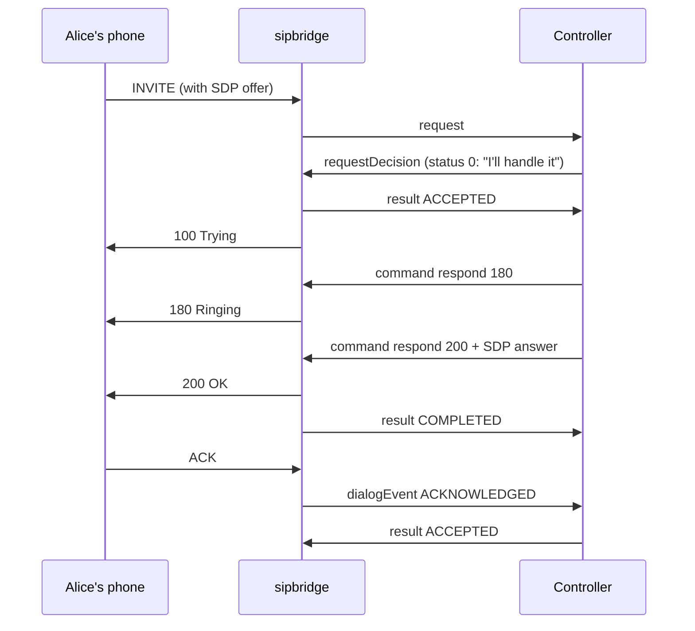

# A Call, Step by Step

This page follows one incoming call from a phone, then one outgoing call, and
shows every control message your controller exchanges with sipbridge on the
way. It assumes you have run [Getting Started](./getting-started.md) and know
what a controller is.

All values in the examples are made up. In your controller, copy the real
values from the messages you receive; in particular, compute `expiresAtMs` from
the current time when you send each command. Long values such as the context
reference are printed on one line; they are ordinary JSON objects.

## The cast

| Who | Role in this example |
| --- | --- |
| Alice's phone | Calls extension 1000 over TLS from `198.51.100.24`. |
| sipbridge | Instance `sipbridge-0`, memory state. Runs all of the SIP protocol. |
| Your controller | Instance `demo-controller`. Decides what happens and runs the call logic. |
| A media server | Owns the audio. sipbridge only carries the SDP your controller supplies. |

## Part 1: an incoming call



### 1. sipbridge offers the request

The phone's INVITE arrives. sipbridge parses it, records exactly which
connection it came in on, creates a **context** (its record of this call), and
sends your controller a `request`:

```json
{
  "correlationId": "8e4c2a6f-1b3d-4f5e-9a7c-0d2e4f6a8b1c",
  "sessionId": "0d4f7a52-93b1-4c8e-a6d2-7e15b9c3f841",
  "remainingBudgetMs": 1998,
  "request": {
    "snapshot": {"context":{"owner":{"instanceId":"sipbridge-0","epoch":"6b1f0c52-6a43-4d0e-9a51-2f8f7c1d9e30"},"id":"4be1f0c27d9a3e5b6c8d0f1a2b3c4d5e","state":{"authority":{"service":"sipbridge","generation":"default","primaryId":"a7c3e9f1-2b4d-4e6a-8c0f-1d3b5a7e9c21","schemaVersion":1},"groupId":"4be1f0c27d9a3e5b6c8d0f1a2b3c4d5e","incarnation":"e3b8a1d4-5c6f-4a2b-9d0e-7f1c3b5a8e92","callId":"a84b4c76e66710@phone.example.test"}},"kind":"UAS","callId":"a84b4c76e66710@phone.example.test","localTag":"5d2b8f0e4a7c1e3b9d6f2a8c0e4b7d1f","remoteTag":"1928301774","localUri":"sip:1000@example.test","remoteUri":"sip:alice@example.test","transport":"tls","executor":{"instanceId":"sipbridge-0","epoch":"6b1f0c52-6a43-4d0e-9a51-2f8f7c1d9e30"}},
    "requestId": "r-9c1e7a3f5b2d4e6a8c0f1b3d5e7a9c2e4f6a8b0d1c3e5f7a",
    "message": {"wire":"SU5WSVRFIHNpcDoxMDAwQGV4YW1wbGUudGVzdCBTSVAvMi4wDQpWaWE6IFNJUC8yLjAvVExTIDE5OC41MS4xMDAuMjQ6NDkxNTI7YnJhbmNoPXo5aEc0Yks3NzZhc2RoZHM7cnBvcnQNCk1heC1Gb3J3YXJkczogNzANCkZyb206IDxzaXA6YWxpY2VAZXhhbXBsZS50ZXN0Pjt0YWc9MTkyODMwMTc3NA0KVG86IDxzaXA6MTAwMEBleGFtcGxlLnRlc3Q+DQpDYWxsLUlEOiBhODRiNGM3NmU2NjcxMEBwaG9uZS5leGFtcGxlLnRlc3QNCkNTZXE6IDEgSU5WSVRFDQpDb250YWN0OiA8c2lwOmFsaWNlQDE5OC41MS4xMDAuMjQ6NDkxNTI7dHJhbnNwb3J0PXRscz4NCkNvbnRlbnQtVHlwZTogYXBwbGljYXRpb24vc2RwDQpDb250ZW50LUxlbmd0aDogMTIyDQoNCnY9MA0Kbz1waG9uZSAxIDEgSU4gSVA0IDE5OC41MS4xMDAuMjQNCnM9LQ0KYz1JTiBJUDQgMTk4LjUxLjEwMC4yNA0KdD0wIDANCm09YXVkaW8gNDAwMDAgUlRQL0FWUCAwDQphPXJ0cG1hcDowIFBDTVUvODAwMA0K","method":"INVITE","uri":"sip:1000@example.test","body":"dj0wDQpvPXBob25lIDEgMSBJTiBJUDQgMTk4LjUxLjEwMC4yNA0Kcz0tDQpjPUlOIElQNCAxOTguNTEuMTAwLjI0DQp0PTAgMA0KbT1hdWRpbyA0MDAwMCBSVFAvQVZQIDANCmE9cnRwbWFwOjAgUENNVS84MDAwDQo="},
    "flow": {"ingress":{"instanceId":"sipbridge-0","epoch":"6b1f0c52-6a43-4d0e-9a51-2f8f7c1d9e30"},"connectionId":"c2f6d1a8-0b7e-4f39-a5c4-8e2d6b1f9a37","sourceIp":"198.51.100.24","sourcePort":49152,"listener":"127.0.0.1:5061","transport":"tls"}
  }
}
```

What is in it:

- `snapshot.context` is the **context reference**. Store it and send it back,
  unchanged, with every later command for this call. You never need to build
  one yourself.
- `requestId` identifies this one SIP request. Your answer quotes it.
- `message.wire` is the original SIP message, base64-encoded. `message` also
  carries parsed conveniences such as `method`, `uri`, `headers` and `body`.
- `flow` is the connection the request arrived on, as sipbridge observed it.
  The source address here is a fact you can rely on, unlike a Via or Contact
  header, which the sender writes.

The request is offered **once**. sipbridge does not resend it, and you do not
acknowledge it separately. The only reply it expects is one `requestDecision`.

### 2. The controller decides

Your controller now does its own work: who is calling, are they allowed, what
should happen. Then it sends one decision. Here it accepts the call but does
not answer yet. `status: 0` means "I take responsibility for this request and
will respond later with commands":

```json
{
  "correlationId": "decision-1",
  "sessionId": "0d4f7a52-93b1-4c8e-a6d2-7e15b9c3f841",
  "remainingBudgetMs": 2000,
  "requestDecision": {
    "context": {"owner":{"instanceId":"sipbridge-0","epoch":"6b1f0c52-6a43-4d0e-9a51-2f8f7c1d9e30"},"id":"4be1f0c27d9a3e5b6c8d0f1a2b3c4d5e","state":{"authority":{"service":"sipbridge","generation":"default","primaryId":"a7c3e9f1-2b4d-4e6a-8c0f-1d3b5a7e9c21","schemaVersion":1},"groupId":"4be1f0c27d9a3e5b6c8d0f1a2b3c4d5e","incarnation":"e3b8a1d4-5c6f-4a2b-9d0e-7f1c3b5a8e92","callId":"a84b4c76e66710@phone.example.test"}},
    "requestId": "r-9c1e7a3f5b2d4e6a8c0f1b3d5e7a9c2e4f6a8b0d1c3e5f7a",
    "sequence": "1",
    "admission": {"directoryEpoch":"directory-42","expiresAtMs":"1795017602000"},
    "basis": "AUTHENTICATED_BINDING",
    "principalId": "alice",
    "bindingId": "alice-desk-phone"
  }
}
```

| Field | Meaning |
| --- | --- |
| `sequence` | The context's next command number: the snapshot's `commandSequence` plus one (it was absent, meaning `0`). Every command on this context increases it by one. |
| `admission.directoryEpoch` | A version label for your own account and routing data. If you change it, sipbridge refuses commands made under the old label. |
| `admission.expiresAtMs` | Absolute time, in Unix milliseconds, after which sipbridge must not act on this decision. |
| `basis` | Why this request is allowed: `AUTHENTICATED_BINDING` says you verified the account. See [the decision rules](../protocol/messages.md#deciding-a-request). |
| `principalId`, `bindingId` | Your names for the account and for this device registration. sipbridge stores them on the context but never interprets them. |

A decision can also answer at once. `status: 486` would reject the call as
busy, and `status: 200` with a body would answer immediately. REGISTER and
SUBSCRIBE always need a final status in the decision.

If no decision arrives within the request's deadline (about two seconds),
sipbridge answers the phone with `503` itself. A request is never queued
waiting for a controller.

### 3. sipbridge confirms

```json
{
  "correlationId": "decision-1",
  "sessionId": "0d4f7a52-93b1-4c8e-a6d2-7e15b9c3f841",
  "result": {
    "certainty": "ACCEPTED",
    "snapshot": {"context":{"owner":{"instanceId":"sipbridge-0","epoch":"6b1f0c52-6a43-4d0e-9a51-2f8f7c1d9e30"},"id":"4be1f0c27d9a3e5b6c8d0f1a2b3c4d5e","state":{"authority":{"service":"sipbridge","generation":"default","primaryId":"a7c3e9f1-2b4d-4e6a-8c0f-1d3b5a7e9c21","schemaVersion":1},"groupId":"4be1f0c27d9a3e5b6c8d0f1a2b3c4d5e","incarnation":"e3b8a1d4-5c6f-4a2b-9d0e-7f1c3b5a8e92","callId":"a84b4c76e66710@phone.example.test"}},"application":{"instanceId":"demo-controller","epoch":"3f9a1c0e7b2d4a6f8e1c5b7d9a2f4e60"},"kind":"UAS","callId":"a84b4c76e66710@phone.example.test","localTag":"5d2b8f0e4a7c1e3b9d6f2a8c0e4b7d1f","remoteTag":"1928301774","localUri":"sip:1000@example.test","remoteUri":"sip:alice@example.test","transport":"tls","executor":{"instanceId":"sipbridge-0","epoch":"6b1f0c52-6a43-4d0e-9a51-2f8f7c1d9e30"},"applicationLeaseTerm":"b5e2c8a1-7d3f-4e9b-a0c6-1f4d8b2e6a93","principalId":"alice","bindingId":"alice-desk-phone","revision":"2","commandSequence":"1"}
  }
}
```

`ACCEPTED` means sipbridge recorded your decision; from now on this call
belongs to your controller (`snapshot.application`). sipbridge sends the phone
`100 Trying` on its own.

### 4. Ring, then answer

Your controller asks the media server for an SDP answer, then sends two
commands. First `180 Ringing`:

```json
{
  "correlationId": "cmd-2",
  "sessionId": "0d4f7a52-93b1-4c8e-a6d2-7e15b9c3f841",
  "remainingBudgetMs": 2000,
  "command": {
    "context": {"owner":{"instanceId":"sipbridge-0","epoch":"6b1f0c52-6a43-4d0e-9a51-2f8f7c1d9e30"},"id":"4be1f0c27d9a3e5b6c8d0f1a2b3c4d5e","state":{"authority":{"service":"sipbridge","generation":"default","primaryId":"a7c3e9f1-2b4d-4e6a-8c0f-1d3b5a7e9c21","schemaVersion":1},"groupId":"4be1f0c27d9a3e5b6c8d0f1a2b3c4d5e","incarnation":"e3b8a1d4-5c6f-4a2b-9d0e-7f1c3b5a8e92","callId":"a84b4c76e66710@phone.example.test"}},
    "sequence": "2",
    "admission": {"directoryEpoch":"directory-42","expiresAtMs":"1795017604000"},
    "respond": {"requestId":"r-9c1e7a3f5b2d4e6a8c0f1b3d5e7a9c2e4f6a8b0d1c3e5f7a","status":180}
  }
}
```

Then `200 OK` with the SDP answer as a base64 body:

```json
{
  "correlationId": "cmd-3",
  "sessionId": "0d4f7a52-93b1-4c8e-a6d2-7e15b9c3f841",
  "remainingBudgetMs": 10000,
  "command": {
    "context": {"owner":{"instanceId":"sipbridge-0","epoch":"6b1f0c52-6a43-4d0e-9a51-2f8f7c1d9e30"},"id":"4be1f0c27d9a3e5b6c8d0f1a2b3c4d5e","state":{"authority":{"service":"sipbridge","generation":"default","primaryId":"a7c3e9f1-2b4d-4e6a-8c0f-1d3b5a7e9c21","schemaVersion":1},"groupId":"4be1f0c27d9a3e5b6c8d0f1a2b3c4d5e","incarnation":"e3b8a1d4-5c6f-4a2b-9d0e-7f1c3b5a8e92","callId":"a84b4c76e66710@phone.example.test"}},
    "sequence": "3",
    "admission": {"directoryEpoch":"directory-42","expiresAtMs":"1795017612000"},
    "respond": {"requestId":"r-9c1e7a3f5b2d4e6a8c0f1b3d5e7a9c2e4f6a8b0d1c3e5f7a","status":200,"headers":[{"name":"Content-Type","value":"application/sdp"}],"body":"dj0wDQpvPW1lZGlhIDEgMSBJTiBJUDQgMjAzLjAuMTEzLjEwDQpzPS0NCmM9SU4gSVA0IDIwMy4wLjExMy4xMA0KdD0wIDANCm09YXVkaW8gMzAwMDAgUlRQL0FWUCAwDQphPXJ0cG1hcDowIFBDTVUvODAwMA0K"}
  }
}
```

You supply only the status, your own headers and the body. sipbridge builds
the rest of the response: Via, To tag, Contact, CSeq and so on. Headers that
would override those are refused.

Each command gets its own `result`. For a response, sipbridge replies once the
message has actually been written to the phone's connection:

```json
{
  "correlationId": "cmd-3",
  "sessionId": "0d4f7a52-93b1-4c8e-a6d2-7e15b9c3f841",
  "result": {
    "certainty": "COMPLETED",
    "sipStatus": 200,
    "snapshot": {"context":{"owner":{"instanceId":"sipbridge-0","epoch":"6b1f0c52-6a43-4d0e-9a51-2f8f7c1d9e30"},"id":"4be1f0c27d9a3e5b6c8d0f1a2b3c4d5e","state":{"authority":{"service":"sipbridge","generation":"default","primaryId":"a7c3e9f1-2b4d-4e6a-8c0f-1d3b5a7e9c21","schemaVersion":1},"groupId":"4be1f0c27d9a3e5b6c8d0f1a2b3c4d5e","incarnation":"e3b8a1d4-5c6f-4a2b-9d0e-7f1c3b5a8e92","callId":"a84b4c76e66710@phone.example.test"}},"application":{"instanceId":"demo-controller","epoch":"3f9a1c0e7b2d4a6f8e1c5b7d9a2f4e60"},"kind":"UAS","callId":"a84b4c76e66710@phone.example.test","localTag":"5d2b8f0e4a7c1e3b9d6f2a8c0e4b7d1f","remoteTag":"1928301774","localUri":"sip:1000@example.test","remoteUri":"sip:alice@example.test","transport":"tls","executor":{"instanceId":"sipbridge-0","epoch":"6b1f0c52-6a43-4d0e-9a51-2f8f7c1d9e30"},"applicationLeaseTerm":"b5e2c8a1-7d3f-4e9b-a0c6-1f4d8b2e6a93","principalId":"alice","bindingId":"alice-desk-phone","answered":true,"localSdp":"dj0wDQpvPW1lZGlhIDEgMSBJTiBJUDQgMjAzLjAuMTEzLjEwDQpzPS0NCmM9SU4gSVA0IDIwMy4wLjExMy4xMA0KdD0wIDANCm09YXVkaW8gMzAwMDAgUlRQL0FWUCAwDQphPXJ0cG1hcDowIFBDTVUvODAwMA0K","remoteSdp":"dj0wDQpvPXBob25lIDEgMSBJTiBJUDQgMTk4LjUxLjEwMC4yNA0Kcz0tDQpjPUlOIElQNCAxOTguNTEuMTAwLjI0DQp0PTAgMA0KbT1hdWRpbyA0MDAwMCBSVFAvQVZQIDANCmE9cnRwbWFwOjAgUENNVS84MDAwDQo=","revision":"5","commandSequence":"3"}
  }
}
```

"Written" means the operating system accepted the bytes for the phone's
connection; it does not prove the phone read them. What matters next is the
phone's ACK.

### 5. The phone acknowledges

sipbridge retransmits the `200 OK` as SIP requires until the phone's `ACK`
arrives, without involving you. When it does, sipbridge tells you with a
`dialogEvent`:

```json
{
  "correlationId": "ev-7f3a",
  "sessionId": "0d4f7a52-93b1-4c8e-a6d2-7e15b9c3f841",
  "remainingBudgetMs": 2000,
  "dialogEvent": {
    "kind": "ACKNOWLEDGED",
    "snapshot": {"context":{"owner":{"instanceId":"sipbridge-0","epoch":"6b1f0c52-6a43-4d0e-9a51-2f8f7c1d9e30"},"id":"4be1f0c27d9a3e5b6c8d0f1a2b3c4d5e","state":{"authority":{"service":"sipbridge","generation":"default","primaryId":"a7c3e9f1-2b4d-4e6a-8c0f-1d3b5a7e9c21","schemaVersion":1},"groupId":"4be1f0c27d9a3e5b6c8d0f1a2b3c4d5e","incarnation":"e3b8a1d4-5c6f-4a2b-9d0e-7f1c3b5a8e92","callId":"a84b4c76e66710@phone.example.test"}},"application":{"instanceId":"demo-controller","epoch":"3f9a1c0e7b2d4a6f8e1c5b7d9a2f4e60"},"kind":"UAS","callId":"a84b4c76e66710@phone.example.test","localTag":"5d2b8f0e4a7c1e3b9d6f2a8c0e4b7d1f","remoteTag":"1928301774","localUri":"sip:1000@example.test","remoteUri":"sip:alice@example.test","transport":"tls","executor":{"instanceId":"sipbridge-0","epoch":"6b1f0c52-6a43-4d0e-9a51-2f8f7c1d9e30"},"applicationLeaseTerm":"b5e2c8a1-7d3f-4e9b-a0c6-1f4d8b2e6a93","principalId":"alice","bindingId":"alice-desk-phone","answered":true,"initialAck":true,"revision":"6","commandSequence":"3"}
  }
}
```

Reply with a `result` that repeats its `correlationId`. This only says
"received":

```json
{
  "correlationId": "ev-7f3a",
  "sessionId": "0d4f7a52-93b1-4c8e-a6d2-7e15b9c3f841",
  "result": {
    "certainty": "ACCEPTED"
  }
}
```

If sipbridge does not get that reply it sends the same event again, with the
same `correlationId`, backing off for a bounded time. Treat a repeated
`correlationId` as a duplicate.

The call is now up. Audio flows between the phone and your media server; it
never passes through sipbridge.

## Part 2: hanging up

**The phone hangs up.** sipbridge receives the `BYE`, answers it with `200 OK`
itself and sends you a `dialogEvent` with kind `ENDED`. You tear down your side
(media, billing records) and reply `ACCEPTED` to the event.

**Your controller hangs up.** Send a `dialogRequest` with method `BYE`, using
the next sequence:

```json
{
  "correlationId": "cmd-4",
  "sessionId": "0d4f7a52-93b1-4c8e-a6d2-7e15b9c3f841",
  "remainingBudgetMs": 40000,
  "command": {
    "context": {"owner":{"instanceId":"sipbridge-0","epoch":"6b1f0c52-6a43-4d0e-9a51-2f8f7c1d9e30"},"id":"4be1f0c27d9a3e5b6c8d0f1a2b3c4d5e","state":{"authority":{"service":"sipbridge","generation":"default","primaryId":"a7c3e9f1-2b4d-4e6a-8c0f-1d3b5a7e9c21","schemaVersion":1},"groupId":"4be1f0c27d9a3e5b6c8d0f1a2b3c4d5e","incarnation":"e3b8a1d4-5c6f-4a2b-9d0e-7f1c3b5a8e92","callId":"a84b4c76e66710@phone.example.test"}},
    "sequence": "4",
    "admission": {"directoryEpoch":"directory-42","expiresAtMs":"1795018200000"},
    "dialogRequest": {"method":"BYE"}
  }
}
```

A BYE result can arrive in two steps. `ACCEPTED` (with the request) comes as
soon as the BYE has been written; the phone's answer and the `ENDED` event
follow. If the phone never answers, SIP's own timeout ends the dialog anyway.
The 40-second budget is allowed because the controller negotiated
`sip.command-budget.v1`; SIP transactions can legitimately take up to 32
seconds.

### When a result says UNKNOWN

Suppose the network broke while that BYE was being written, and you receive:

```json
{
  "correlationId": "cmd-4",
  "sessionId": "0d4f7a52-93b1-4c8e-a6d2-7e15b9c3f841",
  "result": {
    "certainty": "UNKNOWN",
    "error": "physical write outcome unknown"
  }
}
```

The BYE may or may not have reached the phone. **Do not send the command
again**: a second BYE is a new request, and the phone may already have seen
the first. Instead read the current state with `inspect`, and decide from what
it says:

```json
{
  "correlationId": "inspect-1",
  "sessionId": "0d4f7a52-93b1-4c8e-a6d2-7e15b9c3f841",
  "remainingBudgetMs": 2000,
  "inspect": {
    "context": {"owner":{"instanceId":"sipbridge-0","epoch":"6b1f0c52-6a43-4d0e-9a51-2f8f7c1d9e30"},"id":"4be1f0c27d9a3e5b6c8d0f1a2b3c4d5e","state":{"authority":{"service":"sipbridge","generation":"default","primaryId":"a7c3e9f1-2b4d-4e6a-8c0f-1d3b5a7e9c21","schemaVersion":1},"groupId":"4be1f0c27d9a3e5b6c8d0f1a2b3c4d5e","incarnation":"e3b8a1d4-5c6f-4a2b-9d0e-7f1c3b5a8e92","callId":"a84b4c76e66710@phone.example.test"}}
  }
}
```

The same rule applies whenever a session drops while a command is in flight.
[Commands and Outcomes](../protocol/commands.md#handling-unknown) explains why.

## Part 3: an outgoing call

To place a call, pick a new context ID of your own (any unused reference
string that does not start with `in-`) and send `openUac` with sequence `1`.
The context reference contains only that ID, because the call does not exist
yet.

You must say where the call goes. A SIP URI alone is not enough: sipbridge
never dials an address just because a URI names it. There are two ways.

**To a carrier or another server**, name an explicit network target. Here the
call goes out over TLS and uses a stored credential if the carrier challenges
it:

```json
{
  "correlationId": "cmd-out-1",
  "sessionId": "0d4f7a52-93b1-4c8e-a6d2-7e15b9c3f841",
  "remainingBudgetMs": 40000,
  "command": {
    "context": {"id":"out-7d1e3f5a9b2c4d6e"},
    "sequence": "1",
    "admission": {"directoryEpoch":"directory-42","expiresAtMs":"1795017630000"},
    "openUac": {"uri":"sip:+15550100@carrier.example.test","method":"INVITE","headers":[{"name":"Content-Type","value":"application/sdp"}],"body":"dj0wDQpvPW1lZGlhIDEgMSBJTiBJUDQgMjAzLjAuMTEzLjEwDQpzPS0NCmM9SU4gSVA0IDIwMy4wLjExMy4xMA0KdD0wIDANCm09YXVkaW8gMzAwMDAgUlRQL0FWUCAwDQphPXJ0cG1hcDowIFBDTVUvODAwMA0K","network":{"transport":"tls","credential":{"id":"carrier-trunk-1","version":"3"}}}
  }
}
```

**To a registered phone**, send it down the connection the phone registered
on. Pass the `flow` you received with its REGISTER as
`admission.selectedFlow`, together with your account and binding names:

```json
{
  "correlationId": "cmd-out-2",
  "sessionId": "0d4f7a52-93b1-4c8e-a6d2-7e15b9c3f841",
  "remainingBudgetMs": 40000,
  "command": {
    "context": {"id":"out-2a4c6e8f0b1d3f5a"},
    "sequence": "1",
    "admission": {"directoryEpoch":"directory-42","expiresAtMs":"1795017630000","selectedFlow":{"ingress":{"instanceId":"sipbridge-0","epoch":"6b1f0c52-6a43-4d0e-9a51-2f8f7c1d9e30"},"connectionId":"c2f6d1a8-0b7e-4f39-a5c4-8e2d6b1f9a37","sourceIp":"198.51.100.24","sourcePort":49152,"listener":"127.0.0.1:5061","transport":"tls"}},
    "openUac": {"uri":"sip:alice@198.51.100.24:49152;transport=tls","method":"INVITE","principalId":"alice","bindingId":"alice-desk-phone","headers":[{"name":"Content-Type","value":"application/sdp"}],"body":"dj0wDQpvPW1lZGlhIDEgMSBJTiBJUDQgMjAzLjAuMTEzLjEwDQpzPS0NCmM9SU4gSVA0IDIwMy4wLjExMy4xMA0KdD0wIDANCm09YXVkaW8gMzAwMDAgUlRQL0FWUCAwDQphPXJ0cG1hcDowIFBDTVUvODAwMA0K"}
  }
}
```

The connection has to be the one sipbridge actually holds; if the phone's
connection has closed, the command is refused and the phone must register
again.

An INVITE is `ACCEPTED` as soon as sipbridge has committed it, long before
anyone answers. The result's snapshot contains the full context reference; use
it for every later command on this call:

```json
{
  "correlationId": "cmd-out-1",
  "sessionId": "0d4f7a52-93b1-4c8e-a6d2-7e15b9c3f841",
  "result": {
    "certainty": "ACCEPTED",
    "snapshot": {"context":{"owner":{"instanceId":"sipbridge-0","epoch":"6b1f0c52-6a43-4d0e-9a51-2f8f7c1d9e30"},"id":"out-7d1e3f5a9b2c4d6e","state":{"authority":{"service":"sipbridge","generation":"default","primaryId":"a7c3e9f1-2b4d-4e6a-8c0f-1d3b5a7e9c21","schemaVersion":1},"groupId":"out-7d1e3f5a9b2c4d6e","incarnation":"1c5e7a9b-3d2f-4b6e-8a0c-5f7d9b1e3a64","callId":"9f2d4b6e8a0c1e3f5a7b9d1c3e5f7a9b@sipbridge"}},"application":{"instanceId":"demo-controller","epoch":"3f9a1c0e7b2d4a6f8e1c5b7d9a2f4e60"},"kind":"UAC","callId":"9f2d4b6e8a0c1e3f5a7b9d1c3e5f7a9b@sipbridge","transport":"tls","executor":{"instanceId":"sipbridge-0","epoch":"6b1f0c52-6a43-4d0e-9a51-2f8f7c1d9e30"},"revision":"1","commandSequence":"1","applicationLeaseTerm":"b5e2c8a1-7d3f-4e9b-a0c6-1f4d8b2e6a93"}
  }
}
```

Progress then arrives as `dialogEvent` messages: `PROVISIONAL` for ringing,
`ANSWERED` when the far end picks up, or `FAILED`. sipbridge sends the ACK for
a `200 OK` itself. The exception: if your INVITE carried no SDP, the far end's
`200 OK` carries the offer and you must supply the answer. Send it as a
`dialogRequest` with method `ACK` and the SDP as its body; sipbridge does not
invent an answer for you.

### Supplying a password when challenged

If the carrier answers `401` or `407`, sipbridge asks you for the credential
named in `network.credential`:

```json
{
  "correlationId": "cred-5b9d",
  "sessionId": "0d4f7a52-93b1-4c8e-a6d2-7e15b9c3f841",
  "remainingBudgetMs": 2000,
  "credentialLookup": {
    "context": {"owner":{"instanceId":"sipbridge-0","epoch":"6b1f0c52-6a43-4d0e-9a51-2f8f7c1d9e30"},"id":"out-7d1e3f5a9b2c4d6e","state":{"authority":{"service":"sipbridge","generation":"default","primaryId":"a7c3e9f1-2b4d-4e6a-8c0f-1d3b5a7e9c21","schemaVersion":1},"groupId":"out-7d1e3f5a9b2c4d6e","incarnation":"1c5e7a9b-3d2f-4b6e-8a0c-5f7d9b1e3a64","callId":"9f2d4b6e8a0c1e3f5a7b9d1c3e5f7a9b@sipbridge"}},
    "credential": {"id":"carrier-trunk-1","version":"3"}
  }
}
```

Reply with the username and password, repeating the `correlationId`:

```json
{
  "correlationId": "cred-5b9d",
  "sessionId": "0d4f7a52-93b1-4c8e-a6d2-7e15b9c3f841",
  "credentialResult": {
    "username": "trunk-user",
    "password": "example-only-password",
    "version": "3"
  }
}
```

sipbridge computes the digest response for the retry and discards the
password. It never stores it, logs it or writes it into its state. Never put a
password in `openUac` itself.

## What happens if your controller goes away

A controller that disconnects **loses its calls**. sipbridge ends the calls the
controller owned, while still finishing the SIP work it already committed
(for example, ACKing a `200 OK` or sending a cleanup BYE). Reconnecting starts
a fresh session for new calls; it does not give back the old ones. Phone
registrations stay valid, because they are your data, and phone subscriptions
keep running until their own expiry. [Restarts and Disconnects](./lifecycle.md)
covers this in detail.

## Where to go next

- [Building a Controller](./application.md): the complete list of duties.
- [Message Families](../protocol/messages.md): every message type.
- [Commands and Outcomes](../protocol/commands.md): sequencing, budgets and
  result certainty.
