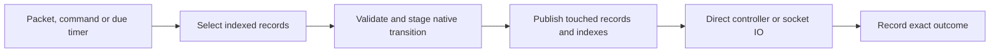

# Resident Memory core

This is locked architecture revision two for the replacement Memory runtime,
approved by Astra on 2026-11-13 before implementation. Native staging measurement
found the idle work removed, but the controller exchanges still miss the matched
CPU gate; revision two replaces those exchanges with the direct decision contract.
The checkpoint runtime follows [runtime](runtime.md) until its replacement is
qualified. Implementation review and the CPU gate remain separate requirements.

## One owner and one execution path

The Memory runtime owns typed transaction, dialog and subscription records for
its process lifetime. Indexes select records by context, native transaction key
and dialog identity. Ordinary operations do not encode/decode stored state,
reconstruct a Call-ID graph, or enter the generic CAS/effect pipeline.
The pinned sipgo `StepTransaction` and `StepDialog` functions own SIP decisions.
Reuse protocol helpers, transport, control codecs and fixtures; replace the
execution machinery rather than placing another cache behind `state.Backend`.

A short local lock protects each affected context. Stage changes to touched
records before publication. A rejected transition publishes no partial protocol,
index or output mutation. Command-sequence consumption and retained refusal results
follow the existing public command contract. Native reducers return candidate next
values. Release state locks before controller/socket IO or waiting for a result.
Only immutable instructions and boundary DTOs cross that gap. Revalidate the
original identity, revision and deadline when applying an asynchronous result.
Exact physical completion remains recordable after unrelated revision changes.

## What lives in memory

| Record | Retention |
| --- | --- |
| Transaction | Native phase, observed return flow, needed wire and original timers; remove after protocol/replay duties finish |
| Dialog/subscription | Identity, routes, sequences, controller/flow binding, offer/ACK or subscription state; remove on its terminal boundary |
| Pending output | Exact wire/flow, deadline, attempt identity and physical outcome; retain only while an obligation or uncertainty needs it |
| Command result | Small immutable result for active waiters and the supported bounded command replay window |
| Controller | One live process/session and lease entry; never renew every owned dialog |

Use actual byte/count accounting and explicit limits. Do not reserve a fictitious
64 MiB for every small record. Do not retain parsed requests or historical graphs
merely to answer later operations. Public snapshots are projections, not another
authoritative copy. Update indexes/counters for changed records only.
Admission reserves bounded capacity for the mandatory completion work it creates.
Accounting avoids blanket per-group reservations without allowing new work to
strand accepted obligations.

## Timers, IO and required behavior

One indexed local deadline heap and one wake timer execute native deadlines,
subscription expiry and actual retirement deadlines. Timer identity/generation
rejects stale notifications. Idle contexts do no periodic work. There is no
coordinator election, worker-presence renewal, distributed queue or index repair
in this runtime. Ordinary UDP retransmission state stays local.

Fresh application requests use the [direct decision contract](../PROTOCOL.md#direct-request-decision-memory-target):
one native notification, one controller decision and one native committed result.
Memory requires `sip.request-decision.v1`; it has no alternate routing/ingest/
presentation handshake. Native completion remains local. The native transaction
holds only the bounded pending request until its original deadline, using the same
indexed deadline heap. There is no presentation queue or controller acknowledgement
of the notification. A controller decision is the first application acceptance.

The controller supplies account policy and response/content once. Accepted SUBSCRIBE
stages the response and required NOTIFY content/transaction together before either
is emitted. The committed result permits controller publication; it never claims a
physical write. Initial INVITE and other asynchronous business handlers may admit
the request and use ordinary commands afterward. Existing post-OK, ACK, fork,
uncertainty, method, digest-challenge, transport, flow-publication and command-time
policy rules remain in force. The canonical schema and generated consumers change
together; the v1 major alone is not a compatibility receipt.

An output obligation changes from authorized to started before one socket attempt.
Completion records WRITTEN, proven NOT_WRITTEN, or UNKNOWN. UNKNOWN cannot authorize
another attempt. Reserve/Complete/InspectEffect wire operations map to these local
record operations. Successful INVITE finals, ACK/fork handling and ACK-before-BYE
remain native duties. Every accepted SUBSCRIBE still requires its NOTIFY. Direct
controller lifecycle delivery retains bounded deduplication and its original bound.

Resident outputs are internal instructions, not historical controller receipts.
Once the physical dispatcher has returned and dependent native settlement has
recorded a definite outcome, release that output and its deadline immediately.
The transaction/dialog retains any remaining SIP obligation, including required
NOTIFY and positive ACK-write evidence. Keep started/UNKNOWN outputs, unsuccessful
settlement and outputs whose dispatch completion has not been acknowledged;
the existing bounded terminal-proof cutoff covers an unacknowledged completion.
A forgotten output cannot be reserved again: report UNKNOWN without granting
permission to write or claiming that the original attempt did not write.
Independent command results and active waiters keep their documented lifetimes.

Retired transaction dispositions retain only the fields still needed for exact
request/flow matching, selectors, cutoff, accounting and outstanding-output
fencing. Release dead policy, application and credential references. Do not
clear values still read by an admitted notification after its state lock is
released.

Readiness and the existing bounded drain remain separate from liveness. Memory
restart loses its authority and requires fresh registration/setup. Do not advertise
controller checkpoint recovery. Initial setup can fail during a process outage.

## Locked delivery order and acceptance

1. Astra approves this architecture; lock it before implementation.
2. Implement this one Memory runtime and preserve the public behavior above.
3. Run protocol, controller and wire qualification; obtain Astra's implementation review.
4. Deploy one Memory registration worker in staging and compare identical successful
   REGISTER/SUBSCRIBE/NOTIFY traffic, transport, resources and history with Drachtio.
5. Only after the Memory CPU gate passes, implement Redis continuity.

The CPU gate is at most the larger of **1.25 times Drachtio CPU** or
**Drachtio CPU plus 2 millicores** under matched steady traffic. Repeat at 17 and
130 registrations; measure truly idle CPU separately. Require no protocol failures,
no periodic context scanning and no growth with retired history. Record allocations,
GC, retained bytes, latency and successful operations alongside CPU. The live
production Drachtio observation is context, not a controlled comparison.

The later Redis seam contains only compact continuity facts: dialog/subscription
identity, routes/sequences/owner, accepted-INVITE obligations, committed required
NOTIFY, pending physical outcomes and bounded replay evidence. Preserve these
before successful output creates obligations. Do not build the Redis adapter,
distributed scheduler, migration or generalized storage framework in this phase.
