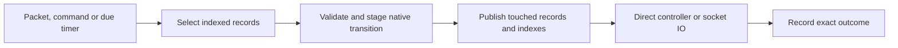
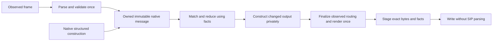
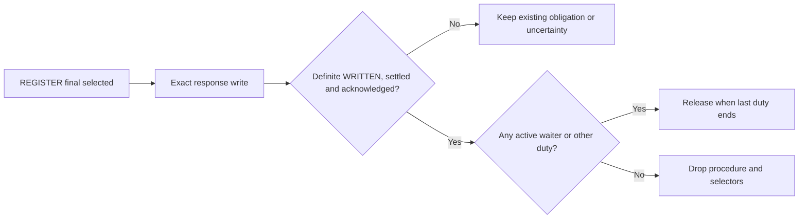

# Resident Memory core

The resident runtime is the default process-local SIP owner. Explicit Redis
selection reuses this same implementation for the local phone domain defined in
[Runtime](runtime.md#native-ownership-domains); calls retain their shared Redis
owner.

## One owner and one execution path

The Memory runtime owns typed transaction, dialog and subscription records for
its process lifetime. Indexes select records by context, native transaction key
and dialog identity. Ordinary operations do not encode/decode stored state,
reconstruct a Call-ID graph, or enter the generic CAS/effect pipeline.
The pinned sipgo `StepTransaction` and `StepDialog` functions own SIP decisions.
Protocol helpers, transport, control codecs and fixtures are shared; Memory
execution does not place another cache behind `state.Backend`. The selected
[Redis core](redis-core.md) uses the same native procedures for its separate
shared call domain. No context has both resident and Redis authoritative records.

A short local lock protects each affected context. Stage changes to touched
records before publication. A rejected transition publishes no partial protocol,
index or output mutation. Command-sequence consumption and retained refusal results
follow the existing public command contract. Native reducers return candidate next
values. Release state locks before controller/socket IO or waiting for a result.
Only immutable instructions and boundary DTOs cross that gap. Revalidate the
original identity, revision and deadline when applying an asynchronous result.
Exact physical completion remains recordable after unrelated revision changes.

Native duplicate and refusal arbitration use the exact server/client transaction
selector, never the subscription's dialog selector. A changed Via branch is a
new server transaction even when Call-ID, tags and CSeq match. A stale subscription
CSeq receives its normal rejection through the existing bounded native refusal
transaction on the observed return flow. This does not change the accepted
subscription's dialog, pending renewal, CSeq, expiry, processor or command result.
An exact already-admitted transaction still prevents a competing refusal final.

When a resident response establishes a subscription or SIP dialog, its accepted
public snapshot includes the exact dialog selector derived from the native
Call-ID and tags, once, alongside the retained transaction selectors. Stage this
projection on the candidate snapshot before capacity accounting and publish it
with the same native context and dialog index; no caller-side selector synthesis
or later publication repair is required. A refresh preserves that selector
without accumulating copies. This does not change exact-transaction duplicate
arbitration, selector retirement, the accepting process/epoch or pinned phone flow.

Generated NOTIFY branches include the authority, context incarnation and ID,
command sequence and operation ID. Reusing an operation ID for a later sequence
or another context cannot alias a still-live client transaction; an exact
command replay keeps its original identity.

## Parse once and retain only required message data

The same native reducers continue to decide SIP transaction and dialog behavior.
Change their message representation, not their protocol state machines. There
is one in-process message API and one transition implementation, not a second
cached FSM or parallel prepared/wire execution engines.

A received UDP datagram or TCP/TLS frame is parsed once. The ingress parser's
exact bytes and parsed value belong to the same observed frame. Native code
freezes an owned immutable message from that pair, retaining the validated
identity and the compact facts needed by matching, construction and projection.
Do not parse the same bytes again to prove a fact already established by that
boundary. Raw controller or stored messages pass through their own decode and
validation boundary once; caller-supplied metadata is not native proof.

The native dependency owns the opaque message and immutable facts. No caller
can mutate exported wire and leave cached identities describing different bytes.
Facts include the native method/status and request URI, Call-ID, directional
tags, CSeq, Via and observed transport, native transaction keys and any routes,
Contact or header/body material the procedure actually needs. Derive keys and
normalization with sipgo's existing rules. Preserve exact digest request-URI and
body semantics. Observed admission and portable identity validation keep their
existing distinct requirements and rejection behavior.

The frozen value must own its data: changing the read buffer, source parsed
headers, a later builder or another reducer candidate cannot change it. Do not
retain a mutable `sip.Request`/`sip.Response` graph or an entire large packet
indirectly through small metadata slices. Share immutable facts and byte evidence
where ownership permits, rather than deep-copying them at every transition.
Mutable SIP objects remain private construction/projection temporaries.

Native structured builders produce both their validated facts and final wire.
Response construction, ACK/CANCEL association and construction, digest retry,
in-dialog requests and required NOTIFY must not render a packet merely to parse
it again. Header changes such as response To-tags, retry Authorization/CSeq/Via
or observed Via received/rport create a new value; they never modify an admitted
origin. Keep the selected native response's exact conflict/replay identity
separate from an immutable physical emission derived for an admitted flow.
An approved replacement TLS flow can change Via received/rport without changing
that selected response or constituting a conflicting application final. These
are variants of the same message API, not separate transition engines. Render
once per distinct finalized value; reuse existing bytes when no change is needed.
Finalize physical return-flow routing before rendering and fingerprinting that
emission. The dispatcher writes those exact bytes and records their outcome;
it does not parse, patch or regenerate them.

Reducer validation checks phase, identity, sequence and obligation invariants
against the immutable facts. Matching and timer inputs reuse those facts. A
timer does not parse an old request to classify it or construct its response.
Keep full response/fork/ACK/CANCEL and transport-sensitive matching checks;
prepared facts are not permission to reduce validation to a branch lookup.

| Message use | Required retained data |
| --- | --- |
| Admitted procedure | Immutable identity, construction/matching facts and the exact bytes still needed by its protocol or public evidence contract |
| Quiet dialog/subscription | Compact dialog/subscription facts; no whole parsed packet graph as its source of truth |
| UDP retry or successful INVITE awaiting ACK | The exact selected output and existing original deadlines/identity |
| Required NOTIFY or uncertain physical output | Its exact message/flow and completion evidence until the existing obligation ends |
| Original command waiter or lifecycle event | Its own immutable historical outcome/message evidence until acknowledgement or the existing cutoff |
| Retired disposition | Existing minimal selector/hash/flow/cutoff evidence; no message data without a remaining obligation |

Replacing the current local INVITE does not replace an earlier accepted client transaction's Timer M. If its exact dialog ACK was positively written and M remains active, transfer immutable references to that successful final, ACK and written flow to the actual old transaction in the same locked publication. Reuse the existing per-identity ACK budget counter. Keep no former dialog or command payload. The shared native replay check requires the SDK's replay classification and exact final/ACK identity; output uses the saved flow through the unchanged M cutoff and does not change the new dialog, SDP, command result or lifecycle. Native non-2xx ACK replay remains transaction-owned. Release the optional tuple when M has actually closed and its admitted ACK output proofs are gone, through the existing timer and proof-release hooks. It adds no timer, history map or background sweep.

Public control DTOs are projections of the frozen message, built only at their
actual delivery/observation boundary. Original result evidence must not take a
wire-to-rich-DTO-to-wire detour or reparse its wire on every lookup. Keep the
exact original receipt pointer and original outcome/bytes while snapshots retain
their documented current-projection meaning. Snapshot/event copies that freeze
mutable state across IO remain necessary; immutable message sharing does not
justify borrowing a mutable live snapshot.

The consolidated dependency changes only through its reviewed export workflow;
the checked-in pinned snapshot is never patched in place. All native producers,
reducers, matchers, builders, writers, public projections and storage
conversions use the same message API. The checkpoint fixture adapter encodes
its existing byte representation and validates decoded SIP bytes at most once
when that message is consumed within an operation. Preserve lazy
selected-field validation: decoding a group or reserving a selected write must
not eagerly parse unrelated stored origins, responses or cached results. Map
the opaque native message explicitly into the existing storage shape;
reflection must not silently omit private fields. Preserve field numbers,
descriptor identity, exact bytes, nil/empty/presence and direct-reader/protobuf
oracle parity. In-process pointers and caches are not serialized, and no
resident authoritative cache is added to checkpoint execution.

Stored physical effects that fail the existing SIP observation checks remain
opaque for classification and completion. Do not add a weaker parser fallback
to recover method, status or identity from malformed historical packets. This
does not relax uncertainty or authorize another write. Valid effects reuse
their immutable message within the operation, including freshly staged native
outputs and lifecycle events. No compatibility migration or cleanup is required.

Control framing follows the canonical
[JSON protocol](../PROTOCOL.md#json-websocket-framing). The strict JSON profile
remains the sole control wire format. Parsing changes alone never
authorize early UNKNOWN release or loss of an original waiter's result.

## Completed reliable REGISTER lifetime

A completed TCP/TLS REGISTER is a procedure, not a live registration record.
The controller owns registration policy, binding identity and registration
expiry. Native registration-procedure retention ends when the selected final
response is definitively WRITTEN, dependent native settlement and dispatcher
acknowledgement are complete, and no original/replay waiter, pending/UNKNOWN
output, lifecycle event or protocol obligation remains. Release its context,
transaction selectors, request hash, command receipt and deadline together.
Do not schedule a two-minute retirement timer for that completed procedure.

Original command waiters retain their detached historical result and snapshot;
retiring a context cannot replace that result with a later ended projection.
UNKNOWN and unacknowledged work retain their existing fences and bounds.
Existing context identities are never reused, so a command for the removed
procedure cannot address a new one.
An old decision/command retry against an absent context returns UNKNOWN without
a snapshot. Inspection may prove current context absence; that proof never
claims the old decision was unaccepted or the SIP response was NOT_WRITTEN.
This conservative absence rule requires no retained historical marker.

An identical later TCP/TLS REGISTER may become fresh controller work after this
retirement. There is no native historical duplicate-suppression promise for the
removed procedure. A controller must treat that fresh request according to its
registration policy. UDP retransmission and response replay retain their
existing process-local timers and bytes. Established calls, successful INVITE
finals/ACK, SUBSCRIBE state and required NOTIFY completion are unchanged.

## What lives in memory

A request waiting for a controller decision reserves room for either outcome.
It counts toward the inbound limit and the limit for refusals after controller
admission. The per-source limit uses the address sipbridge sees on the network.
Outgoing work and refusals generated before controller admission each have
their own limit. The latter includes a `503` sent when admission is full.

A refusal keeps its transaction state and the evidence of whether its
response was written until the SIP timers and write tracking have settled.
If the refusal has no other work left, sipbridge can free the context and
keep a small record to recognize retries through the original replay deadline.

| Record | Retention |
| --- | --- |
| Transaction | Native phase, observed return flow, needed wire and original timers; remove after protocol/replay duties finish |
| Dialog/subscription | Identity, routes, sequences, controller/flow binding, offer/ACK or subscription state; remove on its terminal boundary |
| Pending output | Exact wire/flow, deadline, attempt identity and physical outcome; retain only while an obligation or uncertainty needs it |
| Command result | Small immutable result for active waiters and the supported bounded command replay window |
| Controller | One live process/session capability; standalone Memory owns its lease, composed phone state references the existing control-session capability |

Use actual byte/count accounting and explicit limits. Do not reserve a fictitious
64 MiB for every small record. Do not retain parsed requests or historical graphs
merely to answer later operations. Public snapshots are projections, not another
authoritative copy. Update indexes/counters for changed records only.
Admission reserves bounded capacity for the mandatory completion work it creates.
Accounting avoids blanket per-group reservations without allowing new work to
strand accepted obligations.

## Timers, IO and required behavior

One indexed local deadline heap and one wake timer execute native deadlines,
subscription expiry and actual retirement deadlines. Timer identity/generation
rejects stale notifications. Idle contexts do no periodic work. There is no
coordinator election, worker-presence renewal, distributed queue or index repair
in this runtime. Ordinary UDP retransmission state stays local.

Fresh application requests use the [direct decision contract](../PROTOCOL.md#direct-request-decision):
one native notification, one controller decision and one native committed result.
Memory requires `sip.request-decision.v1`; it has no alternate routing/ingest/
presentation handshake. Native completion remains local. The native transaction
holds only the bounded pending request until its original deadline, using the same
indexed deadline heap. There is no presentation queue or controller acknowledgement
of the notification. A controller decision is the first application acceptance.
For an unbound direct INVITE, Trying may select and retain the automatic 100,
but cannot emit it before the decision. A deferred acceptance emits that held
response once; an immediate final replaces it, and decision timeout selects
the normal 503.

The controller supplies account policy and response/content once. Accepted SUBSCRIBE
stages the response and required NOTIFY content/transaction together before either
is emitted. The committed result permits controller publication; it never claims a
physical write. Initial INVITE and other asynchronous business handlers may admit
the request and use ordinary commands afterward. Existing post-OK, ACK, fork,
uncertainty, method, digest-challenge, transport, flow-publication and command-time
policy rules remain in force. The canonical schema and generated consumers change
together; the v1 major alone is not a compatibility receipt.

An output obligation changes from authorized to started before one socket attempt.
Completion records WRITTEN, proven NOT_WRITTEN, or UNKNOWN. UNKNOWN cannot authorize
another attempt. Reserve/Complete/InspectEffect wire operations map to these local
record operations. Successful INVITE finals, ACK/fork handling and ACK-before-BYE
remain native duties. Every accepted SUBSCRIBE still requires its NOTIFY. Direct
controller lifecycle delivery retains bounded deduplication and its original bound.

Resident outputs are internal instructions, not historical controller receipts.
Once the physical dispatcher has returned and dependent native settlement has
recorded a definite outcome, release that output and its deadline immediately.
The transaction/dialog retains any remaining SIP obligation, including required
NOTIFY and positive ACK-write evidence. Keep started/UNKNOWN outputs, unsuccessful
settlement and outputs whose dispatch completion has not been acknowledged;
the existing bounded terminal-proof cutoff covers an unacknowledged completion.
A forgotten output cannot be reserved again: report UNKNOWN without granting
permission to write or claiming that the original attempt did not write.
Independent command results and active waiters keep their documented lifetimes.

Retired transaction dispositions retain only the fields still needed for exact
request/flow matching, selectors, cutoff, accounting and outstanding-output
fencing. Release dead policy, application and credential references. Do not
clear values still read by an admitted notification after its state lock is
released.

Readiness and the existing bounded drain remain separate from liveness. Memory
restart loses its authority and requires fresh registration/setup. Do not advertise
controller checkpoint recovery. An established control-session disconnect expires
its exact application term and ends that term's calls through the existing owner
index. A later hello admits fresh work under a fresh term and does not restore
calls. Native phone flow replacement remains independent, as defined in
[control disconnect](redis-core.md#control-disconnect). Initial setup can fail
during a process outage.

A TCP/TLS subscription is pinned to the accepting worker and exact phone flow.
Closing that flow or reaching its own subscription expiry ends it; Contact remains
the SIP target, and REGISTER does not move it. A bounded local flow-to-subscription
index handles closure without visiting other contexts. Register the index before
rechecking physical liveness so a close during admission cannot leave an active
subscription. Closure fences new work independently of best-effort ENDED delivery;
active transaction/output duties retain their own bounds. UDP keeps its own expiry
and local listener lifetime, since there is no remote connection-close signal.

After the prior application capability releases ownership, a fresh live
processor may admit a new NOTIFY on the exact retained phone flow.
The command's existing next-sequence and current policy checks still apply;
admission binds the new term and owner index with its consumed command sequence.
It cannot revive an ended subscription, change its flow, or replay an old command.
Before the old owner releases, an exact next-sequence NOTIFY receives an
unpersisted NOT_ACCEPTED without consuming a sequence or attempting output. This
does not fence a later independent notification after release.
An exact admitted SUBSCRIBE renewal may likewise select its current processor
term even when its process identity matches the predecessor. Calls keep strict
original-term ownership.

## Shared session capability for the local phone domain

Standalone Memory retains its existing term-minting lease authority. In the
composed runtime it does not acquire, renew or populate a second lease map.
The authenticated control session owns one capability for its actual shared
application term. Resident contexts hold a reference to that same capability,
not copied term liveness. A successful existing lease request records its
conservative monotonic bound using request start plus the validated returned
remaining lifetime; response completion time cannot extend that bound.

Publication has one lock order: selected context, session capability, resident
index/accounting lock. Index selection releases the index lock before taking a
context lock. The capability guard validates exact application/term, session and
original bound, then performs only bounded local publication. It covers initial
context and owner-index insertion, accepted decision/required-NOTIFY publication,
processor adoption/command admission and application-output reservation. No Redis,
controller or socket I/O, result wait or release callback runs under that guard.
Each APP output retains its originating capability pointer until reservation or
definite completion; adoption never substitutes the successor's capability for
an older output, even when application and shared term match. Native response/
completion duties do not reacquire application admission authority.

Disconnect, a definitive local fence or conservative capability expiry invalidates
under that same capability lock. Release notification runs after unlocking and
uses the existing exact-term resident owner index and filters each context by
the actual capability pointer before removing membership. A delayed old-session
release cannot remove a successor using the same application/term. It must not miss a context
published immediately before invalidation. The session's existing heartbeat
scheduler also observes natural expiry, while every publication guard rejects
immediately at the bound. No per-subscription renewal, liveness polling, new
owner registry or recovery queue is introduced. Once released, that capability
cannot be renewed locally, even if a delayed Redis reply would otherwise be valid.

The released owner index marks subscriptions available for a new processor,
without ending their pinned phone lifetime. Inspect may expose the current
subscription snapshot to a new live processor only after release and while the
original process/socket and own expiry remain healthy. A new NOTIFY binds that
processor's actual capability and application identity in the same guarded
publication as its next command sequence. Old callbacks, wrong accounts/policy,
foreign local references and ended or closed-flow subscriptions cannot adopt.
Existing waiter results and physical W/N/U obligations retain their own bounds.

## Relationship to Redis

Fixture results alone do not establish production acceptance. Qualify protocol,
controller and wire behavior for the actual combined build. Idle contexts do no
periodic work, and retained resources must not grow with retired history.

The binary Redis storage contract is owned by [Redis core](redis-core.md).
JSON remains confined to the application control connection. This resident phone
domain does not mirror its native records into Redis or restore them after restart.

## Peer re-INVITE ACK observations

The accepted native ACK transition stages a message-bearing `ACKNOWLEDGED` with
an `inviteCseq` correlation value (which may be zero) only for a live controller
negotiating `sip.reinvite-ack.v1`. Message presence distinguishes it from an
initial ACK. Retain its immutable native
message and frozen post-transition snapshot in the existing charged lifecycle
budget through acknowledgement or the original two-minute cutoff. A subsequent
INVITE cannot replace that event's answer. Duplicate ACKs incur no additional
delivery debt. Updating remote SDP for `LocalOfferInACK` is part of the same
locked, accounted publication; initial ACK events remain snapshot-only.

Delivery rechecks the original term and negotiated capability; a mismatch
releases the event without retry. Late-offer SDP updates apply to all controllers.
An early-offer ACK body is delivered unchanged without replacing remote SDP.
