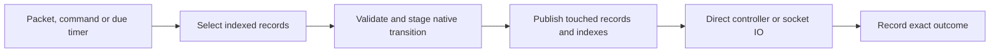
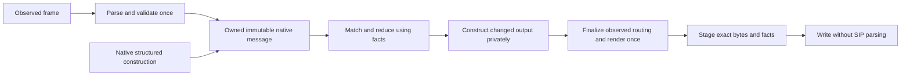

# Resident Memory core

This is locked architecture revision three for the replacement Memory runtime,
approved by independent Sol review on 2026-11-13 before implementation.
Revision two's direct decision contract is implemented; its matched 130-phone
SIP-process CPU gate remains unmet. Revision three removes repeated SIP parsing
and wire reconstruction through one immutable native message representation.
This is the implementation target; it is not a statement that the serving
revision already implements the representation below.
The checkpoint runtime follows [runtime](runtime.md) until its replacement is
qualified. Implementation review and the CPU gate remain separate requirements.

## One owner and one execution path

The Memory runtime owns typed transaction, dialog and subscription records for
its process lifetime. Indexes select records by context, native transaction key
and dialog identity. Ordinary operations do not encode/decode stored state,
reconstruct a Call-ID graph, or enter the generic CAS/effect pipeline.
The pinned sipgo `StepTransaction` and `StepDialog` functions own SIP decisions.
Reuse protocol helpers, transport, control codecs and fixtures; replace the
execution machinery rather than placing another cache behind `state.Backend`.

A short local lock protects each affected context. Stage changes to touched
records before publication. A rejected transition publishes no partial protocol,
index or output mutation. Command-sequence consumption and retained refusal results
follow the existing public command contract. Native reducers return candidate next
values. Release state locks before controller/socket IO or waiting for a result.
Only immutable instructions and boundary DTOs cross that gap. Revalidate the
original identity, revision and deadline when applying an asynchronous result.
Exact physical completion remains recordable after unrelated revision changes.

## Parse once and retain only required message data

The same native reducers continue to decide SIP transaction and dialog behavior.
Change their message representation, not their protocol state machines. There
is one in-process message API and one transition implementation, not a second
cached FSM or parallel prepared/wire execution engines.

A received UDP datagram or TCP/TLS frame is parsed once. The ingress parser's
exact bytes and parsed value belong to the same observed frame. Native code
freezes an owned immutable message from that pair, retaining the validated
identity and the compact facts needed by matching, construction and projection.
Do not parse the same bytes again to prove a fact already established by that
boundary. Raw controller or stored messages pass through their own decode and
validation boundary once; caller-supplied metadata is not native proof.

The native dependency owns the opaque message and immutable facts. No caller
can mutate exported wire and leave cached identities describing different bytes.
Facts include the native method/status and request URI, Call-ID, directional
tags, CSeq, Via and observed transport, native transaction keys and any routes,
Contact or header/body material the procedure actually needs. Derive keys and
normalization with sipgo's existing rules. Preserve exact digest request-URI and
body semantics. Observed admission and portable identity validation keep their
existing distinct requirements and rejection behavior.

The frozen value must own its data: changing the read buffer, source parsed
headers, a later builder or another reducer candidate cannot change it. Do not
retain a mutable `sip.Request`/`sip.Response` graph or an entire large packet
indirectly through small metadata slices. Share immutable facts and byte evidence
where ownership permits, rather than deep-copying them at every transition.
Mutable SIP objects remain private construction/projection temporaries.

Native structured builders produce both their validated facts and final wire.
Response construction, ACK/CANCEL association and construction, digest retry,
in-dialog requests and required NOTIFY must not render a packet merely to parse
it again. Header changes such as response To-tags, retry Authorization/CSeq/Via
or observed Via received/rport create a new value; they never modify an admitted
origin. Keep the selected native response's exact conflict/replay identity
separate from an immutable physical emission derived for an admitted flow.
An approved replacement TLS flow can change Via received/rport without changing
that selected response or constituting a conflicting application final. These
are variants of the same message API, not separate transition engines. Render
once per distinct finalized value; reuse existing bytes when no change is needed.
Finalize physical return-flow routing before rendering and fingerprinting that
emission. The dispatcher writes those exact bytes and records their outcome;
it does not parse, patch or regenerate them.

Reducer validation checks phase, identity, sequence and obligation invariants
against the immutable facts. Matching and timer inputs reuse those facts. A
timer does not parse an old request to classify it or construct its response.
Keep full response/fork/ACK/CANCEL and transport-sensitive matching checks;
prepared facts are not permission to reduce validation to a branch lookup.

| Message use | Required retained data |
| --- | --- |
| Admitted procedure | Immutable identity, construction/matching facts and the exact bytes still needed by its protocol or public evidence contract |
| Quiet dialog/subscription | Compact dialog/subscription facts; no whole parsed packet graph as its source of truth |
| UDP retry or successful INVITE awaiting ACK | The exact selected output and existing original deadlines/identity |
| Required NOTIFY or uncertain physical output | Its exact message/flow and completion evidence until the existing obligation ends |
| Original command waiter or lifecycle event | Its own immutable historical outcome/message evidence until acknowledgement or the existing cutoff |
| Retired disposition | Existing minimal selector/hash/flow/cutoff evidence; no message data without a remaining obligation |

Public control DTOs are projections of the frozen message, built only at their
actual delivery/observation boundary. Original result evidence must not take a
wire-to-rich-DTO-to-wire detour or reparse its wire on every lookup. Keep the
exact original receipt pointer and original outcome/bytes while snapshots retain
their documented current-projection meaning. Snapshot/event copies that freeze
mutable state across IO remain necessary; immutable message sharing does not
justify borrowing a mutable live snapshot.

This revision changes the consolidated dependency through its reviewed export
workflow; the checked-in pinned snapshot is never patched in place. Update all
native producers, reducers, matchers, builders, writers, public projections and
storage conversions to the same message API. The existing checkpoint adapter
continues to encode its current byte representation and validates decoded SIP
bytes at most once when that message is consumed within an operation. Preserve
lazy selected-field validation: decoding a group or reserving a selected write
must not eagerly parse unrelated stored origins, responses or cached results.
Map the opaque native message explicitly into the existing storage shape;
reflection must not silently omit private fields. Preserve field numbers,
descriptor identity, exact bytes, nil/empty/presence and direct-reader/protobuf
oracle parity. In-process pointers and caches are not serialized;
this does not implement the later Redis adapter or add a resident
authoritative cache to checkpoint execution.

Stored physical effects that fail the existing SIP observation checks remain
opaque for classification and completion. Do not add a weaker parser fallback
to recover method, status or identity from malformed historical packets. This
does not relax uncertainty or authorize another write. Valid effects reuse
their immutable message within the operation, including freshly staged native
outputs and lifecycle events. No compatibility migration or cleanup is required.

The public JSON profile, schema, controller handshake and SIP replay/retirement
contract stay unchanged in this revision. Its strict JSON validator cannot be
deleted on the assumption that ProtoJSON enforces the same null, enum, alias,
base64, duplicate-key and nesting rules. Reliable REGISTER history is a separate
lifetime decision; parsing changes alone do not authorize duplicate business
mutation, early UNKNOWN release or loss of an original waiter's result.

## What lives in memory

| Record | Retention |
| --- | --- |
| Transaction | Native phase, observed return flow, needed wire and original timers; remove after protocol/replay duties finish |
| Dialog/subscription | Identity, routes, sequences, controller/flow binding, offer/ACK or subscription state; remove on its terminal boundary |
| Pending output | Exact wire/flow, deadline, attempt identity and physical outcome; retain only while an obligation or uncertainty needs it |
| Command result | Small immutable result for active waiters and the supported bounded command replay window |
| Controller | One live process/session and lease entry; never renew every owned dialog |

Use actual byte/count accounting and explicit limits. Do not reserve a fictitious
64 MiB for every small record. Do not retain parsed requests or historical graphs
merely to answer later operations. Public snapshots are projections, not another
authoritative copy. Update indexes/counters for changed records only.
Admission reserves bounded capacity for the mandatory completion work it creates.
Accounting avoids blanket per-group reservations without allowing new work to
strand accepted obligations.

## Timers, IO and required behavior

One indexed local deadline heap and one wake timer execute native deadlines,
subscription expiry and actual retirement deadlines. Timer identity/generation
rejects stale notifications. Idle contexts do no periodic work. There is no
coordinator election, worker-presence renewal, distributed queue or index repair
in this runtime. Ordinary UDP retransmission state stays local.

Fresh application requests use the [direct decision contract](../PROTOCOL.md#direct-request-decision-memory-target):
one native notification, one controller decision and one native committed result.
Memory requires `sip.request-decision.v1`; it has no alternate routing/ingest/
presentation handshake. Native completion remains local. The native transaction
holds only the bounded pending request until its original deadline, using the same
indexed deadline heap. There is no presentation queue or controller acknowledgement
of the notification. A controller decision is the first application acceptance.

The controller supplies account policy and response/content once. Accepted SUBSCRIBE
stages the response and required NOTIFY content/transaction together before either
is emitted. The committed result permits controller publication; it never claims a
physical write. Initial INVITE and other asynchronous business handlers may admit
the request and use ordinary commands afterward. Existing post-OK, ACK, fork,
uncertainty, method, digest-challenge, transport, flow-publication and command-time
policy rules remain in force. The canonical schema and generated consumers change
together; the v1 major alone is not a compatibility receipt.

An output obligation changes from authorized to started before one socket attempt.
Completion records WRITTEN, proven NOT_WRITTEN, or UNKNOWN. UNKNOWN cannot authorize
another attempt. Reserve/Complete/InspectEffect wire operations map to these local
record operations. Successful INVITE finals, ACK/fork handling and ACK-before-BYE
remain native duties. Every accepted SUBSCRIBE still requires its NOTIFY. Direct
controller lifecycle delivery retains bounded deduplication and its original bound.

Resident outputs are internal instructions, not historical controller receipts.
Once the physical dispatcher has returned and dependent native settlement has
recorded a definite outcome, release that output and its deadline immediately.
The transaction/dialog retains any remaining SIP obligation, including required
NOTIFY and positive ACK-write evidence. Keep started/UNKNOWN outputs, unsuccessful
settlement and outputs whose dispatch completion has not been acknowledged;
the existing bounded terminal-proof cutoff covers an unacknowledged completion.
A forgotten output cannot be reserved again: report UNKNOWN without granting
permission to write or claiming that the original attempt did not write.
Independent command results and active waiters keep their documented lifetimes.

Retired transaction dispositions retain only the fields still needed for exact
request/flow matching, selectors, cutoff, accounting and outstanding-output
fencing. Release dead policy, application and credential references. Do not
clear values still read by an admitted notification after its state lock is
released.

Readiness and the existing bounded drain remain separate from liveness. Memory
restart loses its authority and requires fresh registration/setup. Do not advertise
controller checkpoint recovery. Initial setup can fail during a process outage.

## Locked delivery order and acceptance

1. Astra approves this architecture; lock it before implementation.
2. Implement this one Memory runtime and preserve the public behavior above.
3. Run protocol, controller and wire qualification; obtain Astra's implementation review.
4. Deploy one Memory registration worker in staging and compare identical successful
   REGISTER/SUBSCRIBE/NOTIFY traffic, transport, resources and history with Drachtio.
5. Only after the Memory CPU gate passes, implement Redis continuity.

The CPU gate is at most the larger of **1.25 times Drachtio CPU** or
**Drachtio CPU plus 2 millicores** under matched steady traffic. Compare the SIP
processes alone: sipbridge against Drachtio, excluding application controllers
and sidecars. Controllers handle application updates; routine OPTIONS and native SIP
transaction maintenance remain inside the SIP process. Repeat at 17 and 130
registrations; measure truly idle CPU separately. Require no protocol failures,
no periodic context scanning and no growth with retired history. Record allocations,
GC, retained bytes, latency and successful operations alongside CPU. The live
production Drachtio observation is context, not a controlled comparison.

The later Redis seam contains only compact continuity facts: dialog/subscription
identity, routes/sequences/owner, accepted-INVITE obligations, committed required
NOTIFY, pending physical outcomes and bounded replay evidence. Preserve these
before successful output creates obligations. Do not build the Redis adapter,
distributed scheduler, migration or generalized storage framework in this phase.
