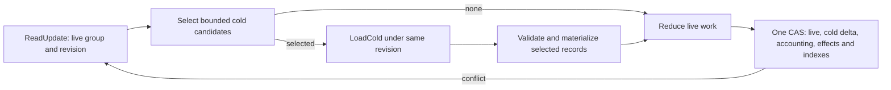

# Completed server evidence: layout experiment

Status: proposed design and isolated test-only prototype, not service behavior. The
runtime continues to retain and validate the whole group. The prototype is not a
persisted format and does not establish that every selected record is eligible for
compaction.

The experiment builds real settled subscription refresh/NOTIFY histories through
native admission and physical completion. It moves reliable terminated non-INVITE
server transactions with a retained final and positive final-written proof into
separate test-only protobuf messages. These messages retain all adapter fields,
exact request and final, timer profile, disposition proofs, flow, owner, policy,
deadlines, selected response and physical proof. Only native version, family,
phase and reliability constants implied by the experimental record kind are omitted.
This conservative superset is not a proven minimum: a safe production eligibility
check must additionally exclude pending/deferred responses, callbacks, digest work,
active timers, unsettled and uncertain effects, REFER and all other continuations.
The test aggregates existing per-transaction remaining emission count, wire-procedure
count and request-proof headroom. These are only components of completion capacity,
not a complete reservation calculation.

On an Apple M1 Max, `go test ./internal/engine -run '^$' -bench
'^BenchmarkCompletedServerLayoutPrototype$' -benchtime=100x -count=1` produced:

| Settled server histories | Full group bytes | Live bytes | Cold bytes | Full decode allocations | Live decode allocations | Live plus one cold decode allocations |
| --- | ---: | ---: | ---: | ---: | ---: | ---: |
| 1 | 4,532 | 2,895 | 1,528 | 143 | 93 | 139 |
| 5 | 12,840 | 4,261 | 8,046 | 397 | 134 | 180 |
| 16 | 35,762 | 7,737 | 26,313 | 1,113 | 227 | 284 |

These are encoded group/message sizes and local decoder allocations, excluding cold
field keys, aggregate/index bytes, outer payload, Redis allocator, CAS, full
subscription-cycle work, codec validation differences and selected-record
rehydration. They do not measure Redis or live heap, and cannot establish an
end-to-end benefit. The full group includes map framing that the separate cold
messages omit. The real store still fetches and rewrites the whole blob, so this
experiment does not claim a cold-fetch saving for the current implementation.

## Proposed authority boundary

Keep one group incarnation and revision. The live record contains current native
work, existing selectors and a bounded directory mapping request identity to cold
record key, immutable charged byte/count/emission/proof summaries and the original
retirement bound. Each cold record retains one exact original request and final,
transaction key and transport, full admitted-flow/disposition proofs, response
selection and settled physical proof, original operation/replay deadlines, emission
counters, owner/policy and request identity needed by delayed commands. The precise
removable fields and native reconstruction must be proven against every reader;
no new SIP matcher may replace the pinned reducer's identity checks. Hydration
for a selected record must restore a valid portable transaction and validate both
wires and all cross-field invariants before it can authorize output.

`ReadUpdate` returns the live record and store-owned inventory under one
incarnation/revision. After engine selection, `LoadCold` obtains the bounded
candidates only if that same observation still holds. A selector collision or
stale selection must fail closed; a CAS conflict restarts selection. `CompareAndSwap` must atomically change the
live value, selected cold field and directory, exact encoded-size totals, aggregate
future completion reserve, receipts, lease guards, scheduler and dispatch indexes.
The memory backend needs the same snapshot and atomic semantics as Redis. Group
retirement must prove the directory and cold fields empty under the same revision.
Unselected malformed cold bytes may remain isolated until selected, but a malformed
directory or aggregate must fail the whole operation; a selected malformed record
must fail closed. This would explicitly change today's whole-group corruption rule.

The aggregate must include all existing `completionBudget` contributions: remaining
emission classes and their worst-case physical/authorization envelopes, wire and
proof headroom, policy inheritance, transaction/context limits, timers and exact
stored bytes. Addition, mutation and deletion must update the aggregate in the same
CAS, check overflow and preserve the original deadline. Expiry alone never proves
physical settlement. Owner loss, delayed Respond/Complete, admitted/refused flow
arbitration, selected final replay, old/new flow and retirement all need explicit
selected readers. Effects with pending, dispatching, unknown or otherwise unsettled
physical work stay hot. No resident authoritative cache or historical sweeper is
introduced.

The existing `Backend.ReadUpdate`/`CompareAndSwap` and Redis scripts expose only a
whole `Payload.ProtocolState`. Lazily hydrating inside that blob can avoid some Go
objects but still transfers, validates and re-encodes the whole blob; it is a separate
prototype, not a substitute for atomic cold fields. The new descriptor and storage
contract require a coordinated fresh namespace cutover with matching workers, no
mixed writers, legacy decoder or automatic migration. No deployment is authorized
by this proposal. Before implementation, benchmark actual Redis `MEMORY USAGE`,
whole subscription cycles, live heap and selected/unselected corruption, and test
all replay, delayed command, owner, capacity, conflict and retirement boundaries.

## Recommended implementation contract

Choose separately addressable cold fields, with a compact directory in the live
group and one group revision. The prototype shows that removing constants alone
saves little; avoiding materialization of unrelated transactions is the useful
change to test next. Begin with a revision-guarded supplemental read only when a
request or command selects cold evidence. This permits the existing Go selector and
pinned native matcher to remain authoritative, avoids embedding SIP parsing in Lua,
and costs an extra read only on the cold path. A later measured optimization can
supply known selector hints to the initial read without changing this authority
contract. This proposal does not assume separate-field fetch already exists.

[The selected-read flow](#selected-read-flow) preserves the current single CAS.

### Selected-read flow

### Values and storage

The private group frame retains active contexts and transactions. Add a bounded
`ColdDirectory` keyed by non-reused `(context ID, transaction key)` and a separate
bounded lookup from existing request/transaction selectors and request IDs to
candidate directory keys. It must retain all candidates needed to reproduce the
current deterministic selection and ambiguity behavior; no hash or selector is
proof. Each entry contains the field ID, context and request identity needed for
selection, selector projections, original `RetireMS` and `DispositionUntilMS`,
exact cold-frame length, and immutable reserve contribution. Its original expiry
is `max(RetireMS, DispositionUntilMS)`; an admitted new flow can change the
latter only under the current disposition-floor rules. Keep the request-fence
classification ahead of any pruning, including when an input selects an expired
entry. Derive field IDs from non-reused context/transaction identity with a
collision-free encoding and bounded length. Do not use raw SIP wire or user text
as a Redis key.

A private, strictly validated, versioned `CompletedServerEvidence` frame holds a
single exact portable request and final response, transport, native key and response
tag, timer profile, admitted-flow proofs and disposition floor, transaction and
request IDs, original flow and selected-response flow, response status/hash,
command/deadline data, physical-written proof and remaining emission counters.
Retain owner, admission, application, policy and completion-scope data whenever an
existing reader needs them. Any fields elided from `stateTransaction` must be proven
constant or unused for this eligible class; otherwise retain them. The prototype
keeps a conservative superset, rather than claiming that the list alone is a
proven minimum. Admission into this representation requires a terminated reliable
non-INVITE server final, positive settled final-written evidence, no active timer,
no pending/deferred response, callback, digest, live retry, unacknowledged effect,
physical uncertainty or other remaining continuation. Exclude REFER, INVITE,
ACK and fork behavior. Conversion is a normal reducer transition after these facts
are established, never a background scan. At selected load, verify the frame kind,
size, directory identity, immutable contribution, exact wire and native matching,
flow proof shape and all bounds; reconstruct the missing constants and call the
pinned portable validation before giving existing consumers a transaction.

In Redis use the existing partition-tagged group hash: retain `data` for the outer
payload/live frame and put each evidence frame in a distinct field under a reserved
binary-safe prefix. Add one store-owned manifest field containing a bounded,
canonical map of field ID to encoded length and its checked byte total. This is the
authoritative inventory of physically stored cold fields. The SIP-owned directory
inside `ProtocolState` owns selection and semantic summaries; it references those
same IDs and lengths, but does not duplicate the store manifest's framing or total.
Neither inventory membership nor a selector is authority to send. Hash fields not
in the manifest never confer authority. Account actual field names, values and
manifest bytes consistently against group byte limits as well as measuring Redis
allocator cost. The memory adapter keeps owned field byte slices in its existing group object,
with snapshots copied under its mutex. Neither implementation has an authoritative
process-local cache outside the selected backend. A deleted group removes its entire
hash and all fields atomically; missing listed fields are corruption, not absence.

### Adapter interface and operation sequence

Extend the existing backend-owned opaque `state.Update` token with the observed
manifest and add a transient `ColdSelection` containing ordered field IDs and
owned frame bytes. `ReadUpdate` atomically returns the manifest with the opaque live
record; before selecting anything, the engine validates its decoded directory's
complete ID/length set against that manifest. A mismatch fails the operation. Add
`LoadCold(ctx, update, keys) (ColdSelection, error)` to `state.Backend`. The engine
selects only keys in its validated directory; the adapter independently accepts only
keys in the token's store manifest, with bounded candidate count and total bytes
within the group limits. `Update` remains bound to the original input,
incarnation, revision, comparison counter, authority and Redis transport observation.
No cold reference can be attached to another update. The adapter returns immutable
copies; the reducer validates each selected frame. A missing field, duplicate key,
invalid directory/selection, or invalid selected frame fails closed.

`execution.CASRuntime` currently calls a synchronous pure `Reducer` after
`ReadUpdate`. Extend that boundary with a pure selection phase that receives the
validated live snapshot and original input and returns only candidate keys, followed
by `LoadCold` in the execution driver and a pure reduction over the live snapshot
plus owned selected frames. Do not perform I/O inside `StateEngine.reduce` or
return partially reduced state for resumption. Selection and materialization happen
before request-fence pruning, and the driver repeats the entire read/selection on
its existing stale/conflict loop. The current process-local striped gate and bounded
worker admission remain as they are; no additional distributed coordination is
introduced. A read-only decision still requires any selected evidence it relies on
to have passed the same validation, and cannot publish physical work.

The memory implementation locks once, checks exact group incarnation and revision,
copies the requested fields, then unlocks. The Redis implementation uses one script
in the same hash slot to check authority/profile, incarnation, revision and counter
and `HMGET` those fields without mutation. It preserves the original deadline and
clock/primary checks; observed stale state returns the existing conflict/stale class
and the existing CAS driver restarts from `ReadUpdate`. A timeout is a read failure,
not missing evidence. It does not allocate a receipt, change timers, lease, revision,
or extend any bound. A selected load may batch every candidate required for
ambiguity and admitted/refusal arbitration; impose the existing group/context bounds,
not a new smaller quota. Unknown or conflicting candidates cannot be silently
ignored. If selection cannot be bounded under existing limits, this API is not yet
ready to implement.

Add an operation-local `ColdDelta` to the CAS input: bounded additions, replacements
and deletions keyed by directory identity and containing exact encoded frame bytes.
It is never persisted in `Payload` as an operation journal. The reducer changes the
live directory and its aggregate alongside this delta. Before commit, the engine
validates that the new directory ID/length set equals the manifest resulting from
applying that delta and that its semantic aggregate agrees with its entries. The
adapter independently derives the new manifest from its observed manifest and delta,
validates bounded IDs, expected old lengths and checked exact totals, and binds the
result to the token. It does not decode SIP-owned directory contents. The Redis CAS
script compares the stored manifest's exact bytes with the token's observed manifest
and checks the existing revision/counter before applying the prevalidated new
manifest and fields; the memory adapter makes the equivalent comparison under its
mutex. Missing expected fields fail closed. This is a trusted-engine boundary: the
store cannot itself verify that opaque `ProtocolState` contains the claimed directory;
the engine must perform that check on every read and before each CAS. Identifying
and testing every path that writes `ProtocolState`, including fixtures and retirement,
is a prerequisite; until then this remains a proposed contract, not a proven one. `CompareAndSwap` checks
all existing input, receipt, owner lease, deadline, capacity and revision guards,
then atomically applies `data`, cold fields, receipts, schedule/dispatch projections
and revision. Redis does this in the existing CAS script and memory under its one
mutex; neither can publish an intermediate state. A failed or uncertain CAS retains
today's semantics. The token binds original read and any loaded cold selection;
removal or replacement of a field not selected and validated is allowed only for
an independently proven expiry under the rule below. A fresh insertion needs no
prior cold read. No separate lock, independent cold revision, alternate retry loop,
or process-authoritative cache is introduced.

### Reducer readers and accounting

Use a reduction-local loader that collects candidate keys from the directory before
any consumer can interpret an absent transaction as absence. It issues one bounded
`LoadCold`, verifies and materializes the selected evidence into an operation-local
transaction map, then runs the existing native matching and reduction code. The
operation-local hydrated map is discarded after CAS or conflict. Ordinary live-only
operations neither decode nor copy cold wire. The selected request or command can
produce a changed cold record, or materialize back into hot state only when the same
CAS also removes the old cold field and preserves every obligation. A selected
record must never authorize output merely because its directory entry matches.

Audit and convert these consumer classes together:

| Consumer | Required cold handling |
| --- | --- |
| Ingress selection, `state_engine_selectors.go`, native completion and relay | Select all bounded candidates; preserve exact matching, ambiguity, flow and replay behavior. Directory selector summaries preserve current selector indexes without parsing unrelated wires. |
| `state_engine_request_fence.go`, refusal and ingestion | Load matching admitted and refused candidates before pruning or deciding absence; validate exact wire and flow proof, preserve saturated proof behavior and original replay bound. |
| Respond commands and request-ID lookup | Resolve retained request IDs through the directory and load the exact record before applying owner, policy, sequence, deadline and selected-final rules. |
| Physical reserve, completion, effect result and response retry | Eligible records have no outstanding effects at conversion; a new replay moves its exact physical obligation into the hot effect list in the same CAS. Its completion selects the originating evidence and transfers positive proof before effect reclamation. Unknown remains hot and charged. |
| Owner expiry, subscription and context lifecycle | Preserve any transaction facts used for owner cleanup, current subscription pending request, delivery and retirement. If those facts cannot be summarized without changing behavior, the transaction remains hot. |
| Timer projection, transaction pruning and context/group retirement | Use bounded immutable directory summaries for eligible entries, honoring request fences first. Delete associated request and selector entries, cold field and capacity contribution in the same CAS. A nonempty directory prevents retirement unless its entries are simultaneously proven expired and removed. |
| Result/receipt, diagnostics and offline inspection | Preserve exact public result and retained settlement semantics; report bounded counts without granting execution or reconstructing omitted bytes. Reads that require an individual transaction must explicitly select and validate it. |

Each entry's immutable contribution is produced by the same checked accounting
functions as the full transaction, including remaining provisional/final emission
classes, wire-procedure count, proof headroom, policy-dependent reserve and all
other effect, timer, byte, transaction and per-context slot contributions actually
used by `completionBudget`. The live aggregate is the checked sum of entries; do
not assume all fields are additive until cross-context and future-dialog terms have
been separated and proven. On insertion, replacement or removal, subtract the old
contribution and add the new with overflow checks; charge actual cold bytes and
conservative future capacity before committing. Replay updates emission counts and
proof floors in the selected record and its contribution atomically. Test aggregate
results against the existing full traversal for mixed histories, admissions,
conflicts and every boundary, including maximum 64-KiB wires. If exact decomposition
is not possible, retain the affected entry hot until it is.

For reclamation, use the already existing group/context retirement scheduling and
normal reductions, with at most one group-level earliest cold expiry hint if needed
to make otherwise idle groups retire. Do not schedule per-transaction or per-dialog
polling. A timer firing only causes bounded normal pruning; it does not prove
settlement. The directory's frozen eligibility and expiry can authorize deletion
without loading cold bytes only after the input's opposite-disposition fence has
been selected and protected and all existing transaction-retirement predicates
hold. If a predicate depends on cold contents, load and validate that entry instead.
A new validated admitted flow can raise its disposition floor exactly as today, and
an old replay cannot extend the original native replay deadline.

### Release and validation gate

This is a new private descriptor and authority contract, not a rolling optional
field. Build both adapters and generated codecs together, change the full private
source/descriptor receipt, and start matching workers in a fresh coordinated
namespace after the old authority is drained or explicitly abandoned. Do not mix
old/new readers or writers, copy old records, add a compatibility decoder, or deploy
as part of this work. Retire the old namespace only through the separately authorized
operational process. The old and new authorities cannot reconstruct each other's
state.

Before promotion, require parity tests for exact duplicates and conflicts, delayed
Respond/Complete, old/new TLS flows, expiry, bounded aggregate capacity and bytes,
ambiguous/stale selectors, concurrent live updates and cold replay, selected and
unselected corruption, owner loss, physical UNKNOWN and positive retirement proof.
Exercise memory and real Redis, lost CAS acknowledgements and atomic field/index
changes. Measure complete subscription cycles, actual Redis allocator bytes, Go
live objects/bytes, parser and codec counts for the same history sizes, including
selected replay; the present synthetic decode results are a design signal only.
