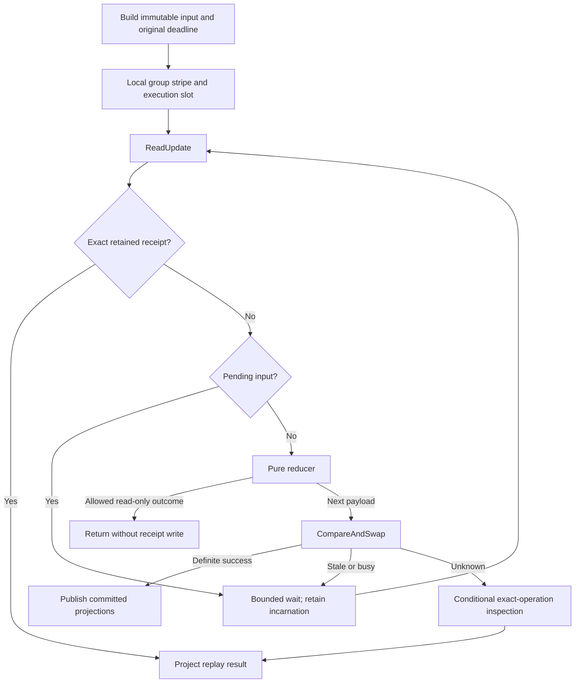
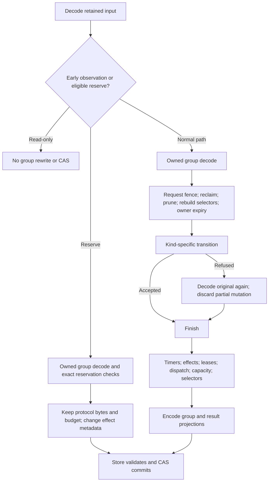
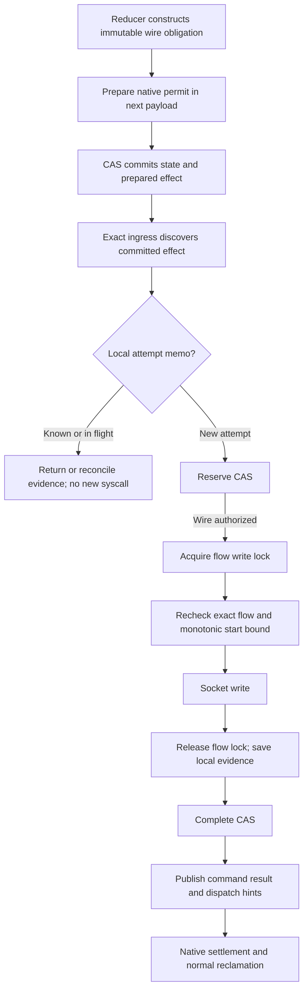
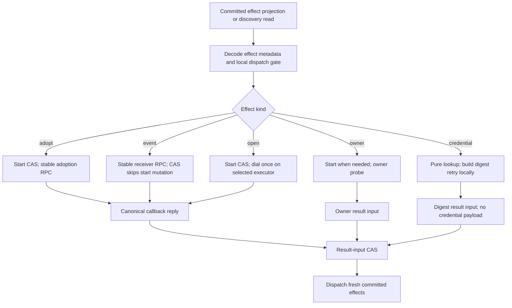
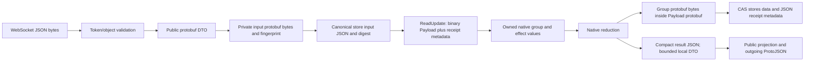
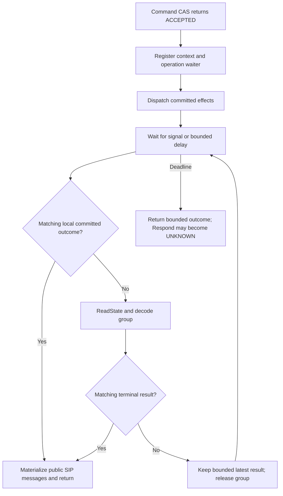

# Execution, storage and physical effects

This chapter maps implemented execution, including direct one-shot request
presentation. Its traversal baseline is source revision
`f8cbce847d29e53d686e1add6e0a2ba12ac816c2`, updated with the source in this checkout.
It describes the service's schema 1 / reducer 1 / timers 1 CAS path, with either the Memory or Redis adapter. It does
not treat the historical claimed fixture driver as a second service mode.

[Architecture](../../ARCHITECTURE.md) owns component boundaries;
[Runtime](../runtime.md) owns exact admission, proof, retention and failure
invariants; [Protocol](../../PROTOCOL.md) owns public RPC framing and semantics.
The [operation index](index.md), [SIP flows](sip.md) and
[lifecycle flows](lifecycle.md) connect this shared machinery to individual
operations. This chapter records current work, not a proposed redesign.

## Units of work and the common CAS graph

A public request, a reducer input, a committed effect, a store call and a Redis
command are different units. One request can generate several reducer inputs,
external callbacks and inspections. A single Redis Lua invocation executes many
commands internally without a network round trip for each command.

The graph's UNKNOWN inspection edge is conditional: external inputs and commands
can inspect the exact operation; internal proof inputs do not automatically replay
an uncertain computation. If inspection cannot establish a receipt, uncertainty
is returned. No committed dispatch projection is synthesized from a replay,
read-only result or uncertain inspection.

[CASRuntime](../../internal/execution/cas.go) holds a local one-token group stripe
through the read/reduce/CAS loop, then releases it. There are 1,024 stripes, so
unrelated groups can collide locally. An execution semaphore bounds concurrent
computations (64 slots in the service constructor). Neither gate serializes other
processes: Redis revision,
incarnation, comparison counter, transport observation and lease guards decide
cross-process admission. A CAS conflict or busy read waits 5 ms and rereads under
the original deadline; retained pending work is never resumed or stolen. An observed
incarnation cannot become a fresh creator after deletion.
A queued input whose semantic deadline expired may perform a bounded receipt-only
lookup under the remaining caller lifetime.

The reducer can request external controller preflight. `applyCommitted` drops the
observation, runs preflight, and retries the same input with a fresh `ReadUpdate`.
The preflight itself uses `ReadState` and may reconcile controller authority. No
protocol aggregate survives across that external I/O. See
[applyCommitted](../../internal/engine/state_engine.go) and
[preflight](../../internal/engine/state_engine_preflight.go).

## Entry points and every reducer input

Control hello, heartbeat and status processing establish/renew session and owner
state before ordinary control RPCs reach the engine. Reply envelopes are matched
to pending `Peer.Call` correlation IDs. They are not all new business inputs.

| Entry or public RPC category | Execution path | Source |
| --- | --- | --- |
| Physical SIP ingress and retained completion | Framing/observation; optional `TryNativeCompletion`; otherwise route lookup and controller ingress admission | [ingress](../../internal/engine/ingress.go), [native ingress](../../internal/engine/state_engine_native_ingress.go) |
| `Ingest` | Attachment validation, input construction, CAS, then dispatch committed effects | [engine handle](../../internal/engine/state_engine.go) |
| `Command`: Respond, OpenUac, DialogRequest, Cancel | Same CAS core; accepted Respond/DialogRequest/non-INVITE OpenUac can wait for operation completion | [engine handle](../../internal/engine/state_engine.go), [command reduction](../../internal/engine/state_engine_reduce.go) |
| OpenUac with a placeholder context | Bootstrap `locate` CAS, `ReadState` to obtain its incarnation, then the command CAS | [bootstrap and handle](../../internal/engine/state_engine.go) |
| `Inspect` | `Load` and native group decode; project current result/snapshot or retirement evidence; no reducer input | [context inspection](../../internal/engine/state_engine_bootstrap.go) |
| `ControllerContexts` | Optional recoverable-controller inventory, owner/attachment checks and bounded context listing; separate response type | [controller recovery](../../internal/engine/controller_recovery.go) |
| `Write` | Physical ingress writer calls Reserve, performs at most one admitted socket attempt, and records Complete | [startup routing](../../cmd/sipbridge/main.go), [writer](../../internal/engine/state_writer.go) |
| `InspectEffect` | Inspect local physical memo; possibly record known completion or read retained write evidence; never reserve a fresh attempt | [writer inspection](../../internal/engine/state_writer.go) |
| Hello / hello acknowledgement, ping / pong, status | Session validation, current-session fencing, pending calls and application lease callbacks; no generic SIP reducer input | [control server](../../internal/control/server.go), [application leases](../../internal/control/application_lease.go) |

The complete current `stateEngineInput.Kind` switch is below. All these kinds use
the common execution graph unless an explicit early observation returns read-only.

| Kind | Producer and work performed | Distinct branch or follow-up |
| --- | --- | --- |
| `locate` | Route/bootstrap admission | Existing selectors or one bounded new admission reservation; not a socket permit |
| `ingest` | Controller-admitted SIP message | Native transaction/dialog matching and transition; can emit presentation, response, event or physical effects |
| `native-ingest` | Proven retained completion relay | Revalidate exact retained completion before ingest; never create a context |
| `reject` | Native refusal arbitration | Prove/select a scoped private response or reuse retained disposition |
| `command` | Public command | Sequence/owner/policy checks and action; exact replay projects retained result |
| `reserve` | Exact physical ingress | Select immutable write attempt; eligible metadata path described below |
| `complete` | Physical ingress evidence | Record WRITTEN / NOT_WRITTEN / UNKNOWN, update causal proofs and command outcome |
| `owner-control` | Controller preflight result | Apply validated controller/attachment observation |
| `owner-result` | Application probe callback | Apply probe result and any required owner transition |
| `owner-check` | Owner expiry coordinator | Apply required expiry transition; healthy unchanged owner is read-only |
| `digest-result` | Credential lookup plus local digest builder | Validate constructed retry against retained challenge; never persist the clear credential reply |
| `effect-start` | Nonphysical dispatcher | Commit executor/start selection where required; unavailable/non-startable effect can be read-only |
| `effect-result` | Nonphysical callback or settlement | Apply matching receiver result; an absent effect can be read-only |
| `presentation-failed` | One-shot request presentation failed or expired | Select a native refusal only if that exact admitted request is still unanswered; never replay the controller call |
| `timer` | Scheduling driver | Validate exact timer identity/generation and due time; absent/not-due timer can be read-only |

Sources: [switch and shared preparation](../../internal/engine/state_engine_reduce.go),
[effect handlers](../../internal/engine/state_engine_effects.go),
[owner state](../../internal/engine/state_engine_native_owner.go),
[credential path](../../internal/engine/state_engine_auth.go).
The supported public command variants and individual SIP operations are expanded
in [SIP flows](sip.md); owner/session/timer drivers are in [lifecycle flows](lifecycle.md).

## Full reduction and the reserve exception

Normal preparation and finish both traverse retained state. Preparation reclaims
settled effects, prunes eligible transactions and rebuilds selectors before the
selected operation. Finish projects native timers, reclaims/compacts effects,
prepares native write permits, appends lifecycle work, projects leases/dispatch,
recomputes completion capacity, rebuilds selectors and encodes the group. A failed
handler reloads the immutable original group before constructing its refusal;
capacity refusal can also rebuild from the original. These are conditional extra
passes, not extra Redis reads. See [reduce and finish](../../internal/engine/state_engine_reduce.go).

[Reserve metadata execution](../../internal/engine/state_engine_reserve_metadata.go)
still decodes the whole native group. It avoids normal finish, selector rebuilding,
capacity recomputation and protocol re-encoding when all eligibility checks pass:
no due retained timer/pending input, current unsealed matching owner observations,
and an exact authorized native physical effect for this worker. It uses the same
reservation authority checks as the normal handler. The original protocol bytes,
indexes and conservative completion reservation are retained; changed effects and
new commit guards are still fully validated/accounted by the store. A failed
attempt discards its private decode and falls back to normal reduction.

The operation-local [wire projection memo](../../internal/engine/state_engine_selectors.go)
shares validated scalar identities and selectors with capacity calculations. It is
bounded by 256 entries / 1 MiB of exact wire keys and holds no parsed SIP graph.
It is discarded with the reduction and cleared on rollback. The pinned native
reducers still own SIP transitions; this memo is neither a protocol cache nor an
alternative authority.

## Physical emission and settlement

[Preparation](../../internal/engine/state_engine_native_completion.go) verifies the
immutable authorization/fingerprint and produces the native permit. There is no
per-send controller grant RPC for this service path. The native
[dispatcher](../../internal/engine/state_engine_native_dispatch.go) invokes the
local writer only on the exact physical ingress; another worker leaves discovery
to that ingress's indexed queue.

[Reserve](../../internal/engine/state_engine.go) uses a fresh internal operation
identity for CAS, so an old computation receipt cannot return permission to repeat
a syscall. Reserve returns owned wire or a known outcome. The
[writer](../../internal/engine/state_writer.go) installs a bounded local attempt
memo, performs Redis work outside the per-flow write lock, and takes that lock
only for final flow/deadline checks and socket use. A full socket write produces
WRITTEN, proven no start NOT_WRITTEN, and partial/unknown evidence UNKNOWN.
The lock is released before recording completion in the store.

Complete has its own read/reduce/CAS and does not reload the group afterward merely
to notify a local command waiter. Native preparation marks known terminal physical
evidence settled; normal reclamation transfers compact transaction/ACK/final proof
before removing the effect. Depending on ordering, this occurs in a later natural
reduction. Physical inspection/reconciliation is separate from permission to send.
The local memo can reconcile a lost store acknowledgement, but its absence is not
proof that a write never happened. See [runtime physical writes](../runtime.md).

## Nonphysical effects and callback inputs

Incoming request presentation is a direct controller exchange rather than a
retained effect. Only a definite fresh commit returns its bounded presentation
DTO. The request path calls the controller after releasing state gates, under
the original deadline. There is no presentation queue, scheduler replay,
cross-worker fallback or successful-acknowledgement CAS. Replayed and uncertain
commit results cannot recreate it. Deferred flow adoption/owner proof returns the
same transient output from its completing transition. Process failure in this
exchange may fail the in-flight request; retained dialog state and physical
obligations have independent lifetimes.

| Effect category | Fresh service-path start and external work | Result and retained state |
| --- | --- | --- |
| Request presentation | One direct RPC from a transient definite-commit DTO, never discovered from retained state | No success result CAS, retained presentation or recovery queue |
| `event` | CAS skips `effect-start`; controller deduplicates stable receiver identity. Envelope projection is materialized at the send boundary | `effect-result` commits receiver outcome. Event recovery is bounded from the original effect deadline |
| `adopt` | Fresh `effect-start` selects executor before the stable-identity controller publication RPC | `effect-result` validates the receipt before publishing accepted delivery and any pending response |
| `credential` | CAS skips start selection because lookup/digest construction is repeatable; raw credentials remain transient | `digest-result` carries constructed SIP message or failure and validates against the retained challenge |
| `open` | Fresh `effect-start` selects executor before local network dial; recovering an already-started open does not dial again | `effect-result` carries flow/failure, then native procedure may emit its request |
| `owner` | Probe/observation path with its original authority and recovery behavior | Owner-specific result input; does not grant socket authority |
| `deliver` with native body | Local Reserve/write/Complete graph above | No receiver RPC or extra `effect-start` for physical emission |
| `wire` or non-native `deliver` retained by historical fixtures | Dispatcher contains compatibility branches, but autonomous service dispatch rejects them | Not an additional live service grant/relay mode |

Sources: [dispatchEffectWithin](../../internal/engine/state_engine.go),
[credential construction](../../internal/engine/state_engine_auth.go),
[owner callbacks](../../internal/engine/state_engine_owner.go),
[startless receiver kinds](../../internal/engine/state_engine_receiver.go).
`acquireDispatch` suppresses concurrent local transport work by effect ID. It is
not cross-worker execution fencing. Receiver idempotency and committed identities
remain necessary in healthy multi-worker operation.

A fresh definite commit supplies copied finite effect projections directly to
dispatch. Replay/uncertain paths lack that projection and can fall back to a
`ReadState` discovery read. Callback dispatch stops when the matching effect is
unchanged or has no continuation; a successful receipt alone does not imply that
another external call should be made. Bounded metrics attribute receiver RPC attempts,
responses/errors and result commit projections to fresh-commit, index or continuation
discovery. Native physical candidates count whether the retained dispatch worker is local,
remote or unknown (including wildcard targets); these are candidate observations, not writes. A successful result without a fresh commit projection may be a
replay or a read-only result; the counters do not distinguish them or track identities.

## Bytes, validation and ownership at each boundary

| Boundary | Current allocation/validation work | Ownership/lifetime and source |
| --- | --- | --- |
| Incoming control frame | Strict JSON token/object tree, duplicate/type/oneof validation, then ProtoJSON decode into public DTO | One received envelope; [control JSON](../../internal/control/json.go) |
| Outgoing control frame | ProtoJSON encode, size check and typed producer validation. It does **not** parse/decode its own emitted JSON | Session write buffer; [control JSON](../../internal/control/json.go) |
| Engine input | Reject retained credential reply; map engine input to private storage DTO; deterministic protobuf encode; SHA-256 fingerprint | Immutable per-operation bytes; [applyCommitted](../../internal/engine/state_engine.go), [binary input](../../internal/engine/state_engine_binary.go) |
| Store input admission | Validate scalar fields/bounds; canonical JSON envelope and digest once per ReadUpdate; clone payload/lease-ID ownership; retain a scalar/header plus raw-payload hash binding | Private update token only. CAS verifies mutation binding without remarshaling the JSON envelope; [input binding](../../internal/state/input_binding.go) |
| Store record read | Binary frame preflight and generated outer Payload decode; structural/size checks; full reads additionally decode receipt/proof/pending JSON and owner observations | Fresh independently owned record; [state binary](../../internal/state/binary.go), [metadata](../../internal/state/metadata.go) |
| Native group decode | Validated direct reader builds the domain group without first building a second generated group graph | Operation-local only; [direct reader](../../internal/engine/storage_direct_generated.go), [group decode](../../internal/engine/state_engine_reduce.go) |
| Effect metadata decode | Private protobuf decode and policy checks; envelope-backed SIP wire can still be parsed for identity validation | Avoids public SIP DTO construction, not all SIP parsing; [effect binary](../../internal/engine/state_engine_binary.go) |
| Effect encode with a public SIP message | `stateEffectForStorage` constructs the retained envelope metadata without copying the parsed message graph and retains one exact wire representation; immutable metadata is shared only during synchronous encoding | Operation-local storage projection; [effect binary](../../internal/engine/state_engine_binary.go) |
| Native group encode | Domain-to-generated storage graph conversion, compact cached result projection, deterministic protobuf size/encode | New protocol bytes; [binary codec](../../internal/engine/state_engine_binary.go), [storage frame](../../internal/storagecodec/codec.go) |
| Payload commit | Outer storage DTO conversion/encode; validate effects/timers/lease membership and encoded capacity; construct JSON guards, projections and receipt | New Redis `data` value plus separate metadata; [Store.commit](../../internal/state/store.go) |
| Results and callbacks | Canonical callback cloning strips session framing. Callback identity generation can encode the input before applyCommitted encodes it again. Public result materialization parses wire-only cached messages when needed | [callback identity](../../internal/engine/state_engine_json.go), [receipt projection](../../internal/engine/state_engine_receipts.go), [result materialization](../../internal/engine/state_engine_binary.go) |
| Fresh commit handoff | Copy finite effect bytes/lease refs and optional bounded local result/observation DTOs | No protocol aggregate crosses external I/O; [committed projection](../../internal/execution/result.go) |

Persisted `data` is framed protobuf, not the diagnostic JSON implementations of
Payload/Effect. Input and receipt metadata still use JSON; opaque protobuf bytes
in those JSON envelopes are encoded as bytes. The outer Payload decoder owns its
protocol byte field, and the native direct reader owns the domain wire values it
constructs. This is not a zero-copy resident group cache.
Full read/replay paths decode retained receipt metadata before applying same-read
result suppression. Suppression on a read does not rewrite the Redis receipt
field; lazy result compaction happens only on a later successful commit.

Several checks traverse data without a serialization round trip: structure/size
validation, commit lease-guard derivation, typed producer validation and CAS input
binding. Conversely, incoming JSON token validation followed by ProtoJSON decode
is two decoding passes, and ordinary native group encoding still constructs a
storage DTO graph. The direct group decoder and reserve exception remove specific
passes; they do not remove all encoding/decoding from the operation.

## Read projections and healthy single-attempt counts

The following counts assume a validated primary observation, an already connected
Redis socket, a loaded Lua script, no conflict/timeout, and no external preflight.
They count **client script invocations / warm request-response exchanges**, not
individual `redis.call` operations. TLS/authentication, connection establishment,
Sentinel discovery, readiness probes, script cache misses and driver retries are
outside these conditional counts.

| Logical operation or branch | Warm Redis exchange count | Returned data / protocol mutation |
| --- | --- | --- |
| `GroupForCallID`, reference/authority derivation | 0 | Local HMAC/configuration computation |
| `ReadState` | 1 script | Binary Payload, revision/incarnation/Call-ID, pending-present bit and timer-owner scalar; no receipts, pending body or lease observations |
| `Load` / `LoadAt` | 1 script | Full Payload plus receipts/proof/pending and observed application leases; `LoadAt` also returns same-read store time |
| `ReadUpdate` exact replay | 1 script, no CAS | Full read/validation, then original receipt lookup before new deadline admission |
| `ReadUpdate` plus allowed read-only reducer result | 1 script, no CAS | Read-only internal result; no retained operation receipt |
| Fresh ordinary mutation or eligible Reserve | 2 scripts | ReadUpdate plus atomic CAS. Reserve exception changes CPU/bytes, not this count |
| `InspectOperation` | 1 full-read script | Scan bounded receipts/proof and pending identity; this is not a one-field Redis lookup |
| Recoverable-controller attachment validation | 1 lease script when negotiated; otherwise 0 | Additional to its public RPC branch; checks current term/generation/holder |
| `ControllerContexts` page | 2 scripts | Attachment validation plus bounded owner-context listing; excludes session setup/renewal |
| Native completion selection and mutation | 2 scripts | ReadUpdate plus CAS; unmatched candidate stops after ReadUpdate with no receipt |
| Fresh local physical Reserve then Complete | 4 scripts for these two inputs | Excludes discovery, producer command and peer response; known attempt/recovery branches differ |
| Tagged existing-context lookup that succeeds read-only | 1 ReadState script | No new group revision; fallback admission takes a different branch |
| Placeholder OpenUac bootstrap then command | 5 scripts before extras | Two for bootstrap locate, one ReadState, two for command; excludes attachment checks, dial/result/write and waits |
| Local completion observation already available to waiter | 0 additional reads | Exact matching bounded DTO from definite CAS |
| One waiter fallback observation | 1 ReadState script | Outer payload plus native group decode; repeated until result/deadline |

Sources: [store reads and commit](../../internal/state/store.go),
[update adapter](../../internal/state/update.go), [StateView](../../internal/state/view.go),
[native completion](../../internal/engine/state_engine_native_ingress.go),
[route/bootstrap](../../internal/engine/state_engine.go).

`ReadState` is a projection of **metadata classes**, not a selected-context storage
read: it still transfers the complete binary Payload, including effect bytes, and
its consumer may decode the complete native group. `Load` and `ReadUpdate` are
logical reads but application-lease observation can initialize an expired owner's
recovery deadline inside Lua. Thus “one read” must not be reported as “zero Redis
writes” without stating the branch. See
[lease observations](../../internal/state/application_lease_guard.go).

Every script is wrapped with Redis-clock checks and validates current primary
identity/role within Lua. Those `TIME`/`INFO` calls are internal commands, not
additional network exchanges. `ensurePrimary` is local when the transport
observation is already validated. Otherwise readiness performs `TIME`,
`INFO server` and `INFO replication`; connection observation has its own primary
checks. `redis.Script.Run` can issue EVALSHA followed by EVAL on NOSCRIPT. Source:
[script wrapper](../../internal/state/scripts.go), [transport observation](../../internal/state/authority.go),
[runKeys/readiness](../../internal/state/store.go).

## Atomic Redis work and key families

`root` below is the configured prefix plus namespace. `p` denotes the configured
partition. Key names describe implementation categories, not separate protocol
authorities. The adapter uses a writable Redis primary/Sentinel deployment;
partition tags are not a claim that these multi-key operations run on Redis Cluster.

| Key family | Representation and role | Atomic operations and source |
| --- | --- | --- |
| `root + {p}:group:id` | Hash: protocol Payload, revision/incarnation, bounded receipts/proof, input/claim metadata, scheduling and owner projections | ReadUpdate / CAS / Load / ReadState / exact retirement; [scripts](../../internal/state/scripts.go) |
| `root + {p}:ready`, `root + {p}:due` | Sorted fallback scheduling indexes for groups not handled by their owned queue | Projected in CAS/retirement and repair; [scripts](../../internal/state/scripts.go) |
| `root + scheduler:heads`, `scheduler:wake`, `scheduler:lease` | Global head index, compact wake stream and coordinator lease hash | Metadata head/lease reads and writes, bounded repair; [scheduler](../../internal/state/scheduler.go) |
| `root + scheduler:workers` | Live dispatch-worker deadline registry | Registration/renewal and wildcard effect discovery; [dispatch](../../internal/state/dispatch.go) |
| `root + dispatch:worker`, `dispatch:worker:wake` | Exact physical/control discovery sorted queue and compact worker wake stream | CAS projection, head/hints, revision-fenced acknowledgement; [dispatch](../../internal/state/dispatch.go) |
| `root + timer:worker`, `timer:workers` | Owned group deadline queue and worker-expiry index | CAS updates queue head; coordinator transfers expired-worker timer ownership in bounded pages; [timer workers](../../internal/state/timer_workers.go) |
| `root + {p0000}:application-lease:id`, `application-leases` | Owner term/expiry/sealing/optional attachment hash and bounded owner index | Acquire/read/renew/fence/recoverable attachment; [leases](../../internal/state/application_lease.go) |
| Lease hash key plus `:contexts` | Sorted owner/context projection | CAS reference changes and bounded owner inventory; [contexts](../../internal/state/application_contexts.go) |
| `root + application-expiry`, `application-expiry:id` | One owner deadline index and bounded resumable sweep metadata | Page/ack fencing, renewal/head update and completed sweep removal; [expiry](../../internal/state/application_expiry.go) |

The CAS Lua body checks group identity/version/revision/counter/pending state,
original deadline, lease guards/fences and index key types/permissions. It plans
lease-reference, context-index and dispatch changes; decodes bounded receipt
metadata; suppresses expired result payloads and checks total capacity **before**
applying writes. Success installs the new group hash value, updates reference and
context indexes, physical/timer queues and earlier-head wake hints atomically.
The number of internal HGET/HMGET/HSET, sorted-set and stream commands depends on
owners, contexts, effects, worker targets and head changes; it is not a fixed
per-dialog network count. The protocol blob is opaque to Lua.

Receipt storage branches are distinct. Ordinary external inputs append bounded
receipts; proof-marked commands can replace the single proof receipt; other
internal proof inputs return a receipt to the current caller without retaining
another replay entry. A read-only internal outcome stores neither. All branches
still use their input deadline and the applicable native proof checks; an internal
receipt return is not permission to repeat external work.

A fresh definite CAS can return its exact result DTO even when the acknowledgement
arrives after result cutoff. Stored replay uses the original cutoff and same-read
store time; a discarded result remains positive commit evidence, not permission
to execute again. Full guarantees and quotas are in [Runtime](../runtime.md).

## Local concurrency, waits and retained lifetime

| Mechanism | Scope and retained content | Source |
| --- | --- | --- |
| CAS stripes and execution slots | Process-local admission; no stored group lock or resident authoritative graph | [CAS runtime](../../internal/execution/cas.go) |
| MemoryStore gate | One in-process adapter gate around record/index/lease operations; serializes that adapter's atomic work | [Memory adapter](../../internal/state/memory.go) |
| Engine work/background slots, lifecycle mutex, dispatch mutex/maps | 48 ingress slots separate from 64 command/completion slots; at most 48 background tasks use the latter pool. Direct presentation cannot consume the command pool while waiting for a nested Respond | [engine](../../internal/engine/state_engine.go) |
| Per-flow write lock and physical-attempt map | Serialize one socket's framing/syscall; retain exact local attempt evidence under a bound, never another SIP FSM | [writer](../../internal/engine/state_writer.go) |
| Control server/session locks, correlation waiters and write gate | Authenticated session claims, pending RPC replies and bounded serialized WebSocket writes | [server](../../internal/control/server.go), [peer](../../internal/control/peer.go) |
| Owner term / optional attachment generation | Redis-backed business-ownership fencing across processes; not a per-dialog mutex | [lease guards](../../internal/state/application_lease_guard.go) |
| Global scheduler lease | Two-second coordinator lease; owner-expiry/orphan adoption/repair work, not healthy per-dialog execution | [scheduler](../../internal/state/scheduler.go), [lifecycle flows](lifecycle.md) |
| Worker registry and per-worker heads | Derivative discovery and timer ownership; CAS/timer generations/physical permits remain final authority | [timer workers](../../internal/state/timer_workers.go) |

[Waiters](../../internal/engine/state_engine_waiters.go) retain at most one bounded
outcome per active local command identity, published only after definite CAS and
fenced by group incarnation/operation/revision. The fresh-commit path initially
waits up to 40 ms for a signal; fallback polling otherwise starts at 10 ms and
backs off to 40 ms, paced after each completed read. It checks local observations
before loading Redis. Sibling-worker completion, lost signals and large outcomes
retain the store-read fallback. Unregistering removes the waiter and its bytes.
See [operation polling](../../internal/engine/state_engine_lifecycle.go).

MemoryStore retains the encoded protocol Payload and adapter metadata in process,
not a second decoded native FSM. Reads reconstruct owned values; CAS validates,
encodes and installs the next value under the adapter gate. Redis instead holds
the encoded record and side indexes externally. Neither adapter lets a native
reduction retain its group across an RPC or socket wait.

Longer-lived data is stored separately: protocol transactions/dialogs/subscription
metadata and their fixed proof lifetimes in the group; bounded operation markers
and result cutoffs in receipt metadata; unresolved physical evidence in effects;
owner references and derivative scheduling indexes beside them. Current cached
results keep wire-only SIP messages without another current snapshot. Actual
terminated transitions discard stopped native timer maps. Positively settled,
matched successful reliable subscription NOTIFY clients can retire before the
generic tail; server SUBSCRIBE proofs, INVITE/ACK duties and UNKNOWN retain their
specified obligations. This distinction changes how much history subsequent
operations decode; it does not remove the read/reduce/CAS boundary.

The current repeated work is therefore visible at several independent layers:
full Payload reads, native group ownership construction, selector/capacity traversal,
effect metadata validation, group encoding, commit projections/receipt accounting,
callback input encoding and fallback waiter reads. This inventory establishes
where work occurs. Whether any pass or retained field can change requires a
separate design decision against the operation-specific invariants.
