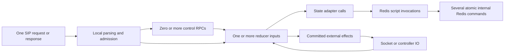

# Operation flow atlas

This atlas documents implemented sipbridge execution, including single-read
completion, metadata projection and attribution counters. It covers normal paths, failure paths,
retained state and repeated per-operation work. It is a source-coupled map, not a
redesign proposal or a capacity qualification. Memory executes touched typed
records directly; Redis executes the checkpoint CAS paths detailed in these
chapters. The historical claimed fixture driver is not another supported mode.

## Reading order and ownership

| Chapter | What to trace there |
| --- | --- |
| [Execution, storage and physical effects](execution.md) | Every reducer input, common CAS pipeline, read projections, Redis scripts, codecs, physical/callback phases, local concurrency and retained state |
| [Scheduling, connections and lifecycle](lifecycle.md) | Control leases, owned queues, coordinator/repair, completion waiting, retention, cross-worker reopen, outages and graceful termination |
| [SIP operation flows](sip.md) | Local challenges/denials, initial and refreshed requests, subscriptions/NOTIFY, both INVITE directions, responses/ACK, CANCEL, BYE and other dialog requests |

[Architecture](../../ARCHITECTURE.md) owns component boundaries. The
[runtime](../runtime.md) owns exact state, proof and scheduling invariants;
[protocol](../../PROTOCOL.md) owns the public contract. The atlas owns the
source-to-operation traversal and work accounting. Follow those links for exact
limits rather than maintaining another field catalogue here. An application
integration must supply its own policy, business-store and media map: sipbridge
does not own those operations.

## Do not conflate these units

One SIP message is not one Redis operation. One Redis script is not one HGET, nor
one network round trip for every Lua command. A write of a SIP response is not a
proof of peer receipt. A final SIP response, a command result, a receiver callback
receipt and a physical-write settlement are distinct outcomes.

The default Memory runtime keeps typed protocol records and immutable native
messages in process. It stages touched records, publishes them under a short
context lock, then releases the lock before I/O. It does not enter the graph or
codec pipeline shown above. The Redis checkpoint runtime uses that pipeline and
keeps authoritative protocol state in Redis. Neither carries a mutable protocol
aggregate across external I/O. Exact Memory invariants and its execution flow
are owned by [Resident Memory core](../memory-core.md).

The lifecycle changes in this revision are narrow: binary control decodes one
generated envelope, and Memory can release completed reliable REGISTER procedures
when their duties end. Follow the [wire boundary](execution.md#bytes-validation-and-ownership-at-each-boundary)
and [retention](lifecycle.md#retention-and-the-resulting-work) links for the source map.

## A concrete repeated path: successful reliable NOTIFY

For Redis checkpoint execution, take a fresh controller-originated subscription NOTIFY on an accepted live flow,
with successful peer response, definite commits, no contention, no digest retry
and no exceptional owner transition. The core logical mutations are:

| Mutation | Why it occurs | Group processing |
| --- | --- | --- |
| `command` | Commit new local CSeq, native client request and physical obligation | Normal group decode, preparation, transition, finish and encoding |
| `reserve` | Admit exactly one physical attempt on the selected flow | Whole group decode remains; eligible metadata path preserves protocol bytes/budget |
| `complete` | Commit actual physical outcome and native settlement evidence | Normal reduction; can update results and causal obligations |
| `native-ingest` | Select and validate peer final against the retained client transaction | Selection and reduction share the authoritative update record; eligible ended NOTIFY can retire |

Each successful mutation has the common ReadUpdate/CAS pair: eight warm script
invocations across these four logical transitions in this selected case, before
separately accounting for callback/preflight branches,
worker queue discovery/acknowledgement, operation waiting, transport validation or
cold/NOSCRIPT retries. This is a **core-path count**, not a universal round-trip
count for every NOTIFY. A response arriving before physical settlement changes
ordering without making either proof optional. Cross-worker physical delivery
adds discovery work; local fresh-commit projections can avoid some reads.

Completion selection now shares the response reduction's authoritative ReadUpdate;
there is no preliminary ReadState/group decode for this path. The native transaction can disappear after the successful final and positive
settled proof, but earlier transitions still decoded and traversed the same
subscription group. Retained SUBSCRIBE servers are still in that group. The
current client-retirement improvement therefore reduces the material handled by
future operations; it does not collapse the four mutation boundaries into one.
See [physical emission](execution.md#physical-emission-and-settlement),
[conditional call counts](execution.md#read-projections-and-healthy-single-attempt-counts)
and [NOTIFY](sip.md#outgoing-subscription-notify).

## Operation coverage checklist

| Surface | Covered operations |
| --- | --- |
| Physical ingress | TCP/TLS accept and close, UDP framing/order lanes, keepalive/framing, method denial, required-auth challenge and local ACK proof |
| Native ingress | New context allocation, exact existing lookup, controller-admitted ingest, retained completion, scoped refusal, request replay and unmatched response |
| Public control | Binary hello/status/heartbeat, Memory RequestDecision or checkpoint Ingest, four Command actions, Inspect, physical Write/InspectEffect, optional controller-context inventory |
| Native mutation catalogue | All fifteen current `stateEngineInput.Kind` cases in the [execution inventory](execution.md#entry-points-and-every-reducer-input) |
| Application effects | Presentation, lifecycle event, flow adoption, credential lookup, application probe and network open; distinct start/result rules |
| Physical effects | Native permit preparation, indexed discovery, Reserve, one socket attempt, Complete, inspection, settlement and reclamation |
| SIP procedures | REGISTER, OPTIONS, SUBSCRIBE refresh/unsubscribe, NOTIFY, UAS/UAC INVITE, provisional/final/fork response, ACK, CANCEL, BYE, re-INVITE, REFER and generic supported dialog requests |
| Shared state | Full/projection reads, replay/uncertainty, CAS conflict, state/owner guards, quotas, receipt expiry, selectors and serialization |
| Background/lifecycle | Owned deadlines/wakes, worker heartbeat, leader acquisition/renewal, unowned fallback, takeover/repair, owner expiry, completion polling, certificate reload, readiness and bounded shutdown |
| Failure and continuity | Store outage/failover/loss, controller loss, physical UNKNOWN, early setup failure, reopened TLS on another worker, late successful fork and native post-answer completion |

Certificate/health/capture details continue to live in the linked
[health](../guide/health.md), [observability](../guide/observability.md) and
[deployment](../guide/deployment.md) guides. They are not hidden extra native
reducer kinds.

## Reading the atlas for simplification

Start with a complete operation, including controller and physical consequences.
For each step, record whether it reads current authority, creates a protocol
obligation, records irreversible evidence, merely derives a projection, or only
repeats data conversion. Keep those classes distinct when proposing a change.

The desired continuity requirement can justify retaining native dialog and
subscription identity across workers without justifying every retained setup
object, every result representation or every repeated traversal. Conversely,
TCP delivery does not make an interrupted process's socket/store boundary atomic.
A simplification must say which post-answer, NOTIFY, sequence, flow and physical
UNKNOWN behaviors survive, and which setup/recovery behavior it intentionally
stops promising. The atlas itself describes current behavior; proposed removals
and their qualification belong in a separate design analysis.

The [completed-server layout experiment](completed-server-layout-prototype.md)
is a test-only prototype and proposed storage contract. It is not another service
execution mode or an implemented cold-field store.
