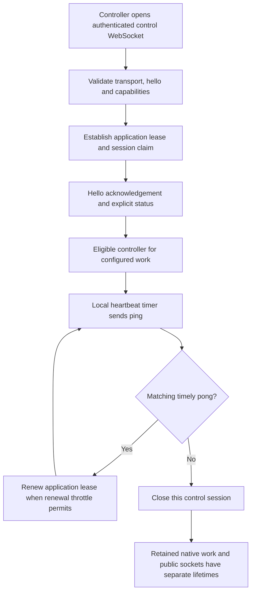
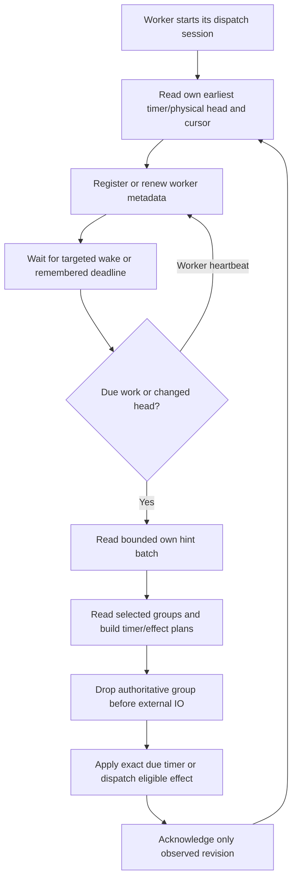
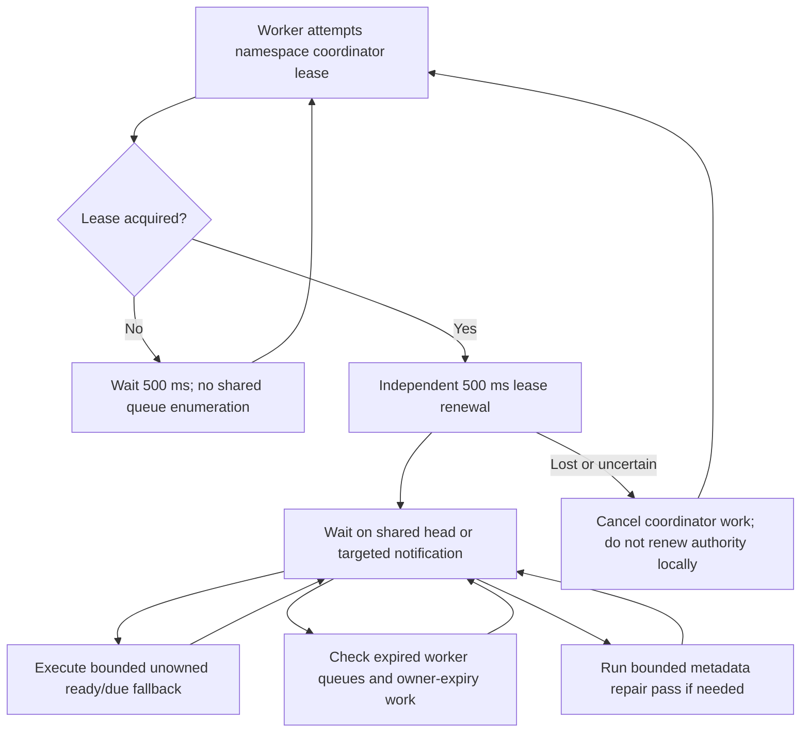
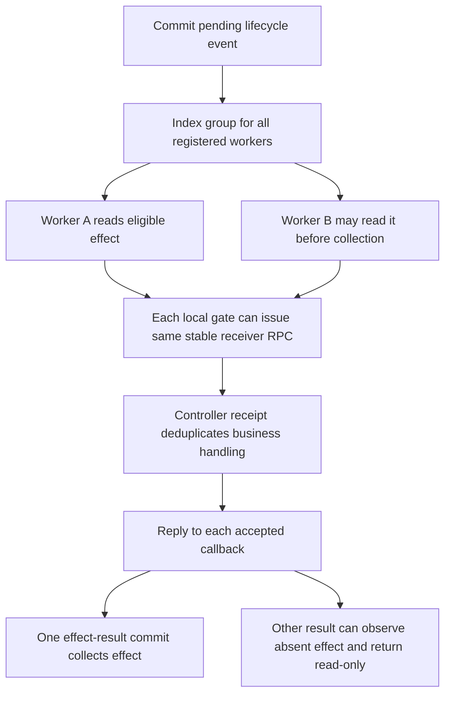
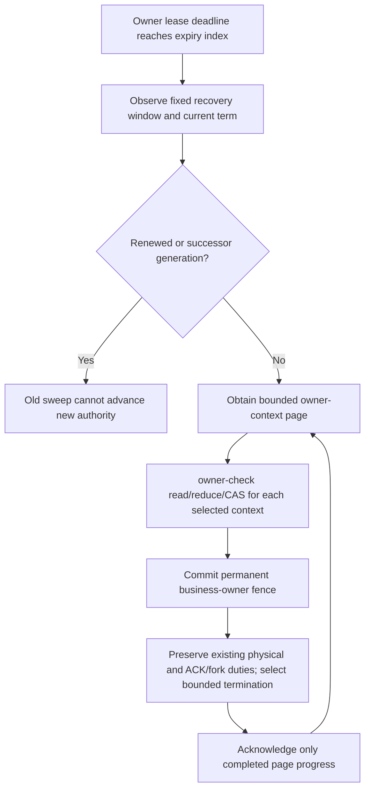
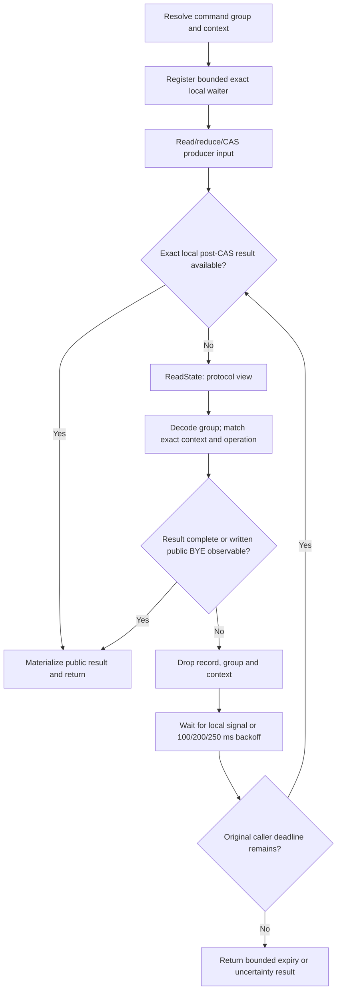
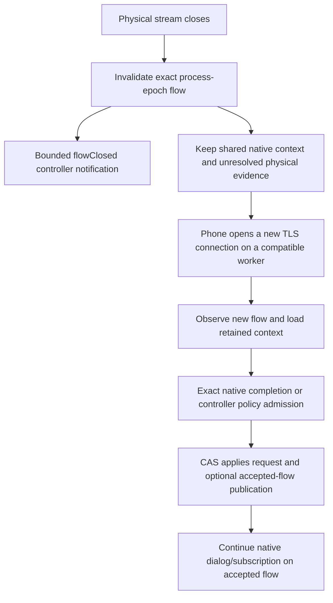
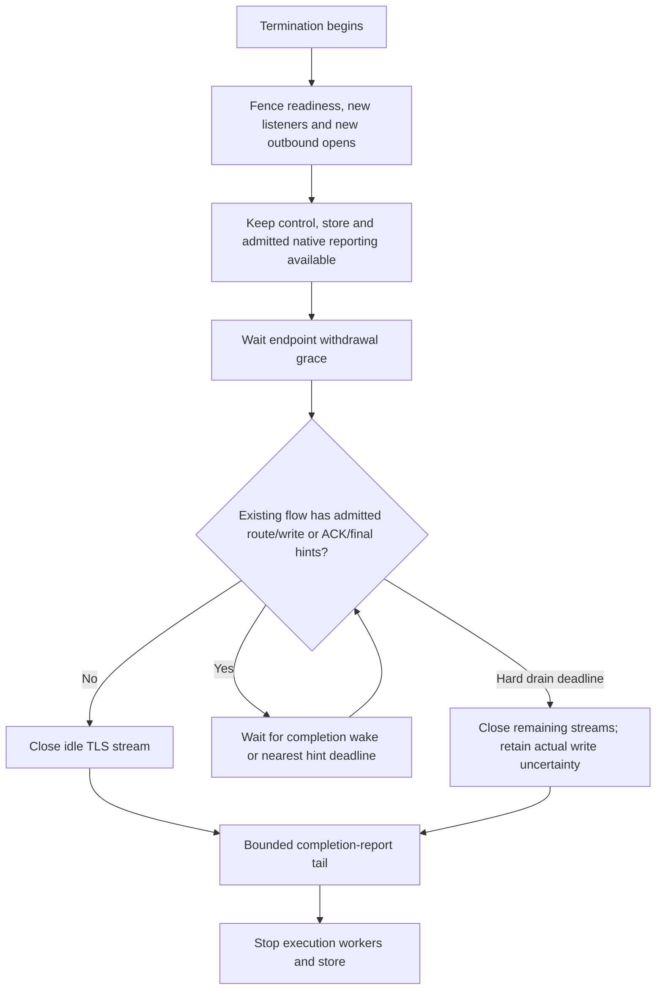
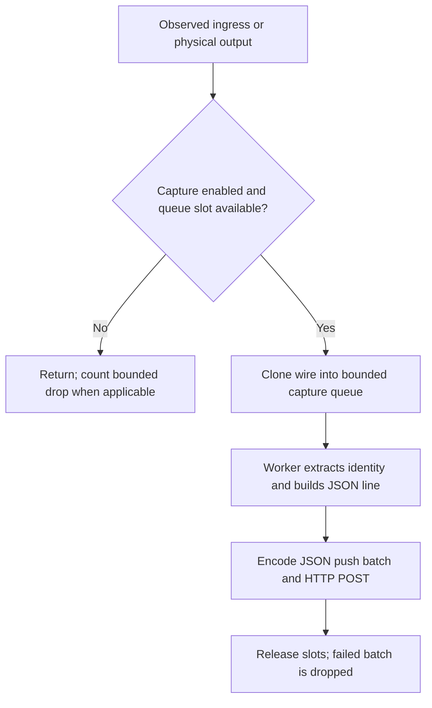
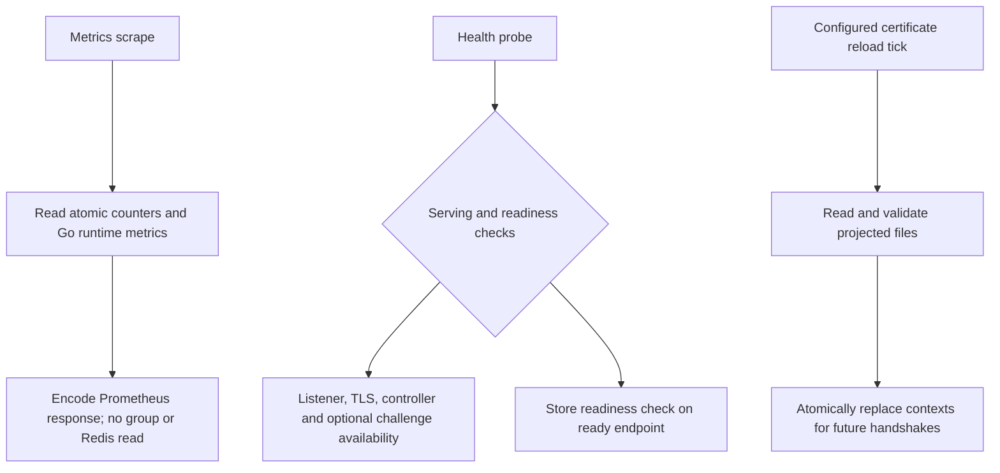

# Scheduling, connections and lifecycle operations

This chapter covers the operations that remain when no user is making a call:
control heartbeats, ownership metadata, due timers, queued effects, command
observation and retention. It also covers outages, connection replacement and
shutdown. [Execution](execution.md) owns the common state-operation accounting;
[SIP flows](sip.md) own individual protocol procedures.

## Separate ownership and separate clocks

| Thing | Owner and lifetime | What it does not own |
| --- | --- | --- |
| Physical socket | One ingress process epoch until closure | A transferable TCP connection or application call |
| Native group and directional dialogs | Shared state authority, incarnation and native identities | Account policy or application memory |
| Timer executor | One derivative worker assignment, heartbeat and sorted queue | The socket, application lineage or permission to emit SIP |
| Application lease | Authenticated controller lineage and pinned term; attachment generation where negotiated | A replacement application's internal call state |
| Physical effect | Committed exact effect, target, permit, attempt and outcome | A generic permission to retry an uncertain write |
| Local operation waiter | One admitted RPC until completion/deadline | A resident authoritative group cache |
| Scheduler coordinator | Short metadata lease in each state namespace | Exclusive execution of all SIP traffic |

Native protocol timers, application lease expiry, controller RPC deadlines,
request-disposition tails and connection-drain deadlines are different clocks.
Extending one is not permission to extend another.

## Control establishment and renewal

Control messages use JSON and bounded per-session write/RPC admission. The default
heartbeat interval is one second; application renewal is throttled to two seconds.
These are process/session costs, not a heartbeat per dialog. Successful normal
message handling can also renew the lease. A definitively fenced term terminates
the session; a temporary store error is not proof of permanent owner loss.

The ordinary owner lease and fixed recovery window differ from optional controller
reattachment. Reattachment is a separately negotiated feature requiring the
application to retain and restore its own checkpoint. This atlas does not assume
that applications enable it. Exact values and fencing behavior remain in
[owner leases](../runtime.md#owner-lease-and-permanent-loss) and
[controller recovery](../controller-recovery.md).

**Source:** [control server](../../internal/control/server.go)
(`hello`, `handle`, `heartbeat`),
[lease renewal](../../internal/control/application_lease.go),
[application lease store](../../internal/state/application_lease.go).

## Owned timer and physical dispatch loop

A definite fresh commit dispatches local effects directly. Its local backup
index becomes eligible after 100 ms; remote targets and repair remain immediate.
An existing earlier score for the same group/target is preserved across commits.
The worker still wakes for the earliest independent native timer. This prevents
healthy direct dispatch from routinely racing its own whole-group discovery read;
it does not add a queue, extend physical authority or promise completion by 100 ms.

The worker's sorted timer queue and physical-dispatch queue share a targeted wake
stream. The head records the next deadline; local waiting does not repeatedly
load every owned dialog to ask whether it has expired. A bounded blocking XREAD
watches notifications on a separate pool. A notification timeout by itself does
not mean a full group load or a timer transaction.

`physicalDispatchSession` renews the two-second worker registration every 500 ms.
The normal renewal branch continues waiting without reloading the head/group.
Owned timer execution is independent of scheduler-coordinator leadership. A group
with no scheduled deadline needs no timer-queue entry.

A timer hint is not removed as a substitute for committing its transition. Native
timer generation, current Redis time, CAS and deadlines still decide whether the
hint can execute. An acknowledgement for an older revision cannot erase a newer
commit's wake. Physical output still runs the independent exact-write lifecycle.

**Source:** [worker loop](../../internal/engine/state_engine_scheduler_physical.go)
(`physicalDispatchSession`, `schedulePhysicalGroup`),
[worker queues and waits](../../internal/state/timer_workers.go),
[dispatch index](../../internal/state/dispatch.go).

## Coordinator, orphan takeover and index repair

The coordinator uses a two-second Redis-time lease and a unique token. Renewal
runs separately from repair/due work. This is a metadata coordination lease, not
a distributed mutex acquired once for every SIP message or dialog timer.
Followers still attempt acquisition every 500 ms; eliminating shared full scans
did not eliminate every fixed Redis metadata command.

Expired worker queue takeover is checked at a 500 ms cadence, with bounded pages
and shorter pacing while pages remain. It changes timer assignment/index metadata,
not protocol revision, socket identity or application owner. Timer ownership does
not move merely because a phone's next request arrives on another worker.

A newly acquired coordinator or a corrupt hint can start one incremental metadata
repair traversal, at most one bounded page per second. It stops at the end of that
pass. This is distinct from continuously scanning healthy protocol groups. Shared
unowned ready/due fallback remains implemented; the operation inventory must not
silently describe that branch as removed.

**Source:** [coordinator](../../internal/engine/state_engine_scheduler.go)
(`schedule`, `scheduleLeader`), [scheduler store](../../internal/state/scheduler.go),
[takeover](../../internal/state/timer_workers.go) (`TakeoverTimers`),
[scheduling contract](../runtime.md#owned-scheduling).

## Direct request presentation and retained lifecycle events

Incoming request presentation is a one-shot controller call from a definite fresh
commit result. It has no retained effect, work index or recovery timer. Another
worker cannot replay it after a pod failure. The original request may fail in
that window, while shared native dialog state remains available for subsequent
requests. Deferred publication/proof completion can return a fresh presentation
DTO, but never creates a presentation retry queue.

Lifecycle events remain separately retained. Their current discovery can race:

This is a reachable race, not a claim that every callback is duplicated. The
`event` path deliberately omits a fresh effect-start selection and relies
on receiver deduplication. A local dispatcher gate excludes only the same process.
A second result can therefore still require ReadUpdate even when its early
observation avoids decoding the native group. Open/adoption retain separate
start/executor selection; physical writes retain their exact ingress target.

The event broadcast protects availability when one worker lacks the required
controller connection. Event recovery retains original deadlines and receiver
identity. Neither lifecycle event delivery nor direct request presentation
permits a second uncertain physical write.

**Source:** [dispatch projections](../../internal/engine/state_engine_reduce.go)
(`projectDispatchWorkers`), [index expansion](../../internal/state/dispatch.go),
[local admission and dispatch](../../internal/engine/state_engine.go),
[receiver result checks](../../internal/engine/state_engine_receiver.go),
[early observations](../../internal/engine/state_engine_reduce.go).

## Application-owner expiry

Healthy application heartbeats update owner metadata once per owner rather than
running a healthy-owner timer for every context. Expiry uses the derivative
application-context index and resumable sweep state. A failed page is retried
from its retained progress; failure is not proof that the contexts are gone.

Owner loss can select failure responses for setup, cancel unstarted application
work and end application calls. Existing successful-final/ACK, late-fork and
UNKNOWN physical obligations keep their independent rules. A replacement controller
without negotiated checkpoint recovery cannot reconstruct the lost application
call merely because native Redis survived. Subscription processor adoption is its
separate policy-approved path.

**Source:** [expiry driver](../../internal/engine/state_engine_owner_expiry.go)
(`processApplicationExpiry`),
[native owner guards](../../internal/engine/state_engine_native_owner.go),
[owner transitions](../../internal/engine/state_engine_owner.go),
[expiry index](../../internal/state/application_expiry.go).

## Operation completion observation

This is **in-flight RPC observation**, not idle scanning of phones. It is still a
source of repeated group reads/decodes when the relevant update occurs on another
worker or no exact local projection is available. The normal backoff caps at
250 ms; a fresh-commit wait-before-read path starts at 100 ms. When the remaining
original budget is no greater than the planned pause plus 100 ms, the pause caps
at 10 ms and the remaining budget. Slow store work does not
accumulate ticker events.

A local successful CAS can publish a bounded exact result for a currently waiting
operation. The waiter retains that result DTO, identity, revision and wake channel,
not an authoritative transaction graph. Removing the need for a store read on this
branch does not make another worker's result locally authoritative.

**Source:** [waiter projections](../../internal/engine/state_engine_waiters.go),
[completion loop](../../internal/engine/state_engine_lifecycle.go)
(`awaitOperationSignal`, `awaitOperationPolling`),
[command handling](../../internal/engine/state_engine.go).

## Retention and the resulting work

| Retained item | Why it remains | When ordinary processing can release it |
| --- | --- | --- |
| Live native dialog/subscription | Cross-worker sequence, target/route and completion continuity | Its native/application terminal path and retirement proof |
| Server request/final evidence | Exact admitted-flow arbitration, cached-final replay and delayed Respond/write completion | Original fixed replay/disposition bounds and proof; reliable Terminated is not enough |
| Successful reliable subscription NOTIFY client | Only until successful final plus positively settled write and no outstanding work | Natural reduction can release the transaction early; no separate reclamation job |
| INVITE origins, ACK and fork evidence | Late finals, ACK replay and ACK-before-cleanup-BYE causality | Their actual native/completion bounds |
| DISPATCHING/UNKNOWN physical evidence | No safe inference of not-written or permission for a second attempt | Exact evidence/settlement and applicable native retirement rules |
| Generic operation marker | Bounded proof of commit/idempotency | Existing marker cutoff; large outcome has its earlier original-RPC cutoff |
| Current command result | Replay/inspect of that exact command | Replaced by later command or context retirement; no duplicate parsed SIP graph/snapshot |
| Pending effects and selected server response retries | External callback/open/physical progress still owed | Exact result, refusal, deadline or terminal transition |

Retained data is revisited by later group operations. A completed server
transaction can have no active SIP timer yet still contribute wire parsing,
selector/budget traversal, encoding, validation and Redis payload bytes.
Retirement floors are not a license to drop unsettled effects. Conversely,
checking a known future cutoff every second does not make that cutoff earlier.

`appendLifecycleTimers` collects allocation expiry, context retirement,
subscription expiry and a single earliest effect/server-response recovery timer
per group, followed by owner duties. Fixed transaction/disposition blockers use
their actual cutoff. Other unresolved retirement blockers retain their bounded
retry branch; describing all retirement as entirely event-driven would be wrong.
The recovery timer can repeatedly reconcile pending/authorized/dispatching/UNKNOWN
or known-but-unsettled work. It is not a transport retransmission of every TCP
message and it does not authorize a second UNKNOWN write.

**Source:** [timer projection/retirement](../../internal/engine/state_engine_lifecycle.go)
(`appendLifecycleTimers`, `lifecycleTimer`),
[transaction pruning](../../internal/engine/state_engine_selectors.go),
[physical proof compaction](../../internal/engine/state_engine_capacity.go),
[result receipts](../../internal/engine/state_engine_receipts.go),
[response recovery](../../internal/engine/state_engine_response.go).

## Connection close, outage and reopen

This path requires retained compatible state and applicable application/media
ownership. It does not recreate erased Redis, move a TCP connection, restore a
lost controller checkpoint or bypass subscription/account policy. An interrupted
initial INVITE can fail.

Redis outages are different: refuse fresh state-authorized work; preserve healthy
sockets/control sessions where possible; treat missing physical outcomes as
UNKNOWN. Readiness can fence new admission without liveness forcing a restart.
A state-unavailable stateless refusal is a narrowly bounded request-only exception,
not a replacement state store. Redis failover can also lose asynchronously
replicated data; there is no second resident native FSM that repairs it.

**Source:** [ingress](../../internal/engine/ingress.go),
[flow replacement](sip.md#replacement-flow-and-publication),
[datastore failure contract](../runtime.md#datastore-failure-and-refusal-arbitration),
[store transport/authority](../../internal/state/store.go).

## Readiness and graceful termination

Readiness withdrawal cannot migrate established TCP/TLS streams. Local bounded
hints track currently admitted routes and incomplete request/final/ACK procedures;
they contain no authoritative SIP graph. Historical replay retention alone does
not hold the socket open for its full lifetime. Holding a write/close fence is
separate from taking a distributed per-dialog mutex.

The drain loop waits for local wakes or the nearest deadline. It has a hard bound,
and reporting can retain a further bounded tail after sockets close. It does not
seal controller application owners or rewrite all dialog/subscription state to
simulate successful handoff. Deployment grace must cover withdrawal, drain and
reporting. Actual configured values belong to the consumer's chart/environment.

Certificate/trust reload validates new atomic contexts for future handshakes;
existing sockets do not have to restart. Native process liveness, SIP serving,
SIP readiness, controller readiness and Redis availability are distinct signals.

**Source:** [drain](../../internal/engine/ingress_drain.go) (`Drain`),
[shutdown wiring](../../cmd/sipbridge/main.go),
[health endpoints](../reference/admin-endpoints.md),
[drain contract](../runtime.md#bounded-sip-connection-drain).

## Periodic work ledger

These are current source intervals, not a recommended redesign or an assertion
that every tick sends the same number of Redis packets.

| Loop | Scope / current trigger | Store or retained-state consequence |
| --- | --- | --- |
| Controller heartbeat | Default one second per session | JSON ping/pong; lease renewal throttle separately gates store work |
| Application lease renewal | Two-second session throttle | Owner metadata; no healthy per-context protocol rewrite |
| Worker registration | 500 ms, two-second lifetime | Per-worker metadata and index maintenance; no ordinary group reload |
| Coordinator acquisition / renewal | 500 ms, two-second lease | Shared metadata command, including idle followers |
| Expired worker takeover check | 500 ms; bounded continued pages | Metadata-only ownership/queue transfer |
| Shared queue watch | Notification or remembered head deadline | Blocking wake read; full protocol read only for selected work |
| Owned worker watch | Targeted notification or remembered deadline | Own queue/head; no namespace-wide dialog enumeration |
| Repair traversal | Bounded pages, at most one per second while a pass is active | Metadata scan; stops at pass end |
| In-flight command observation | Exact local wake or bounded 100/200/250 ms pacing, with a 10 ms deadline tail | May read and decode whole protocol group again |
| Native effect recovery | Projected earliest group deadline | Reconcile the retained pending/uncertain obligation; no blanket permission to resend |
| Protocol/subscription/retirement timer | Actual indexed deadline/generation | Normal read/reduce/CAS for that group |
| Certificate/trust reload and health | Configured process checks | Separate control/transport work; see health/configuration guides |

The distinction matters when diagnosing CPU: no active calls does not imply zero
SIP renewals, zero metadata heartbeats, zero callbacks or zero retained history.
It also does not justify assuming those costs are efficient. The execution ledger
and workload observations must identify the repeated work before changing an
interval, proof or retention rule.

## Capture, metrics and health

Capture is an optional side path with its own wire copy, identity extraction,
JSON-line encoding and outer batch encoding. It is not another native Redis
transaction and capture failure never establishes a SIP delivery result. The
queue includes in-flight records in its bound; a failed batch is dropped instead
of accumulating a durable retry outbox. These allocations belong to the worker
process when capture is enabled and must be included in a CPU investigation.

The liveness endpoint does not turn a Redis outage into a process restart. The
SIP readiness endpoint does consult datastore readiness in addition to process,
TLS and controller state; it must not be described as a counter-only scrape.
Certificate reload does not rebuild every native group or close healthy sessions.

**Source:** [capture](../../internal/capture/capture.go) (`Submit`, `encode`,
`send`, `Run`), [endpoint and reload wiring](../../cmd/sipbridge/main.go),
[runtime counters](../../internal/engine/state_engine_execution_metrics.go),
[observability guide](../guide/observability.md).
