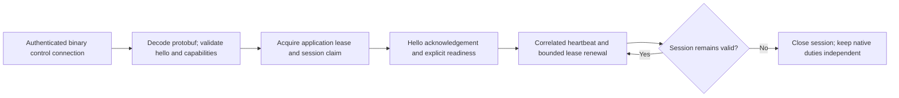
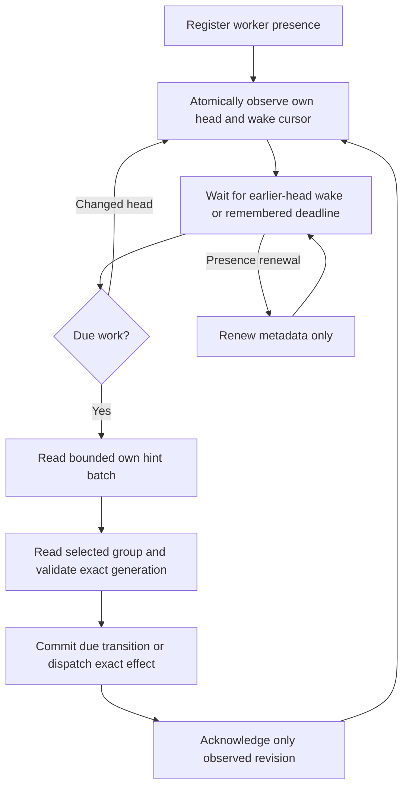
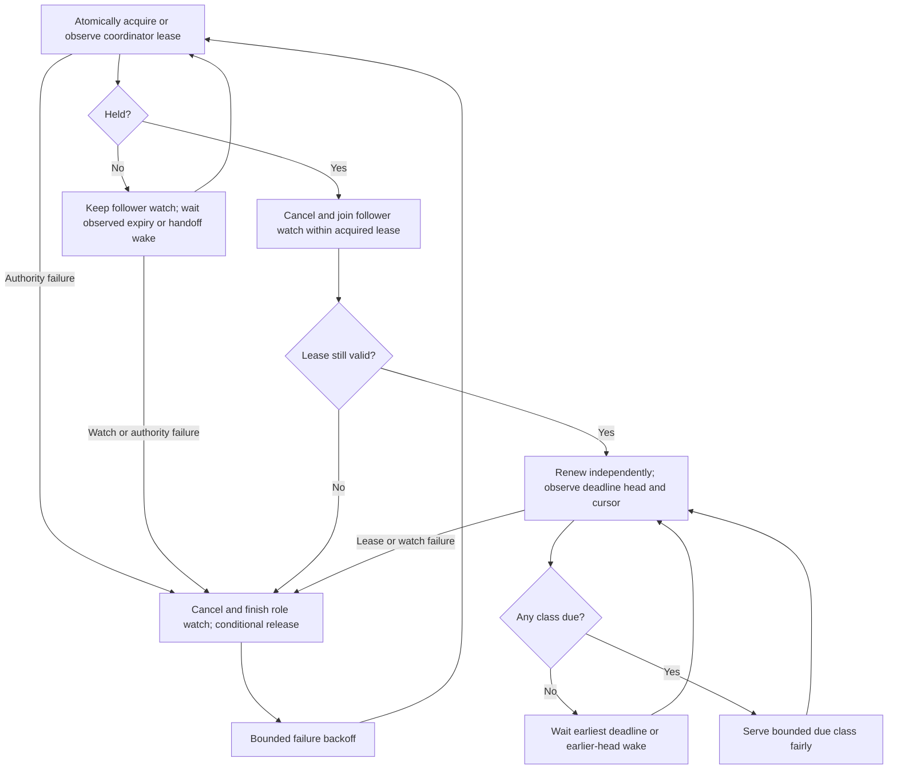
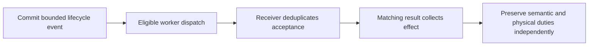
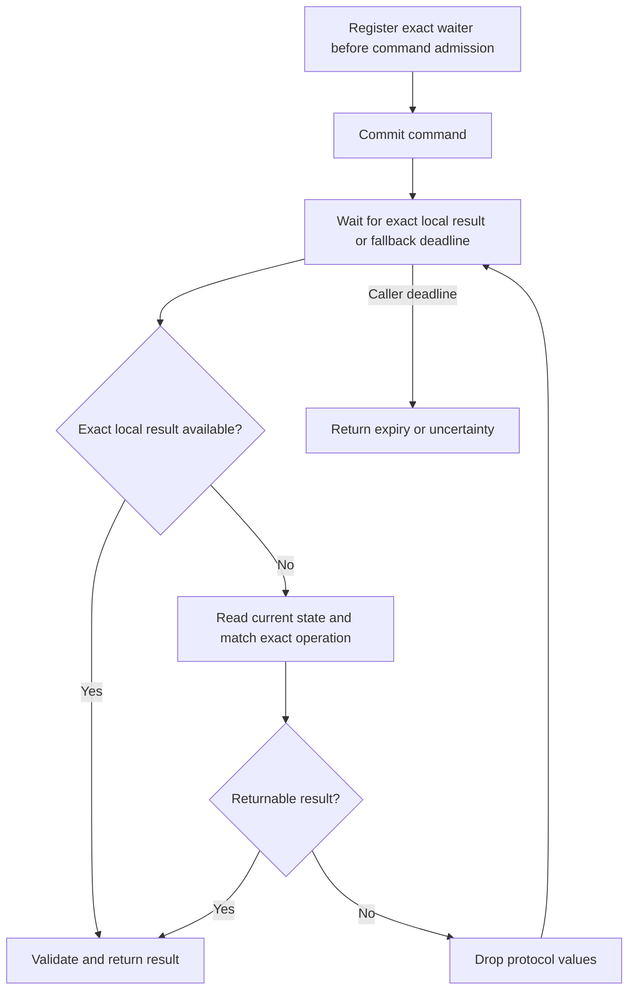
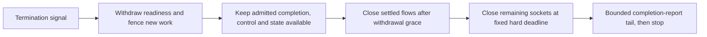

# Scheduling, connections and lifecycle operations

This chapter maps the [runtime contract](../runtime.md#owned-scheduling) to
checkpoint background and failure flows. Memory uses its local deadline heap
and direct record lifecycle in [Memory core](../memory-core.md); it has no worker
presence, coordinator election or checkpoint scan. [Execution](execution.md) owns mutation/write
accounting; [SIP flows](sip.md) own individual protocol procedures.

## Separate ownership and separate clocks

Sockets, logical contexts, controller owners and timer executors have distinct
identities; see [architecture](../../ARCHITECTURE.md#four-distinct-identities).
Controller liveness, worker presence, native timers, command deadlines, replay
cutoffs and connection drain are separate clocks. Extending one extends none of
the others. Scheduling hints grant no protocol or physical-write authority.

## Control establishment and renewal

Default heartbeat is one second; application renewal is throttled to two seconds.
These are per-session metadata operations, never healthy per-dialog rewrites.
Control reconnect can preserve the same live application process. Optional
checkpoint-based controller reattachment is a separate contract in
[controller recovery](../controller-recovery.md).

Sources: [control session](../../internal/control/server.go),
[application renewal](../../internal/control/application_lease.go).

## Owned timer and physical dispatch loop

One presence renewal covers all owned groups. Only nonempty timer-owner queues
appear in the orphan-expiry index. No scheduled group means no timer entry for
that worker. Local fresh output dispatches directly; its backup discovery gets
100 ms, while remote targets and earlier native timers remain immediate.

Read head, cursor and validated clock atomically. A bounded blocking stream watch
notices earlier work without consuming another worker's notification. Transport
timeout or ordinary renewal does not reload a head or group. Discard authoritative
protocol values before socket/controller I/O. The queue is a hint; physical output
still needs its exact permit/reservation and write evidence.

Sources: [worker loop](../../internal/engine/state_engine_scheduler_physical.go),
[worker queues](../../internal/state/timer_workers.go), [dispatch](../../internal/state/dispatch.go).

## Coordinator, orphan takeover and index repair

The three classes are unowned protocol work, application-owner expiry and orphaned
nonempty timer-owner queues. Rotate among overdue classes; use the earliest future
deadline when none is due. An idle coordinator can take its first orphan queue:
its destination liveness comes from worker presence, not existing timer ownership.
Transfer preserves protocol revision, physical flow and application owner.

Creation of the first timer-owner hint and every earlier deadline publishes the
coordinator wake in the same mutation. Hint expiry derives from current presence;
ordinary commits cannot renew a dead owner's lifetime. A lease-handoff stream has
one marker with a finite TTL. All notification/index types and permissions are
validated before mutation.

One finite metadata repair pass starts after acquisition or corrupt hints. Its
paced timer stops at pass end. Worker dispatch remains independent of leadership;
follower handoff and leader scheduling watches replace one another and share the
notification pool's remaining connection. Healthy lease observations update a
local expiry timer while keeping the follower read and its advancing cursor;
they do not cancel or reopen the notification connection. A successful acquisition
retains its exact conservative expiry while joining that watch. See
[runtime](../runtime.md#owned-scheduling) for timing and bounds, and the
[deployment guide](../guide/deployment.md) for coordinated upgrades.

Sources: [coordinator](../../internal/engine/state_engine_scheduler.go),
[lease/head store](../../internal/state/scheduler.go), [takeover](../../internal/state/timer_workers.go).

## Direct request presentation and retained lifecycle events

Presentation is a one-shot controller RPC from a definite fresh commit. Deferred
owner proof/publication can produce it under the original deadline; another
worker cannot replay it. Failure can refuse an unanswered admitted request.
Initial setup may fail in this window.

Lifecycle events are retained separately. Multiple eligible workers can reach the
same receiver, so the stable receiver identity deduplicates business handling:

Acceptance is not proof of handler completion or SIP output. Event recovery keeps
its original horizon; a duplicate result may observe an already collected effect.
Open/adoption start selection and exact native physical writes retain their own
rules in [execution](execution.md#nonphysical-effects-and-callback-inputs).

## Application-owner expiry

One owner lease/expiry index covers many contexts. After its fixed grace, a bounded
context page applies owner checks, commits permanent loss where justified, and
acknowledges progress. Renewal/new attachment fences old sweep work. A failed page
is not proof of retirement. Native final/ACK/fork and physical duties survive their
own bounds; a new application process does not reconstruct an ordinary call.

Source: [owner expiry](../../internal/engine/state_engine_owner_expiry.go),
[owner contract](../runtime.md#owner-lease-and-permanent-loss).

## Operation completion observation

A fresh commit starts with a 100 ms fallback pause; replay/nil projections read
immediately. Further pauses back off to 200/250 ms, with a bounded deadline tail.
Exact local results wake immediately. An intermediate group change is not the
command result. Remote completion still uses a validated full-state fallback;
this remains repeated decoding during an in-flight command, not idle phone scans.
The bounded local DTO is not a resident authoritative graph. See
[command observation](../runtime.md#command-observation-and-dispatch-progress).

Sources: [waiters](../../internal/engine/state_engine_waiters.go),
[completion loop](../../internal/engine/state_engine_lifecycle.go).

## Retention and the resulting work

| Retained item | Reason and release boundary |
| --- | --- |
| Live dialog/subscription | Shared identity, routing and sequence until its terminal/retirement rules |
| Checkpoint server request/final | Exact replay and admitted-flow proofs through fixed cutoffs, even after reliable transaction termination |
| Memory TCP/TLS REGISTER | Release the completed procedure after final WRITTEN, settlement, dispatcher acknowledgement and all waiters/duties end; [owning rule](../memory-core.md#completed-reliable-register-lifetime) |
| Required NOTIFY client | Positive settled write plus matched successful final and no remaining duty permits narrow early retirement |
| INVITE final/ACK/fork work | Native completion and ACK-before-cleanup-BYE obligations |
| Uncertain physical evidence | Remains charged/inspectable; timeout does not authorize another write |
| Operation receipt/current result | Frozen historical outcome and latest command result have different cutoffs/meanings |

Checkpoint operations still traverse retained groups; history can cost CPU without an
active SIP timer. Known fixed cutoffs schedule their actual deadline. Other
unresolved recovery/retirement blockers retain their bounded reconciliation; the
architecture does not claim all retention work has disappeared. The Memory REGISTER exception leaves no historical tombstone; absent old
decision/command retries return UNKNOWN without a snapshot, never NOT_WRITTEN.
Original waiters keep their detached historical evidence. Exact checkpoint conditions
are in [runtime](../runtime.md#retirement-and-physical-uncertainty).

## Connection close, outage and reopen

A closed socket invalidates that exact flow and notifies its controller. Compatible
shared contexts remain. A replacement TLS request proves its context independently:
eligible ACK/CANCEL/BYE completion can remain native, while other methods continue
through controller policy. Acceptance/publication and response-return routing are
separate; see [replacement flow](sip.md#replacement-flow-and-publication).

Redis outage refuses affected new work and preserves healthy flows/control where
possible. Missing write evidence stays UNKNOWN. Failover can lose asynchronously
replicated state; there is no resident copy that reconstructs it. An interrupted
initial INVITE can fail, and controller call memory does not migrate.

## Readiness and graceful termination

Local hints contain no authoritative SIP graph. Replay retention alone does not
hold a settled socket open. The write/close fence preserves actual uncertainty;
drain does not seal application owners or rewrite all dialogs as handed off.
Readiness, serving and liveness are separate signals. Outage/overload is not a
reason to restart the process. Certificate/trust reload preserves existing sockets.

Sources: [drain](../../internal/engine/ingress_drain.go),
[shutdown](../../cmd/sipbridge/main.go),
[exact drain bounds](../runtime.md#bounded-sip-connection-drain).

## Periodic work ledger

| Trigger | Work |
| --- | --- |
| Per-session heartbeat / two-second renewal throttle | Control transport and application-owner metadata |
| One-second worker/coordinator renewal | Two-second presence/leadership; no dialog read |
| Observed lease expiry or handoff wake | Contended acquisition; no fixed acquisition polling |
| Actual orphan/application/unowned deadline or earlier wake | Bounded fair coordinator work |
| Targeted worker deadline/wake | Own queue work and exact-generation transition |
| Active repair page, paced once per second | Finite metadata repair; timer removed when pass ends |
| Exact command result or bounded fallback deadline | Operation observation; can decode current group |
| Native protocol/recovery/retirement deadline | Selected group's transition under original authority |
| Notification transport timeout | Revalidate/continue blocking watch; no head/group reload |

See runtime for bounds and original-deadline rules. No active calls still allows
registration/subscription traffic, control heartbeats and metadata work; diagnosis
must attribute those costs rather than equate packet, commit and Redis-command counts.

## Capture, metrics and health

Capture is a bounded optional wire copy and JSON/HTTP side path. A full queue or
failed batch drops diagnostics; it cannot become a durable retry outbox or SIP
send authority. Metrics sample bounded counters/runtime values without Redis or
protocol reads. Readiness additionally checks dependencies; it is not a counter
scrape. Credential reload reads/validates projected files for new handshakes.

Sources: [capture](../../internal/capture/capture.go),
[observability](../guide/observability.md), [health](../reference/admin-endpoints.md).
