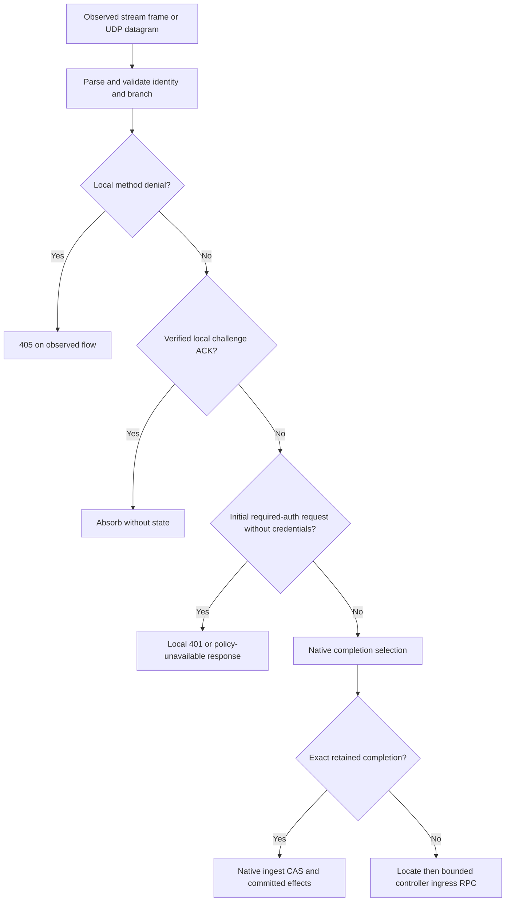
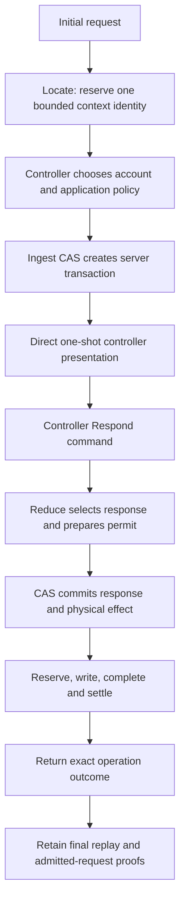
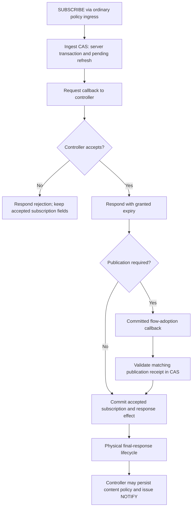
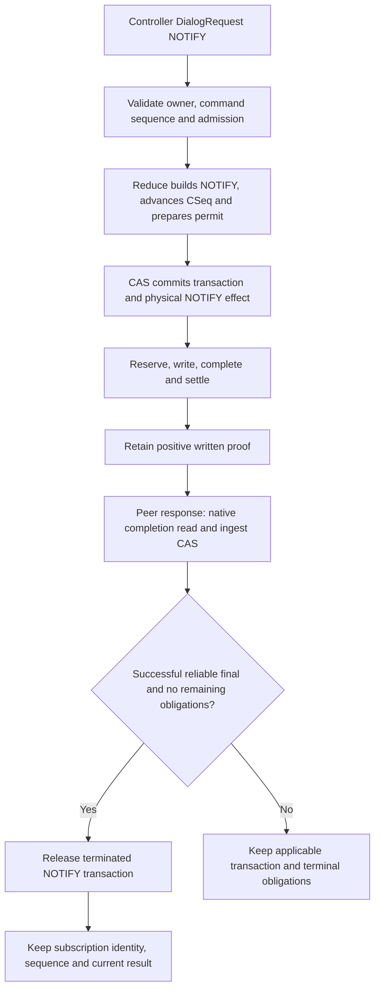
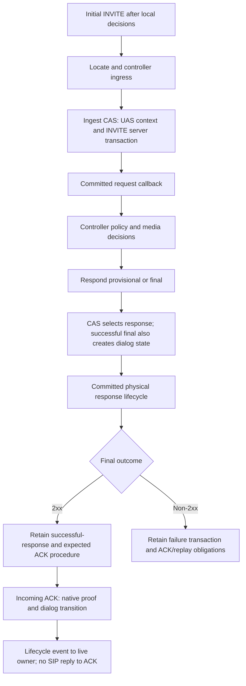
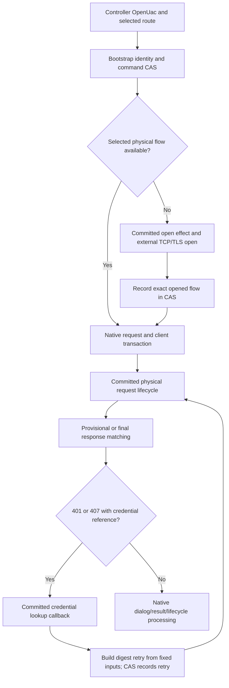
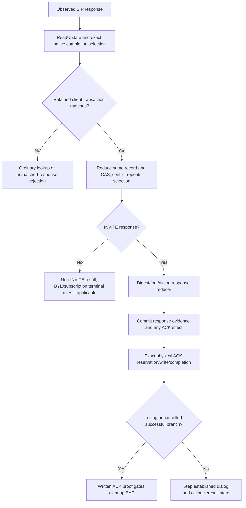
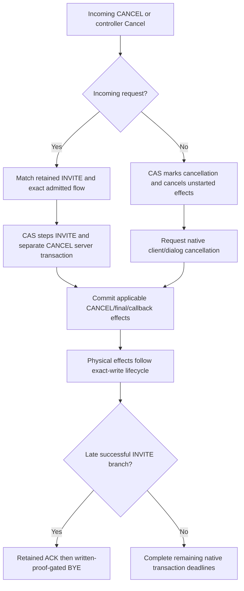
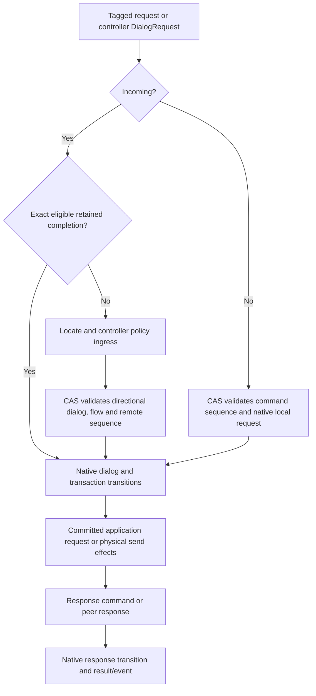
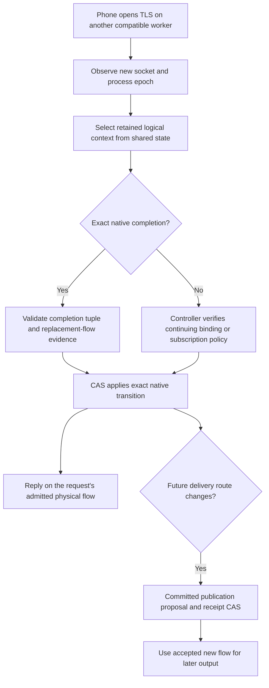

# SIP operation flows

This chapter maps SIP traffic to native procedures, control messages and retained
state. [Execution](execution.md) expands each read/reduce/CAS, callback and physical
write box. [Lifecycle](lifecycle.md) covers scheduling, failure and process drain.
The [runtime](../runtime.md) and [protocol](../../PROTOCOL.md) remain the owners of
exact admission, deadline and completion guarantees.

The controller in these diagrams is an external application. Account policy,
registration publication, subscription content, media allocation and deciding an
opposite call leg are outside sipbridge.

## Operation coverage

| Operation | Main path below | What differs from a generic transaction |
| --- | --- | --- |
| TCP/TLS accept, framing, CRLF and malformed traffic | [Ingress](#ingress-and-local-decisions) | Socket/framing work is local; it is not a Redis transaction per received byte. |
| Disabled REGISTER/SUBSCRIBE | [Local decisions](#ingress-and-local-decisions) | Local 405; no native lookup or controller RPC. |
| Required initial digest challenge and its ACK | [Local decisions](#ingress-and-local-decisions) | Stateless bounded challenge proof; credential verification remains external. |
| REGISTER, OPTIONS and other initial non-INVITE requests | [Non-INVITE server](#initial-non-invite-server-requests) | Controller presentation and Respond; final-response/request proofs outlive the reliable transaction. |
| Initial, refreshed and expiry-zero SUBSCRIBE | [Subscription](#subscribe-initial-refresh-and-unsubscribe) | Accepted Event/Contact/flow, independent remote/local sequences, optional publication callback. |
| Subscription NOTIFY | [NOTIFY](#outgoing-subscription-notify) | Retained local sequence; final/481 subscription behavior; narrow successful-client retirement. |
| Incoming initial INVITE | [UAS](#incoming-invite-and-answer) | Provisional/final selection, dialog creation and ACK procedure. |
| OpenUac INVITE or initial non-INVITE | [UAC](#outgoing-setup-and-credential-lookup) | Bootstrap identity, selected route, optional network open and credentials. |
| Provisional/final responses, forks and retransmitted finals | [Responses](#responses-ack-and-forks) | Exact client matching; ACK and losing-branch obligations. |
| Incoming ACK and local generated ACK | [Responses](#responses-ack-and-forks) | No SIP response to ACK; local ACK requires committed physical output. |
| Incoming CANCEL and local Cancel command | [Cancel](#cancel-and-setup-races) | CANCEL has its own transaction; INVITE outcome can race cancellation. |
| Incoming BYE and outgoing DialogRequest BYE | [Established dialog](#established-dialog-requests) | Native dialog sequence, exact flow and terminal work; written public BYE is separately observable. |
| Re-INVITE, REFER, INFO, UPDATE and in-dialog NOTIFY | [Established dialog](#established-dialog-requests) | Native dialog validation followed by application policy; REFER content is external. |
| Replacement connection / response on another worker | [Replacement flow](#replacement-flow-and-publication) | Shared logical state, separate request-return and future-delivery flows. |
| Duplicate requests and late unmatched responses | [Replay](#replays-and-unmatched-responses) | Cached response obligations differ from a retired client response. |
| Inspect, controller control, timers, dispatch, retirement and shutdown | [Execution](execution.md), [lifecycle](lifecycle.md) | These are operations in their own right, not extra SIP methods. |

The public commands are exactly Respond, OpenUac, DialogRequest and Cancel.
A method appearing in a generic path is not a promise that every application or
native dialog state admits it. Native reducers and controller policy still decide.

## Ingress and local decisions

`Ingress.readStream` preserves framing and observed transport. Stream keepalives
and incomplete frames are handled before route admission. Parsing a frame is not
a native state commit. Large-frame buffer reclamation is process-local memory
management, not Redis maintenance. UDP has bounded per-flow/Call-ID routing lanes;
those are separate from reliable transport and Redis's group CAS serialization.

The method switches disable only REGISTER and SUBSCRIBE. They do not act as a
universal arbitrary-method allowlist. Required-auth configuration covers
REGISTER and initial untagged INVITE/SUBSCRIBE. A digest-bearing request proceeds
to ordinary controller verification; a challenge is not proof of authentication.

`TryNativeCompletion` explicitly skips REGISTER, SUBSCRIBE and NOTIFY **requests**.
It can select exact responses, ACK, CANCEL and BYE, and narrowly permitted retained
final replay after owner loss. A read-side match is proved again at CAS; it grants
no permission to send. A successful selection avoids ordinary controller routing,
although resulting lifecycle effects may still notify the live controller.

**Source:** [ingress](../../internal/engine/ingress.go) (`readStream`,
`routeWithin`), [local challenge](../../internal/engine/local_challenge.go),
[method policy](../../internal/engine/method_policy.go),
[native ingress](../../internal/engine/state_engine_native_ingress.go)
(`TryNativeCompletion`).

## Initial non-INVITE server requests

This is the healthy initial REGISTER/OPTIONS pattern after local decisions. An
exact retained replay takes the replay branch instead of creating another context.

The native worker does not update a registration database. REGISTER acceptance,
ordering and publication are controller responsibilities. The callback and
Respond command are separate operations; a selected response does not establish
a completed socket write. Automatic native output, such as applicable transaction
responses, uses the same committed physical-effect path.

Presentation is returned only with definite fresh commit evidence and is called
directly on the request path. It has no durable queue, callback acknowledgement
transition or cross-worker retry. A pod failure during presentation can fail that
in-flight request. A repeated SIP packet can use retained native transaction
evidence; it does not authorize replaying the controller presentation.

For reliable non-INVITE servers, the portable transaction can enter Terminated
when a final response is selected. That does not erase its request-disposition
or final-write/replay evidence. Later reductions still traverse retained server
transactions for lookup, quotas, scheduling and encoding. See the retention table
in [lifecycle](lifecycle.md).

**Source:** [allocation](../../internal/engine/state_engine_admission.go)
(`reserveAdmission`, `consumeAdmission`),
[ingest/Respond](../../internal/engine/state_engine_reduce.go)
(`ingest`, `command`, `transactionEffects`),
[presentation](../../internal/engine/state_engine_subscription.go)
(`presentRequest`, `presentNow`),
[response evidence](../../internal/engine/state_engine_response.go),
[request fence](../../internal/engine/state_engine_request_fence.go).

## SUBSCRIBE: initial, refresh and unsubscribe

Initial acceptance on the same established flow may commit directly. An existing
subscription, prior delivery publication, changed flow or changed processing
application requires the flow-adoption path. It is therefore incorrect to add a
publication round trip to every initial acceptance, or omit it for a refresh.

`commitSubscription` records Event identity, Contact target, routes, accepted
remote CSeq and expiry. It clears the pending refresh and selects the SIP response.
Expiry-zero records termination intent with a bounded terminal grace; a terminal
NOTIFY is a separate command. Rejection does not replace the prior accepted flow,
Contact, expiry or local NOTIFY sequence. Ingest already advances the remote request
CSeq; rejecting that refresh does not roll it back. This keeps a processed request
from becoming fresh again. Overlapping refresh and publication work
remain guarded by the pending native procedure.

The last box describes a controller boundary, not an additional native database.
The controller supplies the immediate NOTIFY required after successful acceptance
or refresh, including unchanged state ([RFC 6665 section 4.2.1.2](https://www.rfc-editor.org/rfc/rfc6665.html#section-4.2.1.2)).
Additional corrective or registration-rebind fanout is application policy. These
extra sends are distinct from that required NOTIFY and from native SIP retransmission.

**Source:** [subscription](../../internal/engine/state_engine_subscription.go)
(`validateSubscription`, `acceptSubscription`, `commitSubscription`,
`finishFlowAdoption`), [runtime subscription policy](../runtime.md#business-selection-and-subscriptions).

## Outgoing subscription NOTIFY

The diagram shows write settlement preceding the final response; TCP/TLS can
also deliver the peer response first. In that order, termination alone does not
permit removal. A later natural reduction transfers settled WRITTEN proof and
can release the transaction. No extra timer or polling job is created for removal.

`notifySubscription` builds the native request from accepted subscription state
and controller content. It owns the local CSeq and rewrites active expiry from
the accepted remaining lifetime. A live subscription accepts only NOTIFY through
this command path. Final NOTIFY and 481 have subscription terminal behavior;
UDP, unsuccessful replies, digest retries, uncertain writes and pending controller
work retain their existing obligations. REFER-associated NOTIFY on an INVITE
context is not this subscription-only retirement optimization.

The retained public command result survives successful client retirement. A late
duplicate 2xx is no longer a live client-transaction match; see
[unmatched responses](#replays-and-unmatched-responses).

**Source:** [NOTIFY construction and retirement](../../internal/engine/state_engine_subscription.go)
(`notifySubscription`, `settledNotifyRetirable`),
[settled proof transfer](../../internal/engine/state_engine_capacity.go)
(`reclaimEffects`), [response completion](../../internal/engine/state_engine_lifecycle.go)
(`subscriptionResponse`), [normal pruning](../../internal/engine/state_engine_selectors.go)
(`pruneTransactions`).

## Incoming INVITE and answer

Multiple Respond operations do not mean multiple call legs. They update the same
server transaction subject to native response-selection rules. SDP and accepted
target state change with the appropriate dialog transition, not merely because
an application RPC returned. The portable reducers own retransmission and ACK
timer semantics; the adapter commits their effects before output.

Creating or selecting a media endpoint and making an opposite outbound call are
controller operations. sipbridge has no coupled two-leg bridge transaction. Each
leg can have a different native context, Call-ID group, transport and physical
owner.

**Source:** [ingest and Respond](../../internal/engine/state_engine_reduce.go),
[pinned transaction reducer](../../third_party/sipgo/sip/portable/transaction.go),
[pinned dialog reducer](../../third_party/sipgo/sip/portable/dialog.go).

## Outgoing setup and credential lookup

An omitted OpenUac method means INVITE. Explicit supported non-INVITE setup uses
a client transaction without the INVITE answer/fork lifecycle. Request construction
uses the selected URI, advertisement, transport and opaque credential reference.
It does not use a raw username/password NetworkTarget.

Network opening is an external effect and can fail independently of command CAS.
A newly opened unused stream has a process-local unused-use lease; it is not a
reconnectable socket stored in Redis. A successful open does not mean a request
was written. Physical write admission still needs its exact retained effect and
permit.

Digest lookup returns credentials transiently to build a native retry. The
retained challenge fixes the original request, challenge, count, cnonce and branch;
clear credentials are not retained in native state. Retry construction, effect
recording and physical output remain separate boundaries.

**Source:** [outgoing setup](../../internal/engine/state_engine_effects.go)
(`openUAC`, open-effect dispatch),
[credential challenge](../../internal/engine/state_engine_auth.go),
[unused stream lease](../../internal/engine/outbound_stream.go),
[bootstrap identity](../../internal/engine/state_engine_bootstrap.go).

## Responses, ACK and forks

2xx ACK is a dialog obligation; non-2xx ACK has transaction replay semantics.
The implementation does not replace either with a stateless send. Late successful
forks can owe ACK and cleanup BYE after setup cancellation or owner death. A
successful socket write of ACK, not a selected ACK or callback receipt, releases
that BYE dependency. Lost physical evidence remains UNKNOWN.

Ordinary non-INVITE responses complete their client transaction without running
the INVITE/BYE dialog reducer. Response receipt and the operation's original
physical write proof remain different facts.

**Source:** [native selection](../../internal/engine/state_engine_native_ingress.go),
[completion relay checks](../../internal/engine/state_engine_completion_relay.go),
[fork handling](../../internal/engine/state_engine_forks.go),
[ACK causality](../../internal/engine/state_engine_causality.go),
[response dispatch](../../internal/engine/state_engine_reduce.go)
(`receivedResponse`, `dialogEffectsForClass`).

## CANCEL and setup races

CANCEL's response does not prove that INVITE setup failed. A pending network open,
an already written INVITE or a successful final can win a different part of the
race. Never infer a safe second write from an absent application response or a
closed control session. Initial setup can fail during worker loss; retained final,
ACK and fork obligations remain independently bounded.

**Source:** [incoming cancellation](../../internal/engine/state_engine_reduce.go)
(`cancelIncoming`, Cancel command),
[cancel preparation](../../internal/engine/state_engine_causality.go),
[portable server cancellation](../../third_party/sipgo/sip/portable/transaction.go)
(`StepServerCancel`), [fork handling](../../internal/engine/state_engine_forks.go).

## Established dialog requests

Re-INVITE has offer/answer and ACK procedures; rejection must preserve accepted
SDP/target state. BYE has its terminal native procedure and can be completed from
retained state. REFER/INFO/UPDATE and NOTIFY in an INVITE dialog do not become
subscription contexts merely because of their method name. The controller owns
transfer decisions and message content. Incoming ordinary requests are presented
only after native identity, sequence and flow validation.

Outgoing DialogRequest uses the accepted dialog target/routes and native local
sequence. A subscription context routes that command to the NOTIFY-specific path
instead. Native method/state admissibility is narrower than the collection of
methods the transport parser can recognize.

**Source:** [ingest and DialogRequest](../../internal/engine/state_engine_reduce.go),
[pinned dialog transitions](../../third_party/sipgo/sip/portable/dialog.go),
[subscription command](../../internal/engine/state_engine_subscription.go).

## Replacement flow and publication

A physical connection is not the logical owner of a dialog. Timer ownership also
does not have to move because a packet arrives elsewhere. The native retained
context and accepted transport remain authoritative. Replacing TLS with plaintext
is not a continuity operation.

A response to an admitted request uses that request's flow. Publishing a new
ordinary delivery route is a separate guarded operation. Incoming SUBSCRIBE
refresh acceptance and INVITE-dialog flow adoption do not share application
ownership-transfer semantics. No process can reopen or take over the old process's
socket; it can only use a newly observed or selected flow.

**Source:** [replacement response flow](../../internal/engine/state_engine_completion_relay.go),
[ingest and replay validation](../../internal/engine/state_engine_reduce.go),
[publication](../../internal/engine/state_engine_subscription.go),
[accepted delivery](../runtime.md#business-selection-and-subscriptions).

## Replays and unmatched responses

A duplicate request can still owe the exact cached final on its admitted flow.
The retained server transaction, original bytes, disposition proof and selected
response are not interchangeable with a generic operation-id marker. Replaying
the command RPC and retransmitting the SIP request are different operations.

A successful subscription NOTIFY client transaction can already have been removed
when a duplicate 2xx arrives. Native completion then has no client match. A live
subscription's dialog selector may still cause controller ingress and a completion
relay back to native ingest. That ingest returns no-live-client 481. It creates
no new client transaction, sequence, application request/event or physical output.
Ingress never sends a SIP rejection response to a SIP response. Therefore the
correct claim is no new native request/event dispatch or physical send, not
necessarily no controller RPC or Redis read.

**Source:** [selector reconstruction](../../internal/engine/state_engine_selectors.go),
[native selection](../../internal/engine/state_engine_native_ingress.go),
[ordinary lookup](../../internal/engine/state_engine_admission.go),
[ingest and response refusal](../../internal/engine/state_engine_reduce.go),
[ingress reply guard](../../internal/engine/ingress.go).
