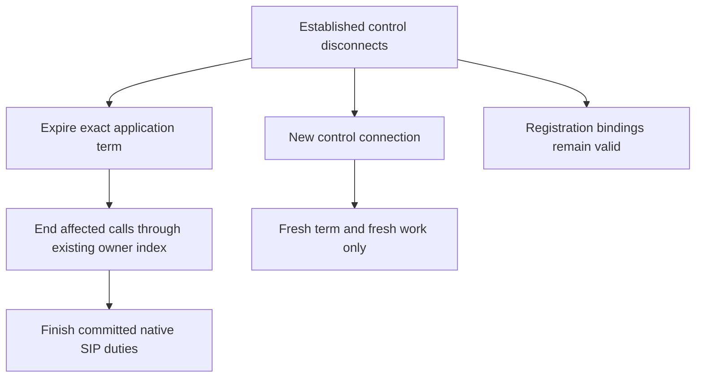
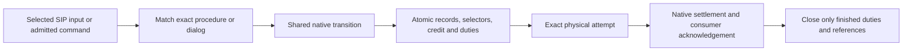
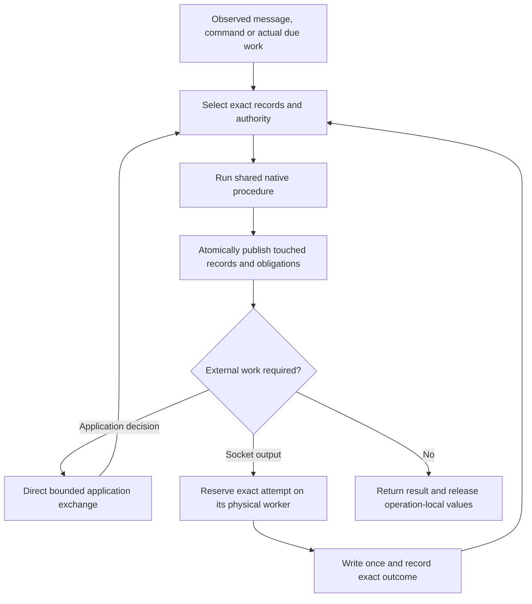

# Minimal binary Redis execution

Status: normative contract for the binary Redis runtime that the service
selects with `SIPBRIDGE_STATE_BACKEND=redis`. It is not evidence of complete
live-workload acceptance. The older checkpoint runtime is retained for explicit
fixtures only. See [Runtime](runtime.md#selected-serving-runtime) for startup.

## Boundary and required behavior

JSON belongs on the authenticated application control connection. Redis payloads use raw private protobuf records. Redis hashes, sets, sorted sets, integer commands and RESP results supply bounded metadata projections; none invokes a JSON codec or Lua `cjson`. Do not wrap payloads in base64, hex or JSON. Fingerprints remain raw bytes. Existing bounded public identifiers are identifiers, not payload encodings.

Redis is the sole shared call and standalone-client authority. Inbound REGISTER
server transactions and the whole phone subscription lifecycle have a separate
sole resident owner as specified in [Runtime](runtime.md#native-ownership-domains).
No local phone record is mirrored here. A worker decodes only the selected records for one operation and releases them after commit. There is no resident authoritative cache, reconstructed Call-ID graph, deferred application-request queue or second SIP state machine. The native SIP transition functions remain shared with Memory.

Initial INVITE setup may fail during a core outage. While the application control term remains live, keep established dialog identity/routes/sequences, successful INVITE/ACK/fork duties, authenticated replacement-flow handling, committed call-NOTIFY and exact physical uncertainty. A matching native BYE on a validated replacement TLS flow can complete without another application RPC. Publishing that flow for later business delivery requires its separate ordered authority.

Standalone non-INVITE OpenUAC uses the same live controller, command policy and
resolved-network/selected-flow boundary as initial INVITE, but creates only a
`TRANSACTION` context with one actual NonInviteClient procedure, one selected
request, one physical output and its original bounded result. OPTIONS, MESSAGE,
NOTIFY (including provisioning/check-sync), REGISTER and PUBLISH are supported;
no dialog or subscription is created. A positive socket write leaves the result
pending. The matched final response or native Timer F completes it; N/U reports
UNKNOWN without inventing a SIP outcome, and a later final may still complete it.
401/407 are final transaction responses here, without credential continuation.
Consumed control sequences return UNKNOWN and never start another transaction.
Native F/K deadlines use the existing due index; UDP E repeats use the existing
process-local heap only after exact settled W evidence, with no Redis work per
tick. Response/F publishes the exact original-worker stop/proceeding hint.

The standalone procedure owns its result and wire records until native termination,
the original waiter cutoff and physical closure. Definite proofs are settled and
actually/recovered-consumer acknowledged before metadata removal. For an exact
terminated standalone transaction with no remaining native timers, dialogs,
events or live waiter, U becomes obsolete only at the immutable physical deadline
plus two minutes. The existing proof-only Forget operation releases that evidence;
metadata and its indexed duty remain for lost-reply reconciliation. Exact absence
then permits terminal removal without asserting W/N or consumption. There is no
control history, new scheduler, handoff or ongoing cleanup scan.

## Initial native refusal

A request refused before application admission still arbitrates against
its exact native server selector. Tagged refusals preserve the request's To tag
and create no dialog selector or mutation of the existing dialog. A tagged
INVITE refusal still owns its sole native-local initial server procedure, not an
in-dialog procedure on the departed call. Its exact non-2xx ACK and original H/I
completion follow that actual unowned refusal association; the To tag alone does
not change it. A matched CANCEL after that selected final retains only its exact
native CANCEL child and response; it cannot replace the INVITE final or acquire
application state. That child retains its own native and physical closure duties.
This also allows 481 after a subscription or call context has ended. Publish its selected final, one unowned server
procedure and exact physical output atomically; a racing application admission
cannot select a second final. The SIP process supplies local attribution without
creating an application lease, business result or callback. Use the existing
server reducers, H/I/J deadlines, local UDP response derivative and physical
W/N/U lifetime. Reliable duplicates are suppressed; UDP duplicates reuse only the
exact positively written selected final while its native lifetime remains live.
The initial-refusal context has no application result, even when its INVITE final uses the native response sequence. Terminal selection must not invent a result for that sequence. Retire the refusal when its actual native and physical duties close. It requires
no recovery queue, historical RPC receipt, registration or subscription state.

## Control disconnect

Application control is disposable. Disconnecting an established control session ends its application's calls in that native pool. Reconnecting admits fresh work under a fresh term; it does not restore calls, reconcile earlier commands, transfer application state or replay a command/event history. Do not advertise controller reattachment, persist recovery handles or retain results for a later session. Native phone TLS reconnection is independent: a phone may reach another worker and continue its dialog while its application control term remains live.

Renewal that definitively observes missing, expired or invalid application authority
closes the control session so the application can admit fresh work. A transport
failure or uncertain renewal keeps its existing bounded lease; it does not recreate
missing authority or establish that an earlier write failed.

Reuse the existing application term and owned-context set. A disconnect expires that exact term atomically and wakes the existing owner-expiry scheduler. Because peers in one native pool share the term, this deliberately ends that application's calls throughout the affected pool; it needs no per-session call index. An old disconnect cannot expire a newer term. A control handshake that was never established triggers no disconnect mutation. Redis failure leaves the existing finite lease expiry as the fallback, without a retry queue or new polling timer. For each expired call, inspect its bounded actual dialog references at the same revision and stage a native cleanup BYE for each eligible confirmed dialog in the same expired-term-fenced publication that releases its application membership. An incoming 2xx awaiting ACK keeps its original native ACK deadline; if that ACK arrives after release, its publication atomically stages the cleanup BYE on the validated completion flow. Existing UAC ACK output requires its own positive WRITTEN proof before cleanup. If an already-selected winning initial UAC late offer has no selected ACK and still needs an application answer when control is lost, terminate that exact native dialog without fabricating an ACK or BYE; preserve the original transaction and other fork duties. A later new unwanted late-offer branch follows the shared [native rejecting ACK contract](runtime.md#forks-cancellation-and-outbound-setup). Native physical uncertainty remains owned and is never retried merely because control disconnected.

For an initial late-offer UAC whose application answer ACK has UNKNOWN physical evidence, control loss may abandon that setup only after the original physical deadline plus two minutes and the first call-end cutoff plus two minutes. Require an unowned ended context, the exact initial winning dialog and ACK as the sole remaining output, and closure of every other native, event and waiter duty. First forget only that exact obsolete UNKNOWN proof under its existing native fences; a definite W/N that wins the race still takes its normal consumer path. After proven proof absence, one revision/assignment-fenced publication applies the SDK dialog termination, removes the exact ACK output and actual owner references, and clears its result backlink. Do not separate those changes or extend either cutoff. This adds no marker, history, ACK-written inference, BYE or established-call exception.

Owner loss ends the application call, not already committed SIP work. Finish only actual successful-final/ACK/fork, output and NOTIFY duties under their existing native deadlines and exact physical evidence. No lifecycle event is redelivered to a later control session. Registration bindings belong to the application directory and survive until normal expiry, unregister or replacement; ending a control session does not delete them. The native REGISTER transaction retains only its own remaining protocol/output work.

Phone subscription lifetime, released-processor adoption and exact socket-close
handling belong to the [resident phone owner](memory-core.md#shared-session-capability-for-the-local-phone-domain).
Its local capability intentionally does not claim immediate cross-worker early
revocation visibility; Redis call publication and call owner loss remain atomic.
REGISTER business bindings remain outside the native transaction owner. Redis
call-NOTIFY and standalone NOTIFY retain their existing records and physical proof;
method-based dispatch must not divert them into the resident subscription path.

## Record boundaries

| Record | Retain | Release |
| --- | --- | --- |
| Context | Non-reused identity/incarnation, application owner/term, command watermark, current delivery, accounting and timer assignment | Terminal state and all required duties/results finish |
| Dialog | Tags, routes/target, transport, sequence watermarks and outstanding native negotiation/ACK/fork facts | Native termination and remaining obligations finish |
| Subscription | Identity, accepted flow, expiry, remote/local sequences and references to required notifications | Termination and required notification duties finish |
| Procedure | Only still-required transaction facts, original deadline and message/output references | Protocol/replay duty and all actual output/result dependencies end |
| Physical output | Exact immutable wire once, flow/process epoch, attempt identity, deadline and outcome | Settlement, dispatcher acknowledgement and remaining dependent duties finish |
| Operation result | Exact sequence/operation identity, minimal outcome and still-required message references; project the current context snapshot at delivery | The original admitted waiter and actual native/physical obligations no longer need it |
| Native lifecycle event | Bounded existing lifecycle snapshot and exact message evidence needed for delivery | Acknowledgement or the existing finite delivery cutoff |

The native lifecycle event record retains existing lifecycle delivery debt only; it is not a fresh-request queue or a new generic queue framework. Transient PROVISIONAL history is not a recovery guarantee. Selecting an authoritative final response atomically removes that initial procedure's outstanding PROVISIONAL event, its deadline and any wire owned only by that event. An application call that already captured the immutable event may finish, but its completion cannot recreate deleted debt. ANSWERED, FAILED, ENDED and required NOTIFY keep their independent delivery rules.

A physical-output metadata record retains the exact canonical `FlowWrite` authorization and bounded native completion references; the selected SIP wire lives in its own referenced message record. Reservation compares a raw digest of the incoming deterministic `FlowWrite` before marking STARTED and pins both records. Up to three referenced procedure, result, or dialog records may change while the attempt is pending, but count-only dependency pins prevent their deletion until final settlement. Application-class reservation also fences the current live application term and the exact current delivery witness; a domain-separated nil/present delivery digest is updated with the context. Native completion and late exact physical proof do not depend on that application fence. A bounded ready-index peek reads metadata only; it never reserves or reads wire.

Do not persist mutexes, channels, parsed mutable SIP graphs or rich public SIP DTOs. Reuse immutable message facts inside an operation; project a public DTO only at its delivery boundary. Preserve each waiter's exact operation outcome and required request/response evidence even after a later command; a newer outcome cannot replace them. The context snapshot is projected from current context facts at result delivery, matching Memory; do not store a redundant historical context snapshot in each result. Current context absence cannot establish historical non-acceptance or NOT_WRITTEN.

The current result slot is identified by the context's command sequence. A superseded result remains only while its admitted original waiter or an actual native, output or lifecycle owner still needs it. Its fixed cutoff is the original operation deadline; no later replay extends it. At actual owner closure, remove an expired superseded result or schedule one exact cleanup at that original cutoff. Capture a completed outcome, required message bytes and selected current projection atomically before its original waiter returns. A waiter past its absolute deadline emits no frame. Supersession never settles physical uncertainty, and no per-waiter identity history or result copy of the context graph is retained.

A single-output command result may retain the exact metadata-field reference to the output that still owns its physical-result lifetime. This backlink permits a successor of another command kind to select that exact owner without scanning procedures or following a later procedure command pointer. Keep it through UNKNOWN; clear or transfer it atomically with metadata deletion or replacement and the corresponding result-expiry re-drive. A native replay cannot silently attach a fresh attempt to an older ordinary command receipt. This private reference is absent once the result no longer has that output dependency; multi-output commands retain their separately defined acceptance/completion semantics.

A retained `NOT_ACCEPTED` receipt records that this operation created no SIP
output or protocol transition. For a command refused by a SIP rule, it
stores the rule's status in the existing `sip_status` field. Its status is zero
for other refusals. The receipt may include a bounded error and the originating
request identity. It has no pending outcome, output or message references, or
retirement proof. The original waiter cutoff controls expiry. Other operations
on the same context have their own outcomes.

A pending result's cutoff is its immutable original command deadline. A shorter physical authorization cannot replace it. The live waiter maps that cutoff through its verified monotonic worker-lease anchor without retaining another timestamp or waiter identity.

Private protobuf field numbers and selected-record codecs are owned by the private schema and native API. Settle them in reviewed implementation slices under these documented bounds, alongside byte accounting and conformance checks. Preserve nil/presence, exact required wire and native matching invariants without a wire-to-rich-DTO-to-wire detour.

## Concrete storage shape

Use one Redis hash per non-reused logical context. Store context, dialog, procedure, physical-output, lifecycle-event and still-required result records in separately addressable fields; each value is its own raw protobuf record. Lua-visible revision, incarnation, owner/term, command watermark, assignment, accounting and earliest deadline are native hash fields. This avoids a separate key for every small object while still allowing HMGET of only the selected records. Never HGETALL and decode the whole context as an ordinary-operation shortcut.

Native selector maps resolve transaction/dialog keys to context and record identifiers. One namespace hash uses the selector class and raw 32-byte digest as its binary field; the bounded value identifies the context, incarnation and exact record field. A lookup resolves that mapping, validates the current incarnation and reads its target plus explicitly requested companion fields in one read-only script on the single Redis primary, returning current owner and revision. Conditional insertion/removal joins record publication and accounts the exact selector field/value bytes; an existing mapping never silently moves to another context. Application-owner membership sets support actual owner expiry. Per-worker sorted sets contain only contexts with real timed duties; per-target pending-output indexes support exact physical delivery. Indexes are atomic projections, not a second state authority or a durable application callback queue.

Serialize compatibility versions, encoding identity, selected-record descriptor graph, frame kinds, key/index interpretation, decoder limits and namespace binding as an explicit deterministic binary profile tuple. Its raw keyed digest binds shared compatibility and logical authority; primary-process metadata does not. Source and image receipts remain separate pins, so a comment-only source edit does not invalidate compatible records. Keep public reference identifiers in their canonical form; do not turn record blobs or fingerprints into textual encodings. Private field numbers and presence belong to the owning private protobuf schema, not a second prose field catalogue.

Connection construction derives that profile and logical authority offline and allocates a lazy client using the shared Redis connection options. A bounded refresh atomically checks the actual primary run ID, master role, Redis clock and exact profile; it may initialize an absent profile for an empty start and never overwrites a mismatch. The returned store is bound to the observed primary, while logical authority remains unchanged across primary promotions. An uncertain refresh reply remains UNKNOWN and requires observation before relying on the connection.

A retained command result records its sequence, operation ID and raw 32-byte deterministic command fingerprint alongside its immutable outcome. These bounded facts distinguish an exact replay from a different command at the same sequence; expiration never proves an uncertain prior operation did not happen.

An application BYE on an established call admits its own bounded continuation credit under the current application lease, command sequence, policy, selected dialog and flow. Its one atomic publication advances the native dialog and local CSeq, creates the selected NonInviteClient procedure, exact request and application-authorized physical intent, and records a pending result with the original command deadline. The exact physical result first resolves that receipt as ACCEPTED with its request on WRITTEN, or UNKNOWN on NOT_WRITTEN or uncertainty; publish that observation before releasing definite proof. A matched final response or native F timeout can later upgrade the shared result and publish the dialog ending transition without changing a result already returned to an earlier caller. Exact proof settlement, timer and selector retirement, result wire ownership and lifecycle delivery remain separate duties. Native owner-loss cleanup BYE uses its existing cleanup authority and does not lend its reserved continuation credit to a fresh application command.

A remote in-dialog BYE response retains its exact server transaction, dialog and physical output under the existing original cutoff. Dispatch its output duty to the BYE consumer and its UDP Timer J to the BYE server reducer. At the original cutoff, exact pending or started proof expires to NOT_WRITTEN or UNKNOWN; definite proof follows ordinary settlement and acknowledgement, and absent proof permits retirement only with its existing consumed marker. UNKNOWN removes only the expired output scheduling head after the exact owner and current proof are revalidated; the output, uncertainty and native duties remain for late definite completion or existing fully-ended-call retirement. Neither elapsed time nor physical absence implies a write.

An application NOTIFY command remains pending after its request is written. The original waiter receives COMPLETED only after a final SIP response or native timeout, and receives UNKNOWN when it cannot observe a definite outcome by its original deadline. A later native completion may upgrade the shared result while an earlier caller keeps its already captured DTO. The pending procedure remains until that result finishes, after which procedure, selectors and timers can retire independently while the result retains only its necessary raw request/response references.

An application BYE publishes its exact dialog request and independent native procedure under the current application, policy and flow authority. Its original waiter observes ACCEPTED with the exact request after a definite write, UNKNOWN after an uncertain or failed write, or COMPLETED if the matching final response or native timeout has already completed it. Later physical or native evidence updates only that command's retained result. UDP retransmissions reuse the original flow and native F cutoff; all result, timer, output and dialog owners close through their existing exact duties.

A preceding remote re-INVITE changes the dialog's remote transaction association. A later application BYE still publishes ENDED through the original canonical call root; its own procedure, original result and lifecycle event retain the exact response under their existing independent cutoffs. The additional cleanup-procedure event backlink remains specific to native cleanup BYE.

Application INFO, REFER, UPDATE and in-dialog NOTIFY use the same selected dialog, non-INVITE client reducer, output proof, F/K deadlines and local UDP retry machinery. A definite write leaves their original result pending until the matched final response or F timeout; an uncertain or failed write returns UNKNOWN. Their native transaction does not terminate the dialog merely because it times out. The exact result and selected request/response records remain owned only while their actual waiter, native procedure, physical output or lifecycle references need them.

An initial UAC's still-owned successful ACK uses the same exact local-BYE
association validation as a later INVITE ACK. An application BYE may replace the
dialog's current local transaction while that original ACK output awaits its
unchanged cutoff. An accepted remote re-INVITE replaces the separate remote
transaction association; it does not change that ACK's retained local INVITE
owner. Validate the retained initial INVITE/ACK and their actual
procedure/dialog owners, then validate the current BYE association or the SDK's
ended-dialog condition. Apply this in physical inspection/settlement and in
absent-proof retirement and fully-ended output reconciliation. An exact duplicate
successful final also retains its original local ACK and M obligation after a
remote re-INVITE; the remote transaction alone is not its local owner.
An initial UAC ACK may be native-generated or its exact current application-answer
ACK. Physical inspection and absent-proof retirement follow that same canonical
wire reference and its existing native owners.
The original proof, W/N/U meaning, cleanup ACK-W gate, cutoff, revision and timer
assignment remain unchanged.

An outgoing re-INVITE binds one independently funded InviteClient to the selected established dialog and publishes its original request, result, local INVITE association and B/D/M duties atomically. Its matched final completes the original result and applies the shared dialog reducer, including the exact SDK-generated ACK when required; a remote offer that requires an answer uses the application ACK path. UDP A remains a local derivative of the exact written attempt. A later local BYE can replace the dialog's current transaction while an earlier INVITE or ACK proof is still owned: recovery follows the exact retained local INVITE request and ACK, and validates the saved BYE's actual transaction association when needed. A repeated successful final while that local INVITE is still selected uses its actual positively written ACK and original M, even while BYE is pending; an unresolved ACK attempt suppresses another emission. An already selected BYE is not created a second time. An application CANCEL targets the actual pending InviteClient and publishes only the paired native CANCEL produced by that reducer, using its already admitted continuation credit. Once a successful INVITE is awaiting ACK, cancellation follows the existing ACK-before-cleanup-BYE rule rather than inventing ACK evidence.

When a new local INVITE replaces the previous dialog association, it can release an old ACK output before its indexed cutoff only if the same selected ACK has a positive dialog write witness and its exact physical proof is absent. It can similarly release the previous application INVITE output only after its exact native consumer marker, absent proof and completed result all match. These conditional releases remove only the obsolete output metadata and owner links; retained dialog, procedure, lifecycle and original-waiter wire owners continue to hold their exact messages. If the exact blocking attempt is already WRITTEN, a new local INVITE may first finish that attempt through its existing native settlement and acknowledgment path, then reselect the current records under the same original admission deadline. This completes native work without another socket write; only the resulting positive witness and released proof can grant replacement. Pending, started, UNKNOWN or NOT_WRITTEN evidence cannot establish a written ACK or grant this completion path. The SDK dialog transition remains the admission authority, and no receipt deadline is extended.

If the previous InviteClient is still Accepted with its original M active, that same replacement transfers its selected successful final, positively written ACK, exact completion flow and bounded ACK emission count to that actual procedure. An exact duplicate successful final is classified by the existing SDK transaction reducer and may replay only that retained ACK on its retained flow, bounded by the original M and existing emission limit. The transferred records remain owned until M and their actual replay outputs close; they do not retain a command receipt or create a new retry deadline. Other fork dialogs keep their own independent native ownership.

A repeated successful final may need another SDK-selected cached ACK before a consumed attempt's original physical cutoff. For the initial INVITE, the currently selected local INVITE, or a transferred successful-ACK tuple, select only that exact positively written ACK and its actual sequence, wire, flow and procedure/dialog owners. Retained output metadata alone does not mean an attempt is unresolved. When every exact old physical proof is absent, the same replay publication may remove only that consumed metadata, its output owner links and its timer while staging the new native ACK. Clear an application ACK result's obsolete output backlink under the same publication without changing its outcome, wire ownership or original cutoff. Any present proof, including unconsumed WRITTEN or NOT_WRITTEN, suppresses this path. An earlier positive write cannot authorize replay of a newer UNKNOWN attempt or a different local INVITE sequence. Preserve all native, wire, lifecycle and result owners, the original M and the existing replay bound; no new replay is scheduled without an actual reducer-selected successful-final replay.

Each process multiplexes its result-hint channel onto the worker's single PubSub connection and uses a bounded map of currently waiting RPCs keyed by exact context, incarnation and sequence. Both channel subscriptions must be acknowledged before publishing a worker binding; an unexpected subscription epoch fences that binding and its waiters. Result hints do not invalidate worker scheduling heads. A publication atomically sends a bounded typed hint with an actual result update; the receiver selects only matching local waiters. Register before the first fenced result read and validate the subscription generation after the read. Hints grant no authority: each wake reads the exact result, and subscription or lease loss fences the local waiter. There is no persisted waiter identity, inbox, polling loop or deadline-only background write. Persisted wall deadlines are mapped through an already verified monotonic lease or due-observation anchor rather than freshly remapped after a clock jump.

Account for encoded record lengths, scalar projections, selectors and required completion reservations directly. Never size a result or receipt through JSON/base64 as a proxy. Reserve room for required INVITE/ACK/NOTIFY and exact results at admission; charge/refund touched deltas atomically. Measure actual Redis MEMORY USAGE including indexes as well as serialized bytes. Avoid content-addressed blob infrastructure or unbounded receipt tables.

A native publication may spend previously admitted completion credit. The atomic storage operation computes positive growth of the final planned records, indexes and context envelope, and deducts it before any mutation; Go does not duplicate that accounting or guess a decrement. Exclude the reservation's numeric credit and its own decimal text from the growth calculation. Shrinking that text can only release additional capacity. Released bytes belonging to a still-open ACK/NOTIFY obligation must replenish its credit or stay reserved until explicit closure; do not fund that admitted obligation through a future fresh business admission.

An optional per-context credit ceiling bounds the pooled remaining credit for open obligations. Admission adds its independently bounded contribution to both; native closure spends required completion growth, reduces the ceiling and clamps the remainder. New work without an existing completion duty gets its own charge and leaves earlier reservations available. Atomic record, index and physical-proof releases replenish only the current ceiling, including when the exact proof settles outside a context publication. A required worker transfer may spend or replenish pooled credit for its exact assignment-byte change. Refunds cannot increase namespace charge through changing decimal-field lengths. A zero ceiling cannot be revived by a late release. The engine owns each admission and closure decision.

Each retained business result records the deciding application's existing lease
term. Exact replay verifies that term and designated recipient as well as the
sequence, operation and fingerprint; a fresh term cannot recover an old decision.
Phone subscription credit, required NOTIFY and retirement belong exclusively to
the resident owner and are not Redis obligations.

The namespace capacity hash tracks context count and logical retained bytes atomically with every context, timer and physical-output mutation. Logical bytes include each context hash key and exact hash field/value bytes, completion reservations, each nonempty per-context deadline-key string, each deadline member and eight-byte score, each per-worker timer or ready member and eight-byte score, and each binary selector field/value. Each context's index-byte scalar is itself counted as a hash field. Shared per-worker key names, Redis allocator overhead and separately bounded worker/application control-plane metadata are excluded; measure actual Redis memory separately. A terminal native caller may retire an exactly fenced context only after its records, outputs, deadlines, indexed projections and reservations have all been discharged. No context scan or automatic reset repairs accounting.

New work counts against the limits of the instance that accepts it, even if
the process restarts or another worker takes over its timers. A request waiting
for a controller decision reserves room for an inbound leg or a refusal and
counts toward the limit for the source address sipbridge saw. When a decision
moves a request into a call or refusal, Redis updates the counters in the
same operation. Retiring the context releases its slot.

Outbound call legs and refusals generated before controller admission have
their own limits. A reply sipbridge sends because admission is full uses only
the latter limit. Adding an instance adds its own slots. Redis still tracks
the namespace totals and enforces the per-context record and byte limits.

An admitted initial INVITE reserves 688 KiB on TCP or TLS and 864 KiB on UDP
for work it may still need to finish. That covers eight maximum-size SIP messages
and up to 22 records that track sends on TCP or TLS, or 44 on UDP. Sipbridge
checks state growth when it saves a change. A UDP timer can resend the saved
response using the existing write record. Each additional outbound fork branch
gets its own allowance when it is accepted. Once the initial replay timer
ends, an eligible confirmed leg with no outstanding setup writes or lifecycle
events can give back its setup allowance and keep the room needed to finish
the call.

Quiet records retain compact facts and their necessary owned bytes. They must not keep a large packet or decoded-record buffer alive through a small Go substring/slice. Share a required immutable output's wire within its bounded procedure; do not duplicate it in a rich public-result DTO merely for storage.

An initial UAS provisional response that has been superseded by a selected final is not an active-call recovery obligation. Its original physical cutoff first resolves any pending ordinary Respond receipt to its truthful outcome. An UNKNOWN attempt may then be forgotten at the unchanged original physical deadline plus two minutes when its own receipt is no longer pending and it owns no required final, ACK, event or dialog wire. Preserve that receipt's UNKNOWN certainty; a replay cannot recreate a physical attempt or recover discarded evidence. Keep the exact output metadata, native ownership and indexed cutoff through proof release and lost-reply reconciliation. Selecting a final re-arms only the actual provisional outputs' original physical duties, so an earlier removed head cannot strand this finite release. This exception does not cover successful finals, ACKs, BYE, required NOTIFY or another transaction's output.

Quiet shared dialog records store their compact native continuity facts directly. Only a bounded procedure, required output or historical result that still needs a message retains its exact wire, transport and relevant source/destination metadata in a small private protobuf record. Do not serialize a parallel graph of typed message construction fields. Full-codec qualification, including protobuf decoding and ownership, must justify a representation; an isolated hydration benchmark is insufficient.

Loading a selected message restores an operation-local immutable holder without eager SIP parsing. Its first actual native consumption uses the existing parser once; matching, construction, timers and projections reuse that holder for the rest of the operation. Memory keeps its existing parse-once path. An already admitted holder may be reused only when the wire, relevant transport/source/destination metadata and validation provenance correspond; equal wire alone is insufficient. Never parse unrelated retained messages or keep a process-wide parsed-message cache. The physical writer takes exact committed bytes without SIP parsing. Preserve observed versus strict native rejection, exact identity/fingerprint checks, header ordering and noncanonical wire; malformed stored input never gets a weaker parser fallback.

## Call procedure target

The following boundaries apply to the selected call implementation. The pinned transaction and dialog reducers remain the protocol authority; these records and publications carry their actual obligations, not another call state machine.

Initial UAC construction uses the same pure native builder as Memory: the caller supplies the already chosen context, flow, advertisement, tag and branch, and the builder returns the native transaction and Start effects without publication or I/O. Preserve Memory's tag/branch derivation and request bytes. Validate transport, selected flow, policy, actual encoded sizes and the bounded initial continuation contribution before any Redis-backed initial write. The private application-command entry authenticates the current controller term and original operation deadline, creates a fresh incarnation and the same domain-derived Call-ID, and resolves either the admitted selected flow or the requested network target under that bounded operation. It rechecks policy and worker authority before atomic admission; an ambiguous publication is never retried as a fresh call. A credential reference may be persisted with the native procedure, but lookup credentials and digest secrets remain operation-local.

Initial UAC INVITE admission publishes its bound context, original procedure and selected request, exact ACCEPTED command receipt, client selector, initial physical intent and semantic deadline together. The receipt is ACCEPTED when the native intent is staged, matching Memory; its exact initial-output backlink remains until the corresponding metadata lifecycle releases or transfers it. Later responses and lifecycle duties are separate. An explicit qualification headroom input is not a serving configuration or permission to write before the production bound and local UDP retry path are locked.

The serving due dispatcher routes an initial or re-INVITE UAS dialog ACK deadline to the exact existing native ACK-timeout reducer, preserving its cleanup BYE and original deadline.

The private UAC deadline dispatcher applies the pinned client transaction transition for B, D and M under the exact due revision and live timer assignment. Timer B may end an unanswered initial call and publish its FAILED lifecycle duty and truthful command completion together; D and M close their native transaction deadlines without retiring the original anchor or discarding later fork obligations. Timer A remains a process-local derivative.

| Selected operation | Atomic native publication and retained lifetime |
| --- | --- |
| Initial INVITE UAS or UAC | Retain the selected server or client procedure, origin, exact result and native timers while setup or a response obligation remains. Outage may fail new setup, but a committed successful-final obligation remains durable. |
| Successful final and forks | For a received UAC success, publish the selected fork's dialog, selector, native transition and outgoing ACK duty together. A UAS success instead retains its native final-retransmission and incoming-ACK wait. Each fork retains only its own outstanding final/ACK and cleanup duties; preserve the existing bounded fork limit. A losing UAC fork's cleanup BYE requires positive ACK WRITTEN proof. |
| In-dialog ACK or remote BYE | Resolve the exact dialog and associated procedure. Distinguish non-2xx transaction ACK from 2xx dialog ACK. A validated replacement TLS flow may complete native obligations without a live controller; publishing that flow for business delivery remains separately ordered and authorized. |
| Re-INVITE, local BYE or REFER | Fence application command authority, sequence, selected dialog and current flow; publish the shared native transition, result and exact physical intents together. Preserve offer/answer, ACK and outstanding fork obligations. |
| CANCEL | Match the exact original INVITE and publish its native paired transaction and any resulting obligations without treating absence or uncertainty as proof of an outcome. |
| Authentication challenge | Commit the matched challenge and attempt first; perform a bounded credential call outside the publication. Before an authenticated retry, reselect the exact procedure and recheck owner, lease, policy, delivery, flow and deadline. Never persist the credential secret. If the process dies during initial credential lookup, do not replay it; the existing application-owner expiry bounds cleanup of that failed setup. |

For an application answer to a remote offer in a successful INVITE, select the current dialog and its exact InviteClient, apply the native local ACK with the supplied answer, and commit its native-completion output and independent command receipt together under the validated application admission. An ACK write is positive evidence only after its exact physical WRITTEN completion. For a new local re-INVITE, retain the actual new InviteClient and its own selector, output, semantic timers and result under the selected dialog; the earlier INVITE and any outstanding fork duties remain independently owned. A CANCEL applies the native transition to the selected active INVITE and starts only its actual paired client transaction. A successful final racing CANCEL keeps its required ACK, and any cleanup BYE waits for that ACK’s positive write.

The paired client CANCEL remains an actual child of the selected INVITE and uses that INVITE's existing contribution. Its original F/K deadlines and exact physical output are retained until their own duties close; UDP E is a process-local derivative of a recorded write. An unknown physical outcome keeps its proof and child ownership. After the fully ended call and both fixed retirement horizons, exact proof-only forgetting may release that physical output without asserting delivery; the child then retires through its native selector and re-drives its parent.

If CANCEL arrives while credentials are being looked up for a committed initial INVITE challenge, select the exact current challenged attempt, apply its native cancellation and end that setup in the same publication. The SDK leaves an already terminated reliable transaction unchanged; the ended context fences the credential completion in that case. The challenged transaction's already committed ACK and physical duties remain independently owned. The credential completion must reselect and cannot start an authenticated retry after that cancellation; no additional credential timer or recovery record is created.

For a fresh UAS INVITE, publish an unbound UAS context, UUID request identity, selected InviteServer procedure and original wire, server transaction selector, original TimerTrying and direct-decision cutoff together before the single application presentation. The SDK's 200 ms Trying timer and the bounded decision race on the same context revision. While the direct decision remains unbound, Trying may select and retain 100 but cannot physically emit it. A deferred status-zero decision binds the validated current application, records its accepted receipt and emits that held 100 once; an immediate final replaces an unsent 100. For an established re-INVITE, its own Trying deadline likewise retains an unsent 100 until its decision is accepted; status-zero emits that held response through the exact dialog/procedure owners, while a final, timeout or CANCEL replaces it without a socket write. If Trying fires after status-zero, it stages the response directly. An expired unbound initial presentation selects its exact initial InviteServer and original decision deadline, stages native 503 and its physical duty atomically, marks the unbound context ended with its fixed first-end retirement cutoff, and consumes neither an application command sequence nor an upstream lease. It creates no result or lifecycle event; the no-result output retains exact initial-procedure and final-response provenance for settlement and terminal cleanup. A held unsent 100 is replaced by that final; an already bound or changed procedure conflicts. Its output, transaction and any later ACK retain the ordinary native deadlines and uncertainty rules. Missing or expired presentation follows the same native 503 transition as Memory. A direct final returns ACCEPTED after committing native intent; later application Respond commands consume their sequence under current authority and return their result only from recorded physical completion or their original deadline. Provisional and final response quotas remain bounded.

The initial InviteServer's admitted pooled contribution funds its own bounded Respond continuations, as in Memory. Check total, provisional and final emissions against their limits. Each write must fit the context’s record and byte limits. Independently admitted procedures fund their own work.
Respond selection fences the live application, policy and current delivery. Once committed, the selected SIP response uses native RESPONSE authority on its admitted flow and does not require that application lease to remain live at physical reservation.

At a UAS dialog's original ACK timeout, apply the native dialog timeout without hiding an already selected local BYE. When no local BYE exists, stage the transitioned dialog, actual noninitial client procedure and selector, exact native output, F deadline and physical cutoff atomically on the retained completion flow, using the admitted call contribution without a live application lease. When an exact retained local BYE already owns that dialog's termination, validate its selected wire, native transaction association and existing owners, preserve that BYE and its original output, result and F/K duties, and consume only the ACK-timeout transition in the same revision/assignment publication. Do not create a second BYE or infer delivery from its presence. A UAS timeout does not require local ACK proof; a UAC losing-fork cleanup still requires its positive ACK proof. A matched local BYE final or its native F termination publishes the SDK's dialog timer cancellations in the same revision- and assignment-fenced publication as the ended dialog. Remove each canceled shared dialog timer member; Timer2xx remains a process-local derivative and needs no shared index. An ended dialog must not leave an indexed ACK deadline whose native timer is already inactive. Preserve the actual BYE, physical evidence, result and original transaction cutoffs; cancellation grants no delivery inference.

For a successful initial UAS final, one atomic publication selects the response wire, updates the InviteServer procedure, creates the dialog and its selector, retains the original request and final through the dialog references, and indexes the original transaction L and dialog ACK deadlines. Dialog.Transaction is the SDK transaction key, not a Redis record name; the server selector resolves its procedure. Use `r:procedure-<UUID>` and `r:origin-<UUID>` and transaction timer members `call-tx-<UUID>-<timer>`; dialog members use the existing dialog timer helper. H, I, L, Trying and ACK are semantic deadlines. Timer G and dialog 2xx repeats, including reliable-transport 2xx repeats, are bounded process-local derivatives armed only from the exact recorded WRITTEN attempt, with the original native cutoff, lease fence and targeted ACK stop hints. They do not cause a Redis operation per repeat. Preserve the already-admitted UAS continuation headroom, ordinary atomic capacity refusal, physical uncertainty, and all native ACK/CANCEL obligations; this target does not yet claim a complete UAS runtime.

Initial UAS physical-response completion selects its exact retained metadata, owning procedure and, for an ordinary Respond, that output's own result. A newer procedure command pointer cannot replace that result's identity. Match Memory's server-response receipt: WRITTEN gives COMPLETED with status; NOT_WRITTEN or UNKNOWN gives UNKNOWN with status and bounded delivery error, with no redundant request/response wire retained in the receipt. A later exact WRITTEN proof may upgrade the same UNKNOWN receipt. Publish the exact result hint atomically with that receipt. Direct-final ACCEPTED certainty remains final at intent commit and does not become physical-completion certainty. Before settling W/N, re-arm its original output cutoff under the same selected revision; UNKNOWN does not settle, acknowledge, retry or create a new timer. Only an actual returned dispatcher or recovered definite consumer releases the settled proof. Per-output evidence and ownership references govern independent responses; a transaction-wide consumed flag cannot stand in for them.

Command admission validates the live application, policy and delivery witness; committed SIP response outputs use RESPONSE physical authority even when they reference an ordinary command result. They may still reserve after application expiry, matching Memory and preserving a committed successful final. Result identity does not grant or require APPLICATION physical authority.

One immutable selected message field can serve all procedure, dialog and physical references needing the same bytes. A replacement-flow physical variant has a separate field and never changes the selected logical final. A quiet dialog retains native identity, routes and sequence facts; it does not retain packets whose protocol, replay, physical and waiter obligations have all ended. Operation-local selected-message memoization prevents repeated parsing without introducing a shared parsed cache.

Replacing an initial-UAS provisional response releases its displaced selected message in the same revision- and assignment-fenced publication only when its last actual owner closes. A completed output cutoff may have retained that message as the procedure's current response before the replacement existed. The replacement must therefore account for that remaining procedure reference even when the earlier output metadata has already retired. Retain bytes still owned by an actual output, result, procedure or dialog; an elapsed deadline alone is not ownership proof. Ordinary Respond receipts retain no request/response wire, and a provisional response cannot be a dialog's selected successful final. This exact reference release does not infer physical certainty, release UNKNOWN evidence, change original deadlines or weaken the final zero-record Terminal guard.

A remote BYE's server response settles only its exact definite physical proof. Before settlement, re-arm its original output cutoff under the current metadata/revision and executor fences, so a crash cannot strand a late definite proof after an earlier uncertainty cutoff. Keep the current executor when live; an expired or absent assignment may use the actual live completing worker, independently of the output's physical flow owner. Persist the selected server procedure's consumed marker under the same current metadata/revision fence before releasing that proof. Positive WRITTEN may also set its written-final marker; NOT_WRITTEN and UNKNOWN never establish that fact. This native completion does not require a live application lease and grants no business-flow adoption.

The first publication ending a call records its original retirement cutoff at first end plus two minutes and indexes that real duty atomically with the native transition. Later obligations can delay retirement but cannot slide or replace that original cutoff; their exact deadlines re-drive the final atomic retirement. An ACKNOWLEDGED or ENDED lifecycle debt retains its frozen snapshot and no message when Memory emits no message for that transition. Initial UAC transport failure similarly delivers FAILED with its frozen ended UAC snapshot and original operation ID, with no message, selectors or event error. It uses the same bounded lifecycle lane and fixed delivery cutoff; acknowledgement re-drives the immutable call-retirement duty.

The same private `call_retire_at_ms` scalar and `call-retire` member also index the finite disposition of a cancelled initial UAS setup. Only the validated initial SDK CANCEL transition selecting 487 may create that setup cutoff, once, at selection plus two minutes. This does not change public `Ended`, its CANCELLED snapshot, or create an ENDED event. Setup retirement independently requires an unanswered UAS with no dialogs, the actual cancelled initial InviteServer and its CANCEL-produced final provenance, all native procedures terminated with no active deadlines, no remaining output or event owners, and elapsed result/waiter cutoffs. Removing the last verified initial anchor retains the same setup-only context shape and cutoff for the final zero-count Terminal publication. An elapsed setup cutoff does not permit another send.

For a validated cancelled setup that remains unbound, has command sequence zero, was never answered, and has no dialogs, the terminated initial anchor and at most its one actual CANCEL procedure may retain their exact UNKNOWN response attempts after every native timer, event, receipt and other duty has closed. This setup-only exception permits losing the initial call: for each actual owned attempt, retain its native owner, metadata and indexed `call-retire` duty until the later of the immutable setup cutoff and that attempt's original physical deadline plus two minutes. A revision- and executor-fenced proof release may then forget only that exact UNKNOWN and its pins. Absence after an uncertain release reply is reconciled under the same setup witness and fixed cutoff before atomically removing that output's exact ownership; no consumed marker or written/not-written outcome is invented. A definite late completion instead follows its existing settlement and re-drive. Re-evaluate the bounded actual owners one at a time; no polling, background recovery queue or output history is introduced. Other setup shapes and established call, subscription and NOTIFY guarantees keep their own rules.

Call response events retain the exact selected response once, with the observed selectors and post-transition frozen snapshot. The canonical original INVITE anchor owns at most three actual message-event references: one outstanding coalesced PROVISIONAL, the initial ANSWERED or FAILED outcome, and the selected dialog's BYE-response ENDED. ANSWERED and initial FAILED are mutually exclusive. UAS anchors may own their selected dialog's ENDED event as well. BYE timeout and CANCELLED remain snapshot-only; a BYE-response ENDED has no fabricated operation ID. An established re-INVITE CANCELLED event uses its existing Root to identify that exact noninitial INVITE procedure, whose Events reciprocally retains the event and its contribution. Completion or expiry atomically removes that reference and re-drives the owner; message and owner lists remain empty for this snapshot-only event. When an ACK-timeout cleanup BYE creates a message-bearing ENDED event, the actual cleanup procedure also retains that event until completion; it is already an actual response-wire owner. The original INVITE anchor remains the message event root, and the cleanup procedure re-drives its re-INVITE credit owner after its own event and native output duties close. Digest retries use the same original client anchor and contribution; a retry's optional root reference resolves directly to that retained anchor in the same context and operation lineage, with no chains or cycles. An empty procedure root denotes the original procedure itself; list ordering does not identify it. The anchor's identity remains while its actual event references remain, without retaining obsolete initial wire solely for that identity. Inspecting those at most three records supplies coalescing without another pointer or event history.

A message-bearing event names its canonical retained root independently of its at most three actual wire owners: the selected transaction, optional winning dialog and original operation result when it shares that response. Its owners may become empty when the event is the remaining wire owner; its root and reciprocal root event reference remain until completion. Event deletion and each owner's message replacement or retirement recheck the reciprocal bounded references before deleting shared wire. Maintain the ownership references atomically with those transitions, without copying a SIP packet, scanning the context or introducing global reference counts. Ownership bookkeeping cannot replace the event's frozen public payload, root, message or original delivery cutoff. Completion reselects current owners while still fencing the exact attempt timing and executor. Snapshot-only events need neither root nor wire-owner list. These bounds cover the supported initial/digest paths; another event producer must establish its own equivalent ownership before integration.

A call context retains only its actual initial INVITE procedure references (at most the original and three digest retries) and actual dialog references (at most 16). Creation and retirement update those bounded associations atomically with the referenced records; they contain no speculative forks, events, waiter identities or historical entries. Ordinary operations select only their affected records. Each independent native, output, event and result duty removes its own records and re-drives call retirement. Final retirement follows the remaining bounded anchor/dialog references after those duties close, and may stage bounded closures when one atomic change would exceed the per-operation field limit.

The same context owns sorted, unique references to its actual noninitial procedures. Initial and noninitial procedures together stay within the existing native-procedure cap; neither list overlaps the other or the dialog references. Add and remove a reference with the actual procedure in the same publication, retaining it while that procedure's output, waiter or credit obligations remain. A deferred INFO or re-INVITE can be live with no timer, so timer absence never proves native quiescence. Owner-loss and terminal handling select bounded batches from these actual references and run the corresponding native termination/refusal before removing them, keeping one real indexed termination duty through finite stages. An empty noninitial list is an independent prerequisite for the narrower quiescent retirement helper. No separate count, history registry, Redis set or polling loop is needed.

Those already-reachable procedures and dialogs retain sorted, unique references to their actual outstanding physical-output metadata. Add each reference atomically with its exact output intent, metadata and initial cutoff; remove it only with deletion of that metadata after its proof and native dependencies release. An initial INVITE procedure owns its responses; the dialog owns later ACK and in-dialog outputs. These are ownership references, not historical attempts or a second output index. The procedure bound is its existing emission limit; a dialog's bound is the existing total native procedure/emission limit, with the usual per-context record and byte limits. Quiet owners with no outstanding outputs retain no references. Validation and traversal are linear in the actual references and do not reconstruct SIP messages.

At a call output's original physical cutoff, reconcile its exact state once. A selected STARTED becomes UNKNOWN without authorizing another attempt. An unchanged UNKNOWN may remove its expired scheduling duty only after the same revision-fenced publication proves its exact metadata remains referenced by the reachable owner. It stays pinned and cannot poll, infer a physical outcome or grant a retry. A late definite completion re-arms the exact original output duty before native settlement. Actual call-end and terminal duties follow the retained ownership links, so removing the expired scheduling head cannot orphan that uncertainty.

Except for the independently superseded initial-UAS provisional rule above, only a fully ended call may forget remaining UNKNOWN evidence after both the immutable first-end-plus-two-minutes cutoff and that exact attempt's physical-deadline-plus-two-minutes cutoff. All actual dialog, ACK, fork, cleanup-BYE, native timer, waiter and lifecycle duties must independently be closed first. Retain accepted command certainty, exact metadata, owner reference and indexed terminal duty through proof forgetting and lost-reply reconciliation. Neither forgetting nor absence establishes WRITTEN, NOT_WRITTEN or consumption. An active call receives no terminal-forgetting exception for successful finals, ACK, forks or other required native work.

The selected native terminal procedure proves those bounded actual owners and duties at one context revision. A private core operation then fences that revision, incarnation, timer assignment and live executor against the indexed `call-retire` head at the later of the unchanged first-end cutoff and the exact output's physical deadline plus two minutes. It releases only that exact UNKNOWN proof and its pins; it leaves the native records and terminal head intact for reconciliation and atomic retirement. A lost reply remains UNKNOWN.

For a fully ended call with several actual owners, terminal selection follows the context's existing initial and noninitial procedure references and dialog references in batches of at most 128 fields. Every batch must observe the same incarnation, revision and executor assignment; a conflict restarts the bounded selection under the original operation deadline. This traversal is terminal work only. It creates no authoritative cache, new owner index or SIP reconstruction on ordinary operations. Check every actual procedure's terminal phase and inactive native timers, each dialog's ended state and inactive timers, and each canonical anchor's actual lifecycle references before treating the graph as closed. The existing early-dialog termination transition remains the only permitted way to close an early dialog. Timer M expiry or a missing timer by itself does not prove fork, ACK, cleanup-BYE, result or event work complete.

An original result remains independently retained until its admitted waiter cutoff has elapsed and its exact physical or native completion dependency is closed. Its scalar marker also remains while any actual initial anchor references it, even after its replay rights end; initial digest anchors may share that one marker. A terminal stage deletes an expired marker only with its last anchor reference, or with final context removal if it is also the current result. Its optional request and response bytes follow their own actual owners. A canonical response event and each actual wire owner retain their established reciprocal references until event delivery or cutoff and owner release. A winning ACK, every losing-fork ACK and its required cleanup BYE must each reach their existing native closure predicates; positive ACK-write evidence required before a losing-fork BYE cannot be inferred from UNKNOWN, an ended snapshot or another fork. Keep the shared continuation contribution until its actual owning procedure and obligations close. No terminal proof changes the application-owned result, public certainty or established dialog guarantees.

Only after those independent obligations close may a terminal pass select one exact remaining output through its actual procedure and dialog ownership. A definite WRITTEN or NOT_WRITTEN proof may be settled and acknowledged by the recovered terminal consumer only when exact output-specific native facts prove under the same revision that no physical-result-dependent continuation remains or applies; this performs no new socket write, result update, lifecycle event or application action. A pending or unexpired output-linked result still uses its normal completion; after its cutoff, clear its exact backlink and ownership atomically without changing certainty. UNKNOWN uses the two unchanged fixed cutoffs and proof-only release above, never that definite-consumer rule. Reconcile proof absence after a lost release reply only under the same terminal witness and both elapsed UNKNOWN cutoffs; a separately consumed definite proof uses its existing native consumption evidence. Absence never identifies the physical outcome.

Before deleting shared wire, enumerate the current result, actual anchor command-result references, selected output result and lifecycle owners as well as the actual procedure and dialog references. Every other superseded result must retain its existing indexed expiry or native re-drive until its wire ownership closes; missing producer coverage fails closed. After each release, reselect at the current revision and remove only exact obsolete metadata and actual owner references in one fenced publication. Preserve `call-retire` and yield to a concrete remaining native duty; an unsupported unindexed obligation cannot become an immediate no-progress loop. The final zero-count Terminal guard removes the context and closes its remaining contribution atomically, but is not itself proof that a message was unreferenced. This does not extend the rule to subscriptions or NOTIFY.

Before routing an owner combination, qualify that every unresolved prerequisite either has its real indexed completion duty or cannot reach this terminal selector. If a retained exact proof has become definite while its normal result or ACK continuation still applies, restore its original physical duty and let that existing consumer run; terminal cleanup cannot replace it. A combination without that evidence remains outside the enabled runtime path; do not hide it by dropping the terminal head or adding a periodic retry.

Before selecting a call terminal owner, the shared native call-retirement dispatcher peeks the next actual context duty excluding `call-retire`. If one exists, it moves only `call-retire` to one millisecond after the later of that duty and the checked Redis time. This ordering lets that real duty run first even when deadlines tie, without a periodic poll. Its eventual closure re-arms the original retirement obligation; the context's first-end cutoff is never changed by this scheduling yield.

Match a duplicate remote BYE against its retained server transaction before considering a new dialog request. While its previous physical attempt is still retained or uncertain, suppress another attempt. A completed UDP server transaction may replay its selected final only after the exact prior attempt is definitely consumed and before its original Timer J; replay does not require an application lease. A terminated reliable transaction suppresses the duplicate. Neither path advances the original call-retirement cutoff.

Native ACK/BYE ingress first validates the observed local flow and uses the original bounded operation deadline. Match a non-2xx server transaction ACK before a dialog ACK, and a retained BYE transaction before a fresh dialog BYE. Reselect only after a definite revision conflict, at most three times under that same deadline; uncertain publication never authorizes retry. An absent selector permits ordinary unmatched-request handling; invalid retained evidence is an error, not permission to create new work. Neither native completion requires a controller connection or application lease.

A fresh in-dialog INVITE, REFER, INFO, UPDATE or NOTIFY requires its existing live application owner. Select the exact directional dialog and context, validate the observed same-transport flow and native request/CSeq/offer rules, then publish only the pending server procedure, its request, actual noninitial membership, native deadlines and direct-presentation cutoff. This publication increments the context revision but does not advance the dialog's remote CSeq, change its offer or publish a new delivery flow. The receiving worker presents that definite admission directly to the controller before selecting an application response. The later decision reselects and applies the dialog transition with its policy and ordered delivery publication in one commit. There is no presentation queue or automatic presentation replay. At validation time only the retained INVITE requests required by the SDK's dialog identity check are decoded; unrelated final and ACK packets are not loaded. The initial private admission scope accepts an exact UDP/TCP flow or a supported replacement TLS flow; other route-adoption shapes need their authenticated qualification before serving.

An in-dialog decision may reselect and prepare from fresh records after a definite revision or assignment conflict, with at most three total selection attempts within its original deadline. This includes read-only preparation and later ownership planning, and an explicitly acknowledged pre-write rejection of its acceptance or refusal publication. A plain conflict from the atomic store guarantees that no mutation occurred; execution, transport or reply uncertainty does not. Each attempt discards its operation-local candidate and rechecks the same application witness, context, request, operation and sequence; an already consumed sequence cannot be replayed. Only a nil result with a definite conflict permits another attempt. Any returned result, authority error, expiry, semantic refusal or UNKNOWN outcome retains its existing meaning, including an error that combines conflict with UNKNOWN. No presentation is repeated and no deadline or physical-output evidence changes.

Application dialog commands use the same three-attempt bound for definite
prepublication conflicts. If all three attempts are rejected before acceptance,
return NOT_ACCEPTED without consuming the sequence or creating a result,
procedure or output. The controller may use its existing bounded retry within
the original policy deadline. An error carrying UNKNOWN must not trigger another
publication attempt. After a command has committed, a failure while observing its
result remains UNKNOWN; it cannot be converted into a rejection or replayed.

For an admitted INFO, REFER, UPDATE or NOTIFY, a deferred decision applies the selected dialog request and any ordered flow adoption atomically with the decision receipt; a final decision or later Respond also commits its exact server response and physical intent with the native transaction. Match the pending procedure by its request and dialog rather than by the context's initial call role. A successful REFER response uses the matching retained dialog's native Contact; other responses use the configured transport advertisement. The direct decision receipt records the accepted native publication; an ordinary Respond retains its own physical result until its exact attempt is settled. The actual procedure and dialog both reference each outstanding response output, with both references inserted and removed in the same publication. Its semantic J, receipt cutoff and output proof remain indexed until their respective obligations close, and the actual noninitial procedure remains reachable until those duties release.

An admitted in-dialog INVITE applies the selected receive transition only with its accepted decision. A final response commits the transaction and dialog response transitions with its exact output; successful final selection installs that INVITE's request, final and SDK transaction key as the dialog's current remote INVITE association and retains its original ACK deadline. A non-2xx ACK resolves the server transaction before dialog matching. A 2xx retry and its stop hint are keyed by the exact associated INVITE procedure, including for the initial UAS INVITE, so an old ACK cannot stop a newer INVITE's retry. A validated replacement flow may complete the ACK without granting business delivery authority. An exact CANCEL is paired with its selected initial or in-dialog INVITE under the same native transaction and physical-proof rules.

When an in-dialog INVITE presentation expires, the native 503 path first applies the pending request and then the 503 dialog transition if the currently selected dialog still accepts that request. This advances protocol CSeq and closes the rejected offer without publishing application, account, delivery or SDP authority, and retains the prior successful transaction association. If the current dialog rejects the request, publish only the exact server 503 and leave the dialog unchanged. Memory and Redis use the same native transition rule.

CANCEL uses the SDK's distinct original-INVITE lookup key and its own server-transaction key. Select the exact retained INVITE, any deterministic existing CANCEL procedure and only their referenced wire under one revision; one operation-local message memo supplies the SDK's paired server-CANCEL transition. Validate the observed local flow and retained identity, allowing the supported TLS replacement independently of a controller lease. The resulting pair and effects are only an unpublished candidate until one publication commits both native transactions and their required response intents; selection never writes or sends a response. An unbound direct INVITE does not create a controller CANCELLED event. Re-INVITE cancellation must also close its exact dialog offer in that same publication.

The private first-CANCEL publication admits no fresh contribution: both transactions, the CANCEL response and any INVITE 487 spend the original INVITE's existing pool. The CANCEL response uses its observed socket; the INVITE response retains its selected transaction flow. Persist both native states, their actual output references, native semantic deadlines, and any bound-context snapshot-only CANCELLED event in one revision-fenced publication before either response can be reserved. Clear the original pending presentation with that same publication, without changing its previous command receipt or binding an unbound context. The wire behind an older INVITE output remains until that output releases it. An in-dialog CANCEL uses the same paired transaction authority and preserves the bound CANCELLED snapshot with the established call still answered and active. If the re-INVITE was accepted into its dialog, apply its 487 to that exact pending offer in the same publication; if application admission is still pending, retain the prior dialog unchanged. Its INVITE response uses the existing dialog-server output ownership and cutoff; neither case changes application delivery or SDP. Existing CANCEL replay and any unsupported retained shape must take their separately qualified paths; they cannot become a second first-CANCEL attempt.

The CANCEL response and INVITE 487 have independent physical proofs. For either exact WRITTEN or NOT_WRITTEN completion, re-arm that attempt's original physical cutoff before settlement. The actual or recovered consumer acknowledges only that attempt; the CANCEL procedure records consumption before its proof can disappear, so a later eligible UDP replay cannot reuse an uncertain predecessor. The INVITE 487 has no separate business receipt or write-dependent native transition. Its settlement does not rewrite an older INVITE command's result. STARTED or UNKNOWN authorizes neither acknowledgement nor another response attempt.

At a CANCEL response cutoff, UNKNOWN keeps its metadata reachable from the native owner and removes only the expired scheduling head. Definite evidence passes through the same exact recovered consumer. An acknowledged INVITE 487 output may release its physical metadata and variant while its native procedure retains the selected final. A CANCEL server transaction retains its exact request and final until its original UDP Timer J, or reliable termination, and its consumed proof has closed; its final publication removes only its own selector, records and actual noninitial-procedure membership. Its own J member is `call-cancel-tx-<identifier>-J`, so dispatch distinguishes it from another non-INVITE procedure without guessing a record family. A UDP request retry before J may then create one new bounded response attempt after its predecessor is consumed, without advancing J or repeating the INVITE transition. Native J does not itself authorize a resend or assert delivery.

Selected call dialog timers use the dialog field's SHA-256-derived private identifier and the native timer name; call transaction timers use the exact procedure identifier and the native timer name. Their creation and cancellation address the same bounded member without storing another lookup index. A quiet call uses the current live worker as executor when it creates a new deadline; otherwise it preserves its assigned executor. A definite expired-assignment refusal may be retried at the same revision with the current worker, while an uncertain publication is never retried as a new action.

An accepted UDP ACK publishes its stop hint with the same native state update. Non-2xx ACK uses the exact INVITE procedure field; 2xx ACK uses the exact dialog field. Both target the original INVITE flow's physical worker, not a replacement ingress. The hint only invalidates that worker's derivative retry and never supplies native authority.

For an initial UAC INVITE, consume the exact physical completion under the current native revision before releasing its output proof. A definite NOT_WRITTEN, while the original transaction has no response, runs the native transport-failure transition, records the original operation as COMPLETED with its write-failure error, ends the call and stages a snapshot-only FAILED lifecycle debt. Preserve any later completed result and never infer a definite outcome from UNKNOWN. WRITTEN leaves the transaction available for responses and may arm only the process-local UDP derivative. Keep the exact result-to-output reference until that attempt's native settlement and actual consumer acknowledgement; release the backlink and physical records only through their fenced cleanup.

A matched successful initial INVITE response can create a later fork even after the transaction timer ends. Keep the original transaction response when the SDK does not replace it and retain each actual fork final once in its dialog. Only the first eligible fork becomes the winner and creates ANSWERED. A losing, cancelled or owner-lost fork keeps its own ACK obligation; only that exact ACK’s positive WRITTEN completion may atomically stage its native cleanup BYE. Duplicate 2xx uses the current dialog ACK and its bounded per-identity count; a retained physical attempt suppresses a new one, and UNKNOWN never authorizes another attempt or a cleanup BYE.

When a later UAC command supersedes the initial receipt, its original cutoff indexes one bounded `uac-result-<initial-anchor-id>` payload-compaction duty. It retains the original result record while an initial anchor references it. The due transition checks the actual bounded initial anchors, the exact winning dialog, its canonical message events and the current receipt before clearing expired message references or deleting a selected wire; it does not parse SIP or extend historical replay. A message still owned by a native record or lifecycle event stays with that owner.

An initial UAC result retains its scalar operation identity while an actual initial anchor references it, even after supersession and the original waiter cutoff. Its original admitted ACCEPTED result owns the exact origin through Request. Superseded expiry can clear Request, Response and Error after their actual wire owners are checked, without extending replay rights. For an ACCEPTED or UNKNOWN receipt eligible for a later winning-ACK upgrade, a still-present exact origin Request means its replay payload remains live; an empty Request means that payload was compacted and the later upgrade keeps both message references empty. The already-COMPLETED definite initial write failure also has no request, and is never downgraded or upgraded by a later ACK.

A successful initial UAC ACK completion selects its exact output proof, current dialog ACK sequence, original procedure and original result. Before releasing a definite proof, a positive WRITTEN publication records the dialog completion flow and ACK witness; the winning initial sequence also records InitialAck and may upgrade the original receipt to COMPLETED with its exact request and final response. Add the result as a live ANSWERED-event wire owner in that same publication when that event still exists. A NOT_WRITTEN or UNKNOWN attempt never establishes the ACK witness or authorizes cleanup BYE. Retain the original result and output dependencies until their own exact physical and native duties close; the original INVITE backlink is independent of the ACK output.

Each initial INVITE client procedure counts actual staged non-2xx ACK outputs for its one immutable native ACK identity. Each dialog separately counts actual staged outputs for its current local INVITE ACK identity; replacing that local INVITE resets the dialog counter in the same publication. Each counter is bounded by the existing per-identity transmission limit, increments only for an actually published output and survives physical proof cleanup. Suppressed or uncertain attempts do not increment it.

Before sending an outgoing initial INVITE, sipbridge reserves room for its first
dialog to finish setup, send its ACK and clean up if needed. Each additional
fork gets more room when its dialog first appears, up to sixteen dialogs in
all. Each update checks the actual records, indexes, outputs and reserved
bytes together. Saving them and updating the reservation happen in one
Redis operation.

Keep the original INVITE and the room it still needs until its duties end.
A later successful response can still require an ACK after timer B, D or M
fires. Each additional procedure reserves room for its own records, writes,
timers, events and command results. Release room as the associated work,
write evidence and references clear. Use the original SIP deadlines and
command result cutoffs to schedule that work. The context and its remaining
reservation are released together when it retires.

A STARTED or UNKNOWN write leaves the outcome open and cannot authorize
another attempt. The rule above for superseded provisional responses is the
only exception that allows discarding that uncertainty while the call is
active. Successful finals, ACKs, forks and required NOTIFYs keep their
existing write evidence.

## One transition layer, two publication mechanisms

Extract synchronous native procedures from Memory orchestration. Inputs are selected typed records, an observed immutable message or typed command, explicit time/original budget and validated authority/flow witnesses. Outputs are only touched record changes, selectors, accounting, earliest deadline, output obligations and an operation result.

Memory publishes those changes under its short local locks. Redis publishes them with a bounded conditional atomic operation. The shared procedures do not acquire controller connections, perform socket I/O, start timers or serialize storage. Avoid a generic job framework or a fake ResidentMemory instance around Redis.

## Atomic storage operations

Authority refusals from Commit may carry one fixed, allowlisted diagnostic phase
identifying the primary/profile, context, application lease, output owner or
mutation preflight that refused publication. Initial OpenUAC errors separately
identify worker-binding acquisition and actual initial publication. These labels
contain no identities, configuration or SIP data; they preserve error identity,
refusal certainty and all existing fences, and add no reads, retries or timers.

1. Read selected shared context/procedure/dialog/output records with their current revisions and required authority witnesses. Selector lookup may be combined with that bounded read; do not read unrelated histories.
2. Commit changed/deleted records only when expected incarnation, revisions, application owner/term, command sequence, delivery and capacity still match. Update selectors, reservations, output intents and the next deadline in the same atomic operation.
3. Reserve an exact output by immutable identity, physical process/flow and attempt token before its socket write. Reservation atomically removes its eligibility from the ready-output index. Losing the reservation reply means uncertainty, not permission for another attempt.
4. Record exact completion independently of unrelated context revisions or a timer-owner transfer. Settle dependent native work and release evidence only at the existing acknowledgement boundary.
5. Execute due native obligations or transfer an expired executor's indexed work under current assignment terms and leases.
6. Retire exact records and accounting only when their obligations and supported result lifetimes end. The final publication removes the last selected records, selectors, timer entry and owner membership together with the context and its capacity charge; it cannot leave an empty unindexed context between two operations. The native caller supplies terminal proof explicitly; empty storage is not that proof.

Lua validates all arguments, keys, expected records and capacity before its first mutation: a script error does not roll back earlier writes. Compare wide revision/sequence values without conversion through Lua floating-point numbers. Use native integer commands or exact byte/string comparison where appropriate. Keep original deadlines through retries. A lost commit reply is UNKNOWN until exact evidence resolves it; never rerun an uncertain socket write.

Recording an exact physical outcome has its own bounded process-lifetime context, independent of a cancelled request or worker lease. If the worker binding is fenced, verify the current primary/profile and record only that same attempt's outcome; do not reacquire a worker, reserve, send, or start a native continuation through this proof path. A live executor can settle the retained proof later. Shutdown, unavailable Redis or lost state may still leave UNKNOWN.

The backend continues to target one Redis primary with Sentinel, not Redis Cluster. Do not introduce cross-shard transactions, consensus, an inbox/outbox or distributed mutexes per dialog. Reuse the established primary, clock and lease fencing rules where they preserve a stated invariant.

## Application ownership

The binary runtime uses the existing non-recoverable process-bound controller lease. A hello for the same live application process on either worker observes the same current term. The lease lasts 30 seconds; renewal requires the exact still-live term. A hello after expiry creates a fresh non-reused term and cannot revive contexts belonging to the old term. Expired terms with owned contexts remain individually addressable until their native expiry work releases those contexts. The current term with no owned contexts has a bounded 120-second idle lifetime. A non-current term is deleted when it has no owned contexts.

The shared native engine starts disconnected and unready, with its immutable
logical authority available for the control listener. Shared operations require
a live worker binding; loss of that binding cancels their operation context.
Controller hello/renewal uses the existing shared lease. Local phone publication
uses the same authenticated session proof under the resident contract, without
another application lease map or per-phone Redis observation.

The shared ingress boundary reuses the immutable message frozen by its physical
frame. Native completion precedes application routing and remains independent of
controller availability. Read-only shared lookup follows exact binary transaction
or dialog selectors; initial INVITE allocates its pending context at admission.
Retained call business requests select their original healthy application and live
term. Every shared receive helper rechecks native identity and the application
witness before its single presentation under the original ingress deadline. An
already admitted exact reliable duplicate is suppressed without another
presentation; UDP replay keeps its native timer and exact physical evidence.
Historical write inspection reports only the exact retained attempt's W/N/U,
without reservation or socket I/O. Local phone routing and its reserved identity
remain exclusively at the composed runtime boundary.

Read-only context inspection selects the current context metadata under a live application witness. It returns a COMPLETED inspection with the current committed sequence and snapshot; that certainty describes the observation, not a replayed command outcome. Independent original waiters retain their own evidence. Calls require their exact still-live application owner and term. Shared command, decision and inspection replies project the responding SIP worker as snapshot executor at the public reply boundary. This changes only reply metadata, not the retained context owner or executor, timer assignment, admitted flow, application term, revision or certainty. Retained lifecycle snapshots keep their recorded metadata; local phone replies remain on their accepting process. Only exact native authority and actual context absence produce a retirement proof. Placeholder inspection, allocation, application restoration and historical result discovery are unsupported.

At most 1,024 application IDs may occupy the current admission index. Successful acquire and renew refresh an application’s 120-second admission deadline; acquisition removes expired index members in a bounded operation before admitting another ID. Expiry of an admission entry never deletes a term with owned contexts, which remains bounded by context capacity. No periodic cleanup or key scan is required.

The same fresh term identifies the private owner record and owned-context membership; there is no independent scope ID. The native application-current pointer, term-scoped lease, owned-context membership and owner-expiry index use scalar Redis structures. Refresh the single owner-expiry index entry when a live lease with owned contexts renews; a term without owned contexts has no expiry work entry. A business transition must atomically fence the current application and live expected term with its native publication. A fresh pending direct request validates its notification recipient's live term while leaving the native owner header empty; only the accepted decision binds ownership. Attaching, transferring or releasing a context owner updates its context header, term membership, owner-expiry projection and the exact context-ID membership byte charge in the same publication. Terminal retirement detaches any remaining owner in the same atomic deletion. An expired owner can be released only after its terminal native work has been staged; physical and timer duties may continue independently. Controller-independent native completion retains its separate authority and does not require a live application lease. A lost acquisition reply is UNKNOWN and is reconciled through the current term, not treated as proof that no term was created. No controller recovery token, attachment or checkpoint is introduced.

Expiry of a subscription's application term releases only that exact owner membership. Retain the subscription, its committed outputs and their physical uncertainty, lifecycle debt and native timers so a later independently admitted NOTIFY or same-socket refresh may bind a live processor while the original phone connection and subscription remain valid. The release checks the current context revision and expired term in the same publication.

## Scheduling without a local dialog heap

Store one sorted-set entry for the earliest actual semantic deadline of each context with timed duties, in its assigned worker's index. A quiet context has no scheduling entry. Each worker keeps one head, one monotonic timer and one coalesced invalidation latch, not a heap or copy of all its dialogs.

The worker alternates eligible context-deadline and coordinator-expiry work in one native callback lane. Up to eight distinct physical-output callbacks run independently, so a slow socket does not hold unrelated deadlines or outputs. The worker reads only the bounded ready prefix needed to skip attempts already in flight. Renewal and lease fencing continue while callbacks run; a fenced generation finishes its cancelled callbacks before reacquisition.

A callback whose exact selection disappeared or lost its revision race invalidates that selected work and refreshes the indexed head; it does not fence the healthy physical process or cancel unrelated writes. Primary, lease, profile, clock and datastore uncertainty retain their process-fencing behavior.

Lifecycle delivery has eight independent bounded application calls. Before launching one, reserve its next retry eligibility by advancing the existing event's `NextMs` in a definite fenced publication. The call deadline is captured before that publication and cannot exceed two seconds or the original event cutoff. Reserve the next existing backoff interval once; a failed reply uses that same interval. If the lane is full or the same event is already active, postpone only its eligibility by at most one second, without increasing its backoff. Already-expired debt is consumed even when the lane is full. These are scheduling changes to the existing event, not a claim, fresh-request queue or additional index. They move blocked event heads so native SIP deadlines can continue.

Use the frozen recipient and stable event/correlation ID. After the application reply, reselect the exact staged event bytes and retry only the metadata publication under the original live executor binding and event cutoff. An unrelated context revision or application-owner change does not require another application call; a changed event or timer assignment stops that completion. A crash before sending delays retry until the staged eligibility. The original finite delivery cutoff and existing duplicate handling remain; no application recovery or unconditional delivery-success guarantee is added.

Map the retained lifecycle cutoff and retry eligibility through the successful due observation's Redis time and monotonic request-start anchor. Capture the bounded application-call budget before selecting the event. A later wall-clock change cannot extend that call or remap its original cutoff. The anchor is operation-local and adds no persisted record or clock RPC.

The same bounded dispatcher delivers snapshot-only call ACKNOWLEDGED and ENDED events. A consumed event may leave a live quiet call with no timer entry. For an ended call, its deletion atomically re-arms `call-retire` from the immutable first terminal cutoff; it cannot remove the last indexed retirement duty. Call and subscription final retirement retain their own native predicates.

A timed context has a native sorted-set projection containing the earliest semantic deadline of each active record. A transition changes only the touched record entries. Compute the proposed context minimum before any mutation: inspect at most the number of touched members plus one existing sorted heads, skip touched members, and compare the first untouched head with the proposed deadlines. Finish assignment, capacity, key-type and ACL checks before publishing record changes, the per-record deadline projection, and the owner's one context-head entry atomically. An empty per-context projection disappears naturally; quiet dialogs retain no auxiliary timer key. Do not serialize or scan a context-wide deadline map to find the next record.

Read the current head after subscription acknowledgement. Capture a notification generation before the read and check it again afterward. A changed generation forces another head read. Never drain the latch after accepting a head. Inserting an earlier deadline, including into an empty index, publishes a bounded wake hint within the successful atomic transition. A removed/postponed minimum may cause one conservative early wake.

Hints improve latency; they do not provide authority or guaranteed delivery. Observe subscription epochs directly instead of using a library channel that can silently drop messages. Include the worker context head, the coordinator owner-expiry head when applicable, a bounded ready-physical-output indicator for that worker, and Redis time in the existing per-pod lease-renewal reply. The indicator and the worker’s ready-output index cover only currently eligible UNRESERVED outputs. Reservation atomically removes eligibility. STARTED/UNKNOWN output and settlement proof remain separately retained; renewal never requeues uncertainty or acts as physical proof. A ready indicator triggers a bounded read of that worker’s ready-output index, without a context scan. A missed remote-output wake therefore cannot strand a committed NOTIFY merely because its physical worker has no context timer. With the current two-second worker lease renewed halfway through, a silently missed hint is recovered at the next successful one-second renewal, plus the successful renewal/head RPC (currently capped at 100 ms) and actual scheduling delay. Redis disconnection, failover, process suspension and unacceptable clock skew invalidate that healthy-operation bound and fence affected work. No additional periodic head-poll RPC is required.

Ready-output scores are their immutable physical deadlines. The eligible range is strictly later than authoritative Redis time; the renewal uses a bounded index count and dispatch reads only that range. A delayed semantic cutoff may leave an expired derivative entry temporarily present, but it cannot trigger the ready indicator or authorize a write. The actual native cutoff transition removes that entry; renewal never scans contexts to repair it.

At the original physical deadline, an exact due-context observation may fence and advance that output only under the current context revision, timer assignment and live executor lease. An unreserved attempt becomes NOT_WRITTEN; an attempt that started becomes UNKNOWN. Existing UNKNOWN, WRITTEN and NOT_WRITTEN evidence remains unchanged. This operation leaves the semantic timer indexed until the following native transition commits its receipt and any required timer change.

Peek due entries; do not pop before executing. Revalidate incarnation and assignment, then commit the native transition and replacement/removal of the scheduling entry atomically. Anchor Redis-time observations to local monotonic request-start time and recheck authoritative time before firing.

One leased coordinator transfers only an expired worker's active deadline index in bounded, fenced batches. Keep orphan work runnable until drained so a replacement coordinator can resume. A quiet context whose recorded executor has died is lazily assigned to a live committing worker when a new deadline is created. Cross-pod ingress keeps an existing live timer owner. Executor assignment never moves sockets or application state and never prevents completion reporting for an already-reserved exact physical attempt.

Each physical process lifetime uses a fresh, non-reused worker reference and epoch. Its existing two-second lease renewal also elects or renews the coordinator and updates its `w-` entry in the shared owner-expiry index; no extra periodic RPC is introduced. The coordinator peeks expired worker references and transfers at most 32 indexed contexts per atomic operation to a live worker, fencing its own lease, the source expiry and each assignment. A transferred assignment uses the target process epoch as its fresh term and increments the exact context revision. The orphan worker entry remains until drained, so another coordinator can resume; removing an empty expired worker entry does not alter pending physical output evidence. Worker lease hashes have a bounded idle TTL and no stale-epoch history is retained.

Lease loss fences and cancels the process's old local work. Ordinary renewal cannot revive an expired lease. After fencing, the same uniquely identified physical process may explicitly reacquire its lease and refresh acknowledged wake subscription, heads and ready state from Redis. This resumes no cached FSM and resets no protocol or output deadline. Transfer and reacquisition serialize in Redis: completed transfers keep their new revision/assignment; a refreshed live source makes transfer refuse. Failed or uncertain reacquisition stays fenced. Controller terms remain independent; this is not application recovery or permission to reissue a STARTED/UNKNOWN output.

Application-owner expiry and its required context termination remain separate from timer-executor failure. Do not conflate the two ownership indexes. A live coordinator selects at most 32 members from an expired application term's owned-context set without removing them, and captures each exact context incarnation, owner, term and revision under the same fenced read. The coordinator lease fences work selection; the exact expired application owner, term and context revision fence each idempotent release, independently of later coordinator turnover. If an exact-item read or release returns authority failure while a concurrent release may have won, one bounded re-observation under the actual profile and primary can classify that item as stale only when the same incarnation now has a different owner/term or the context is confirmed absent. An unchanged identity or failed/ambiguous re-observation preserves the original authority failure; this does not confer authority or retry a release. Subsequent native transitions release each membership atomically only after its required native work is staged. Inbound REGISTER owner release is process-local and follows the resident contract; it creates no Redis owner-set membership.

## Local retransmission boundary

UDP resend ticks are process-local, bounded derivatives of a positively admitted selected output. They repeat exact bytes and the same SIP identity on the existing local UDP flow under the original cutoff. They perform no Redis read or write per tick. Persist semantic state, necessary initial physical evidence and the final semantic deadline once.

An initial UDP INVITE client uses the same bounded local manager for Timer A. Arm only from its exact settled WRITTEN origin while the selected native transaction is still Calling with its original A/B deadlines. Any matched provisional or final response publishes the existing targeted stop hint in that native publication; a hint received before arming suppresses the derivative without parsing the origin. Timer B remains the shared semantic deadline. Losing the process discards A retransmissions without moving or reconstructing their horizon; an uncertain original write never arms them.

For an initial INVITE server transaction, Timer G is a UDP-only derivative bounded by the original H deadline. A successful UAS dialog instead retransmits its selected 2xx under the original ACK deadline on its exact admitted UDP, TCP or TLS flow, including reliable transports. Both use the pinned native reducers and share the same bounded process-local heap, writer slots and pre-arm stop hints as Timer E. An exact transaction ACK stops G; an exact dialog ACK stops its 2xx derivative. A busy local flow skips only that derivative tick; a stream write uses the original bounded deadline under its existing connection lock, and a partial stream failure closes that flow. Neither a retry nor a lost stop hint creates another physical proof or extends H or ACK.

For a non-INVITE client transaction, the caller may arm the local Timer E derivative only after matching an exact WRITTEN and recorded attempt to the same selected origin and original E/F deadlines. Its two-second arm window starts before the post-proof selection can linearize; bounded stop/provisional hints fence races with that selection, including delayed replies. The pinned transaction reducer retains its immutable origin, and the first actual E tick takes one additional owned wire copy for subsequent writes; an earlier response needs neither that copy nor a parse. The local cache has bounded entries, bytes, hints and concurrent writers, and lease loss cancels the old generation.

The pre-acknowledgement selection binds the procedure's origin field and immutable wire hash to those stored on the exact physical proof. Native cleanup BYE output belongs to its dialog; application client output additionally requires its actual procedure membership. Do not invent a second membership list for native cleanup. A matched provisional response, final response or F completion publishes an authority-free typed hint to that attempt's physical worker on its existing wake channel; native record publication preflights this publication before any writes. A hint does not invalidate worker scheduling heads. The local retry callback accepts only the exact UDP flow of this process and checks its context and conservative monotonic cutoff immediately before the datagram write. Failure to arm a derivative cannot alter the native result or proof.

The local profile permits at most 1,024 retry entries, 16 MiB, 2,048 short-lived hints and eight concurrent retry writers; saturation may omit a derivative retry while the original F deadline and native intent remain unchanged. A busy physical flow skips that derivative tick without delaying other flows. An already-started write on the shared UDP listener is not individually canceled; process shutdown closes its owned socket before joining retry writers. A connected UDP socket may use its own write deadline without changing a shared listener.

A native ACK/response handled on another worker commits the actual protocol update and invalidates the retry owner's local hint. A lost stop hint can cause only bounded redundant SIP duplicates through the original cutoff; it cannot create a new context, output identity or independent attempt. A STARTED/UNKNOWN output suppresses replay of that same uncertain transaction output, as the existing native replay gate does; the derivative cache is armed only after the required positive WRITTEN proof. This does not prohibit an independently authorized native SIP action. Later resend errors preserve the existing procedure semantics; they do not invent an application intent, advance command sequence or reset attempt uncertainty. Losing or rebuilding a derivative retry cache never restarts its retransmission horizon. Preserve these distinctions in native conformance tests and retain established INVITE/ACK and NOTIFY obligations.

## Operation-level acceptance

| Operation | Required property |
| --- | --- |
| Inbound REGISTER/renew/unregister | Resident phone owner; direct application decision and existing bounded local transaction release |
| Initial INVITE | Bounded setup; preserve any already-created successful-final obligation before writing |
| ACK/BYE on another TLS worker | Exact context/dialog lookup and native completion, including controller-unavailable BYE |
| Re-INVITE/REFER | Existing call owner and native sequence/negotiation validation; no transfer of application call state |
| Phone SUBSCRIBE/refresh/unsubscribe | Resident phone owner; atomic subscription update plus required NOTIFY intent |
| Call-NOTIFY across worker failure | Retained shared intent and exact attempt evidence; no guessed resend after UNKNOWN |
| Redis outage/failover | No local fallback authority; preserve uncertainty and explicit rollback limitations |
| Worker termination | Readiness withdrawal, bounded admitted-work drain, close TLS; compatible shared records remain usable |

Measure selected records/bytes decoded and encoded, round trips, retained bytes, heap/RSS and native CPU for these cases. Counts must remain independent of retired history. Use fault injection for lost commit/reserve/completion replies, missed hints, owner death during transfer and completion after reassignment. Keep the existing SIP reducers and exact-wire goldens as semantic oracles.

## Cutover

Explicit `redis` selection uses the composed runtime defined in [Runtime](runtime.md#native-ownership-domains). The checkpoint execution/JSON path is not a serving alternative or legacy reader. The private binary format has an explicit compatibility identity. Keep the application control schema/JSON profile unchanged unless a deliberate observable contract change is required. The binary Redis runtime MUST use the same direct `sip.request-decision.v1` request path as Memory, without the checkpoint routing/presentation alternative. The negotiated capability and public wire contract are shared with Memory; verify every producer and consumer together. Initial INVITE setup may fail during a core outage, but this does not introduce a non-persisted initial-procedure path, a public API change or a routing-affinity exception. Any pending native procedure required for matching and any-worker semantics remains uniform and bounded; it is not an application job queue.

A namespace previously written by the checkpoint engine is not readable by this runtime. Stop all old writers before starting the binary runtime on the allowed native root; old JSON records are never decoded, migrated, cleaned up by a recurring task or reset automatically. Grant the Redis credentials only the minimum command allowlist and a wake-channel pattern restricted to the same native root; never all keys/channels or another role's root. Record field/authority compatibility and a concrete rollback procedure before changing a deployment.

### Re-INVITE ACK layout upgrade and rollback

Redis deployments need a coordinated cutover to a new namespace for the
re-INVITE ACK layout and the per-instance limits. Calls from the old namespace
end at the cutover. The Redis profile checks both the schema digest and the
layout identifier. A change in either changes the state authority sipbridge
reports to controllers. Message-bearing `ACKNOWLEDGED` events now reference
a re-INVITE procedure and keep a separate copy of the ACK. The per-instance
limits add counters tied to the instance that first accepted the work.

1. Withdraw admission and drain the old deployment, then stop every old-layout
   worker before starting the replacement deployment.
2. Configure a fresh, empty allowed native namespace and its scoped Redis
   credentials for all new-layout workers. Pin the matching image and control
   schema receipt together; controllers must use the new logical authority.
3. Start the new deployment, verify readiness and authority agreement across
   workers/controllers, then restore admission. Retained calls from the previous
   namespace cannot resume.
4. To roll back, withdraw admission, drain and stop every new-layout worker, then
   start the pinned previous build with its matching control schema receipt on
   another fresh, empty namespace. Verify its authority and readiness before
   restoring admission. This also loses retained calls; never resume stale
   pre-cutover state or point the old build at the new-layout namespace.

Memory runtime is unaffected by this Redis namespace cutover requirement.

### Command refusal status layout upgrade and rollback

Redis now keeps the SIP status for commands refused by a SIP rule. Earlier
builds reject a refusal record with a nonzero status. The field numbers and
schema digest stay the same, and the new layout changes the Redis profile and
the state authority reported to controllers.

Drain and stop the old workers, then use a fresh, empty namespace for the
upgrade. Calls still using the old namespace end when you switch. Follow the
same stop and start order and use another empty namespace to roll back.
See the [Redis cutover steps](#re-invite-ack-layout-upgrade-and-rollback).

## Peer re-INVITE ACK observations

An accepted non-initial ACK atomically stages a message-bearing `ACKNOWLEDGED`
under its exact noninitial InviteServer procedure, independently of worker-local
controller sessions. Message presence identifies a re-INVITE ACK; delivery
projects its `inviteCseq` correlation value (which may be zero) and requires the
original term and negotiated `sip.reinvite-ack.v1` capability. A mismatch
settles and deletes the debt without retry; unavailable sessions retain only
the existing bounded retries and cutoff. That procedure reciprocally owns the
event until acknowledgement or its original two-minute cutoff, preserving its existing
contribution and retirement duty. This adds at most one ACK event per procedure
within its existing three-event limit, not an ACK history. The event owns a
separate frozen ACK message record: the SDK dialog's current ACK can be replaced
by later negotiation without changing an undelivered event. The two records
have independent finite owners and are charged by existing record/namespace
bounds. Event completion/expiry deletes its message and reciprocal reference
atomically and re-drives the procedure's existing retirement duty. Native
ACK validation, duplicate suppression, retransmission stop hints and timers are
unchanged. A `LocalOfferInACK` completion updates current remote SDP and the
frozen event snapshot in that same publication, independently of capability
negotiation; initial ACK events remain snapshot-only.

Fork events project SDP from the accepted fork’s retained INVITE/final/ACK,
preserving selected-dialog current SDP. Early-offer ACK bodies are delivered
as-is without updating remote SDP. The retained descriptor graph and schema digest
are unchanged, but the new event meaning, procedure ownership and `r:event-ack-*`
message records are incompatible with the preceding Redis layout. The layout
identifier now ends in `invite-disconnect-peer-reinvite-ack-v1`, changing the
profile and logical authority. Mixed-version workers and rollbacks against the
other layout are refused at connection time. Memory runtime is unaffected by
this Redis layout change.
